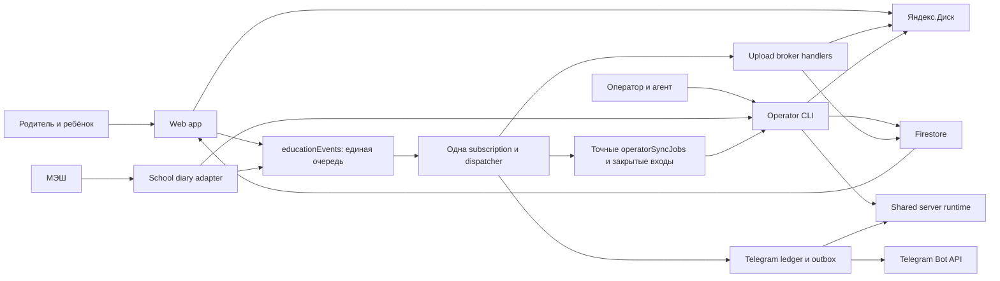

# Карта архитектуры Education

Education соединяет семейный доступ, данные школьного дневника, задания, материалы, проверки и самопроверки. [Корневая продуктовая спецификация](docs/product/README.md) задаёт пользовательские возможности; [навигатор](docs/README.md) ведёт к конкретным контрактам. Этот файл показывает границы системы и разрешённые зависимости.

## Приложения и процессы

| Сервис | Код | Реальное состояние |
|---|---|---|
| [Web app](docs/services/web-app/README.md) | `src/`, `pwa/` | React/PWA читает Firestore и отправляет файлы на Диск; конфигурация экранов и часть local-first архитектуры остаются целевыми |
| [Operator CLI](docs/services/operator-cli/README.md) | `operator/`, `scripts/education.mjs`, предметные CLI | Повторяемые операции и ручной запуск EducationSync; `sync:project` использует общее server runtime; агент выполняет предметные решения по данным |
| [Upload broker](docs/services/upload-worker/README.md) | `packages/education-runtime/upload-broker.mjs`, `storage/` | Обработчики общего consumer выдают адреса и подтверждают байты; отдельный source-listener процесс заменён совместимым CLI |
| [Telegram bot](docs/services/telegram-bot/README.md) | `packages/telegram-notifications/`, `scripts/telegram-bot.mjs` | Семейный worker установлен на Mac и делит server runtime с sync; технические доставки подтверждены. Командные release alerts отсутствуют; [актуальный аудит](docs/audits/education-bot-readiness-2026-10-18.md) |

Приватный PETR-контекст (`learner`, `events`, `work`, Skills) находится вне checkout Education. Он задаёт конкретную учебную цель и доказательства. Общие контракты сервиса должны читаться из самостоятельного checkout; provenance внешнего материала обозначается `petr-private:` и не делает его публичным источником.

## Предметные модули

| Модуль | Владелец смысла |
|---|---|
| [Families](docs/modules/families/README.md) | Семья, ребёнок, роли и проверенная принадлежность источника |
| [School diary](docs/modules/school-diary/README.md) | Нормализованный дневник и порт МЭШ; dashboard и день |
| [Synchronization](docs/modules/synchronization/README.md) | Полнота снимка, сверка, публикация и восстановление |
| [Assignments](docs/modules/assignments/README.md) | Идентичность назначенного задания, связи и статус выполнения |
| [Assessments](docs/modules/assessments/README.md) | Проверяемый тест, попытка и продолжение |
| [Reviews](docs/modules/reviews/README.md) | Критерий, исходник, видимое на работе и учебный вердикт |
| [Materials](docs/modules/materials/README.md) | Общие оригиналы, издания, страницы и семейное право |
| [Notifications](docs/modules/notifications/README.md) | Семантика событий и встроенный inbox; будущая внешняя доставка |

## Правила зависимостей и расширения

1. Продуктовый сценарий ссылается на сервисы и модули, которые его реализуют. Изменение технической структуры не меняет смысл принятого сценария.
2. Сервис связывает модули и адаптеры. Operator sync и Telegram runtime используют общий [server runtime](docs/shared/server-runtime.md) для Firestore/ADC, family graph, owner predicates, Mesh session/credentials и telemetry; расписание процесса, outbox и предметное решение остаются ответственностью каждого consumer.
3. Общий контракт данных и приватности один: модуль определяет предметное поле, [Firestore](docs/shared/data/firestore.md) — связи/совместимость, правила доступа — допустимую запись/чтение.
4. Telegram domain/application layers используют порты и adapters; shared server runtime не содержит Telegram domain/outbox. Исходная реализация worker ещё не доказывает deployment или live message delivery.
5. Новый модуль выделяется при самостоятельной ответственности или повторном использовании. Не переносить Telegram outbox в общий слой до появления второго реального потребителя.
6. Шаблоны, источники, код и проверки связаны через [систему спецификаций](docs/shared/specification-system.md); [производный граф](docs/generated/graph.mmd) показывает всю структуру.

## Источники истины и выпуск

Firestore хранит опубликованные учебные данные и пользовательские результаты, Диск — оригиналы, закрытое локальное рабочее пространство — исходники операторского запуска и credentials. Конкретные владельцы и ограничения определены в [карте данных](docs/shared/data/README.md). Публикация данных не требует выпуска PWA. Изменение клиентского кода проходит отдельную сборку/публикацию; наличие файла в репозитории не доказывает deployment.
