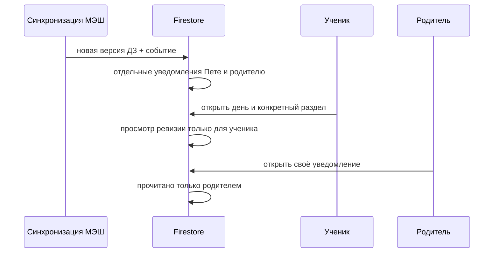

# Education: действия, просмотры и новое

Связанные контракты: [модель семьи](family-data-model.md), [экраны из данных](backend-driven-ui.md), [dashboard](../product/dashboard.md). Карта: [спецификации](../product/README.md).

## Состояние реализации

Адресный inbox работает для изменений ДЗ, разборов фото, уточнений вердикта, родительского зачёта и выпусков продукта. Производители записывают короткие документы в `users/{personId}/inbox`, а клиент показывает их по живой подписке. Системные Web Push и журнал навигации остаются неактивными. Клиентские функции записи действий и просмотров подготовлены, но страницы их не вызывают. Для полного журнала открытий файлов дополнительно нужен [медиа-шлюз](family-artifact-access.md).

## Журнал действий

`families/{familyId}/activity/{eventId}` — добавляемый один раз факт. Событие содержит `schemaVersion`, `actorPersonId`, `deviceUid`, `childId`, `type`, `viewId`, `sectionId`, `entityId`, `sessionId`, `occurredAt` (серверное время). Основные типы: `page_opened`, `section_opened`, `day_opened`, `task_opened`, `test_started`, `test_submitted`, `submission_uploaded`, `notification_opened`. Сами изменения в предметных документах порождают уведомления `homework_published`, `homework_changed`, `homework_removed`, `grade_added`, `review_started`, `review_paused`, `review_ready`, `review_updated`, `parent_accepted`, `parent_reopened` и `product_update`; отдельный журнал аналитики для этих серверных событий пока не заполняется.

Клиент не пишет в событие текст задания, ответы, фото, токены ссылок, OAuth-ключи или полный URL. Секреты и персональные материалы остаются в своих защищённых документах. `sessionId` — случайный идентификатор сеанса, не ключ доступа. Повторный показ того же раздела в одном сеансе не создаёт поток одинаковых событий; действия отправки сохраняются отдельно и связываются с предметной записью. Сбой записи аналитики не отменяет отправку работы.

Клиентские события описывают навигацию и взаимодействие, но не доказывают, что тест сдан или файл сохранён: такой итог подтверждается соответствующим документом и серверным событием. Родительский отчёт различает эти два источника.

## Просмотр и прочтение

Посещение страницы **не означает**, что ребёнок прочёл все блоки и выполнил ДЗ. `users/{personId}/views/{viewKey}` фиксирует увиденную ревизию конкретного раздела только после его открытия; действие хранит также `seenAt`. Новизна вычисляется относительно ревизии источника (`sourceRevision`), а не сравнением двух часов. Для индивидуальных уведомлений `users/{personId}/inbox/{notificationId}` хранит адресата, ссылку на предметное событие, `createdAt`, `readAt?`; открытие уведомления отмечает только его.

При публикации изменённого ДЗ `scripts/day.mjs` сравнивает новый индекс с предыдущим Firestore-индексом. Для добавленного, изменённого или снятого предмета каждому активному участнику семьи, имеющему доступ к ребёнку и нужную роль, создаётся личная запись. Первичная публикация индекса не вызывает шквал уведомлений. ID записи вычисляется из ребёнка, даты, предмета, типа, текста и времени источника; повторная публикация без изменения не создаёт дубль. Разбор фото теперь сам публикует событие при начале и готовом результате; новая оценка МЭШ создаёт запись при сравнении опубликованных срезов одного дня. Родительское прочтение не меняет состояние ученика, и наоборот.

## Что создаёт уведомление и как не засорять центр

`submissions progress` создаёт **одну** запись `review_started` для набора фото и связанных заданий; смена внутренних фаз не создаёт новых записей. При остановке та же запись становится `review_paused` с понятной причиной в карточке, при возобновлении возвращается к `review_started`. `submissions review` заменяет эту же запись на `review_ready`, сбрасывая `readAt`, чтобы готовый результат снова был виден. Несколько номеров на одном снимке объединяются в одном событии; текст не содержит ответа или ключа. `submissions feedback` создаёт отдельное `review_updated`, если уже опубликованный вывод исправлен. ID выводится из семьи, ребёнка, попытки и версии: повторная публикация не дублирует событие. Родительское решение `accept/reopen` и уведомление ученика записываются в одной транзакционной пачке Firestore; клиент не может писать произвольный текст от имени проверки.

Новая оценка создаёт `grade_added` только при увеличении списка отметок в подтверждённом срезе МЭШ; первое опубликование старого снимка не вызывает уведомление.

Команда `npm run notifications -- publish .local/release.json` публикует адресный `product_update` каждому активному профилю из закрытого проверенного описания с короткими пунктами «что изменилось». Ей не нужна новая сборка PWA. Не присылай выпуск при каждом косметическом коммите: сообщение нужно, когда изменение влияет на действия ученика/родителя или устраняет заметную ошибку. Если приложены «до/после», файлы сначала переносятся на Яндекс.Диск, а документ inbox получает только `provider`, `path`, `publicUrl`. Снимки продукта должны быть очищены от личных ссылок и данных ребёнка до публикации публичной ссылки. Для существующего разбора `backfill-review` проверяет живой `dayProgress` и публикует один источник-связанный итог. `backfill-parent` переносит в личный inbox только действующее решение родителя той же версии проверки; повторный запуск не создаёт дубль.

Обычная запись имеет `type`, `entityId`, `sourceRevision`, `createdAt`, `familyId`, `childId`; при наличии добавляются `date`, `subject`, `taskId`, безопасные `title`, `body`, `changes[]`, `media`. `readAt` принадлежит одному адресату. В колокольчике показываются только действия, которые меняют понимание «что делать» или завершённость работы: новое/изменённое ДЗ, новая оценка, старт и итог разбора в одной записи, исправленный вердикт, решение родителя, значимый выпуск продукта. Технические промежуточные шаги, каждая загрузка части фото и простое повторное открытие страницы не создают уведомлений.

## Центр обновлений внутри приложения

`NotificationBell` в общем заголовке подписывается на `users/{personId}/inbox`. Счётчик показывает непрочитанные записи, а список кратко указывает событие, предмет и дату. Открытие колокольчика ничего не помечает прочитанным. Нажатие на запись ставит `readAt` и раскрывает её смысл и доступные изображения; отдельное действие открывает точное задание либо день. Снимки «было/стало» хранятся на Яндекс.Диске, в Firestore находятся только ссылка и метаданные. При открытом приложении новое событие появляется без перезагрузки и без навязчивого тоста. Это **внутреннее** обновление: при закрытом приложении оно не появляется на экране блокировки. Для нового типа события требуется привязать его к источнику, адресату и экрану назначения; нельзя показывать готовый текст ответа или персональные секреты в краткой записи.

Основание выбора: [Apple Human Interface Guidelines](https://developer.apple.com/design/human-interface-guidelines/notifications) рекомендует при открытом приложении добавлять новое содержание и обновлять счётчик без отвлекающего баннера, не дублировать одно событие и показывать в счётчике именно непрочитанные записи. Цвет и точка не являются единственным признаком новизны: рядом остаётся текст события. Системное разрешение на уведомления для такого внутреннего списка не требуется.

## Отчётность и срок хранения

Журнал позволяет ответить, когда и кем был открыт день, конкретный раздел или задача, начат тест, загружена работа и прочитано уведомление. Для родителя это история действий ребёнка с серверным временем и ссылкой на предметную запись; отсутствие события означает только отсутствие зафиксированного действия. Сводки строятся сервером из журнала, а не доверяются клиентскому счётчику. Нужен явный срок хранения сырых посещений и агрегатов перед включением сбора для других семей; пока схема и правила подготовлены, но сбор не активирован.
