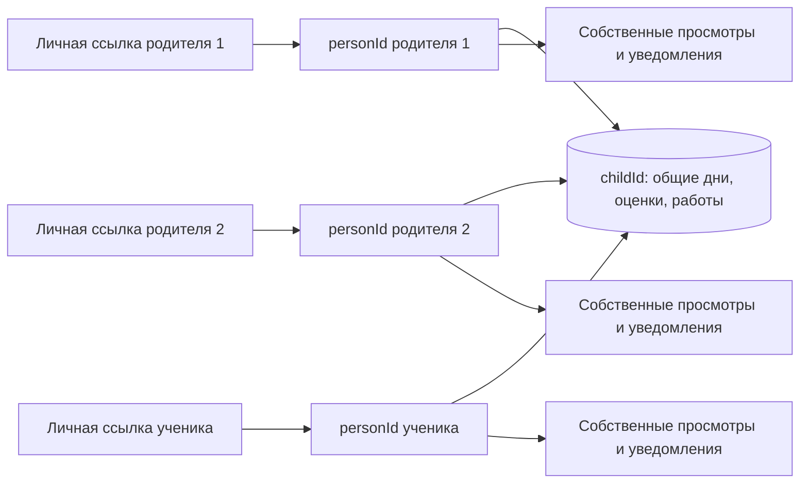

# Education: данные семьи и права доступа

Связанные контракты: [экраны из данных](backend-driven-ui.md), [события и новое](activity-and-inbox.md), [текущие маршруты](../product/access-and-state.md). Карта: [спецификации](../product/README.md).

Библиотека семьи — отдельная проекция общих внутренних оригиналов: [модель, права и покрытие](../product/family-library.md). Новый ребёнок не наследует книги другого ребёнка или семьи по классу и школе.

## Источник истины

Firestore хранит учебные факты, состояние работы и настройки экранов. Клиентские страницы — представления этих данных. МЭШ, Яндекс.Диск и локальный агент остаются адаптерами: МЭШ даёт исходные задания и оценки, Диск — файлы, агент — проверенный разбор. Их результаты попадают в Firestore с источником, версией и временем проверки.

Статус работы, ответы, фото, просмотр и уведомления не должны жить внутри документа страницы, который перезаписывает синхронизация. Повторная синхронизация может менять опубликованное условие, но не удаляет ученическое доказательство. Если условие снято или изменилось, исходная работа сохраняется в истории, а в актуальном плане появляется соответствующая пометка.

## Адреса документов, версия 2

| Путь | Содержание | Кто пишет |
|---|---|---|
| `users/{personId}` | Постоянный профиль родителя или ученика | агент через Admin SDK |
| `users/{personId}/families/{familyId}` | Указатель на доступную семью | агент через Admin SDK |
| `users/{personId}/families/{familyId}/shortcuts/{childId}` | Личный переход к прежней странице дня на время миграции | агент через Admin SDK |
| `accessLinks/{secret}` | Длинная отзывная ссылка на `personId`; клиент читает только собственную действующую ссылку после создания сессии | агент через Admin SDK |
| `deviceSessions/{authUid}` | Техническая сессия Firebase Auth с личной ссылкой | браузер после открытия ссылки |
| `families/{familyId}/members/{personId}` | Роль `parent` или `student`, точный список доступных `childIds`, активность | агент через Admin SDK |
| `families/{familyId}/children/{childId}` | Профиль ученика, учебный год, часовой пояс | сервер |
| `families/{familyId}/children/{childId}/days/{yyyy-mm-dd}` | Расписание, исходное ДЗ, версии задания, проверенный план | синхронизатор / агент |
| `families/{familyId}/children/{childId}/tasks/{taskId}` | Стабильная задача, срок, статус публикации, ссылка на источник | синхронизатор / агент |
| `families/{familyId}/children/{childId}/submissions/{submissionId}` | Фото/ответ, статус проверки, связь с задачей | пока сервер; запись из браузера откроется после безопасной загрузки на Диск |
| `dayOwners/{studentToken}` | Закрытая переходная карта прежней страницы дня на `familyId` и `childId` для очереди разбора | агент через Admin SDK |
| `families/{familyId}/children/{childId}/grades/{gradeId}` | Оценка, вес, предмет, дата, исходный идентификатор МЭШ | синхронизатор |
| `families/{familyId}/children/{childId}/skills/{skillId}` | Целевая модель: подтверждённые свидетельства, прежние ошибки, помощь, давность проверки и текущая гипотеза освоения | агент после проверки; путь ещё не включён в текущий UI |
| `families/{familyId}/children/{childId}/taskPresentations/{taskId}` | Целевая модель: персональный ориентир и выбор известных компонентов с ревизией источника и ссылками на свидетельства | агент после сверки; путь ещё не включён в текущий UI |
| `families/{familyId}/ui/{viewId}` | Версионированная композиция экрана для роли | сервер |
| `families/{familyId}/activity/{eventId}` | Действие участника; только добавление | клиент или сервер |
| `users/{personId}/inbox/{notificationId}` | Адресное уведомление и время просмотра | агент/сервер создаёт; адресат отмечает прочитанным |
| `users/{personId}/views/{viewKey}` | Последняя увиденная ревизия раздела | адресат |
| `connectionInvites/{code}` | Одноразовое приглашение: открытый ключ, срок и статус; лимит и семейная привязка хранятся только локально | локальный оператор через Admin SDK |
| `connectionInvites/{code}/handoff/current` | Временный шифрованный пакет доступа к источнику | приглашённый локальный CLI; удаляет оператор |
| `sourceIdentities/{hash}` | Закрытая связь идентификатора ребёнка в источнике с семьёй и ребёнком Education | локальный оператор |
| `sourceAccounts/{hash}` | Закрытая связь учётной записи взрослого в источнике с профилем семьи | локальный оператор |

`familyId`, `childId`, `personId` и технический `authUid` — независимые непрозрачные идентификаторы. Один родитель может быть связан с несколькими детьми, а один ребёнок — с несколькими родителями. Каждый родитель получает отдельную личную ссылку, но читает **те же документы ребёнка**, что и другие связанные родители. Список `childIds` проверяется для обеих ролей; принадлежность к семье сама по себе не даёт доступа ко всем детям. Детские и родительские экраны различаются ролью и разрешёнными блоками, а не переключателем в URL. Дату и время учебного дня считают в часовом поясе ребёнка.

## Доступ

Личная ссылка имеет вид `https://rubaxa.github.io/education-quizzes/#/enter/<secret>`, где `secret` — 32 случайных байта в URL-безопасной записи. Это **ключ доступа**: получивший ссылку сможет войти под соответствующим профилем. Ссылка может быть повторно открыта на другом устройстве и отозвана или заменена агентом. Токен находится после `#`, поэтому не отправляется GitHub Pages как часть HTTP-запроса; после входа приложение убирает его из адресной строки. Токены не попадают в Git, аналитику и общедоступный PWA-манифест.

Firebase Authentication выдаёт устройству анонимный технический `authUid`. Браузер записывает `deviceSessions/{authUid}` со ссылкой; правила Firestore сверяют её с закрытым `accessLinks/{secret}` и получают постоянный `personId`. При каждом обращении правила повторно проверяют, что ссылка не отозвана, а затем проверяют `families/{familyId}/members/{personId}` и точный `childId`. Клиент не может назначить себе роль, привязать ребёнка или изменить профиль. Это вход **по ссылке**, без отдельного пароля и административного интерфейса. Провайдер Anonymous включён в проекте через `firebase deploy --only auth`; его конфигурация хранится в `firebase.json`. [Документация Firebase](https://firebase.google.com/docs/auth/configure-providers-cli).

Анонимный UID принадлежит устройству, а не человеку. После смены телефона тот же человек открывает свою ссылку снова и видит собственные уведомления и просмотры. У двух родителей разные профили и состояния просмотра, но общие учебные документы ребёнка. Получивший чужую личную ссылку получает и её права; утраченную ссылку нужно отозвать и выпустить новую.

## Приглашения и несколько взрослых: согласованное направление

Приглашение в Education, личная ссылка входа человека и ссылка на отдельный файл — разные права доступа и разные записи. Открытие приглашения создаёт заявку на подключение; само по себе оно не подтверждает личность в МЭШ и не открывает данные ребёнка. До подтверждения в интерфейсе можно показывать лишь заявку и сообщённое заявителем имя с пометкой «не подтверждено». После проверки связи взрослого с МЭШ приглашение связывается с постоянным `personId` и `familyId`, а его создатель видит, какая семья подключилась.

Приглашения выпускает только человек с правом приглашать. Первый суперпользователь может выпускать их без числового лимита. Создатель каждого приглашения задаёт, сколько собственных приглашений сможет выпустить адресат после подключения; по умолчанию это **0**. Делегированный лимит расходуется и проверяется при выпуске, а не хранится как доверенное поле браузера. В кабинете создатель видит дату выпуска, выданное право приглашать, состояние, дату использования, подключённую семью и возможность отозвать приглашение. Одноразовость, срок действия и правило возврата неиспользованного лимита — решения следующего интервью; до него не объявлять их действующими настройками.

Всем связанным взрослым виден общий состав семьи и доступные каждому дети. Историю и состояние приглашения видит его создатель; суперпользователь видит приглашения всей семьи. Другим взрослым не показываются чужие коды приглашений, история их использования и полномочия МЭШ. Индексы `users/{personId}/invites` и `families/{familyId}/invites` содержат только состояние и код ссылки; второй доступен лишь участнику с `inviteUnlimited`. Закрытый ключ и токены МЭШ остаются локальными у оператора.

### Главная страница взрослого: согласованный порядок

После входа взрослый попадает в отдельный кабинет семьи даже при одном ребёнке. Выбран вариант **«Раскрывающийся список»**: все доступные дети сразу видны компактными строками. В строке есть имя, ближайшая опубликованная дата с ДЗ, словесный статус и полоса `сделано / всего` только при известном объёме. Нажатие раскрывает конкретные предметы и действия; готовые предметы свёрнуты отдельно. Ссылка из раскрытия открывает существующий календарь, расписание и подробное ДЗ именно этого ребёнка в родительском режиме; выбор даты остаётся внутри календаря, а ссылка «Все дети» возвращает к семейной сводке при личном входе. Второй и последующие дети появляются из профиля МЭШ/семьи, а не из демонстрационного макета.

Прогресс рассчитывается из тех же документов дня, фото, проверок, тестов, ЦДЗ и решений родителя, что и действующий `DayDashboard`. Пока любая нужная подписка не готова или точный день ещё не опубликован, карточка не объявляет `0/N` и не показывает ложное «Всё готово». Если загрузка нужного набора документов не завершилась за 15 секунд, карточка сообщает о недоступности данных вместо бесконечного «Загружаем»; позднее полученный полный набор всё равно показывает результат. Последняя сверка МЭШ указана отдельно; готовность известных заданий при неполном снимке не равна готовности всего дня. Подготовка к другим датам, включая выходной спецкурс, остаётся доступна через календарь своего ребёнка.

Ниже детей располагаются **отдельные карточки управления**, а не список раскрывающихся пояснений: «Члены семьи», «Приглашения», «Вход детей». Каждая показывает реальное состояние и ведёт к действию. Состав семьи показывает связанных взрослых и детей с их ролями и состоянием подключения источника, но не открывает чужие полномочия. Приглашения показывают дату, срок, статус, право приглашать дальше и кто подключился; создатель может выпустить, скопировать и отозвать своё приглашение, суперпользователь видит все. Вход детей показывает по каждому ребёнку, действует ли личная ссылка, когда она выдана, сколько технических сессий её использовали, и даёт копирование, безопасную замену и историю. Полный секрет ссылки виден только авторизованному взрослому с правом доступа к этому ребёнку и не попадает в публичный список. Название и число технических сессий не выдаются за достоверное число физических устройств или время последнего использования: таких данных пока нет.

Ученик сохраняет собственную текущую главную страницу с календарём и не видит семейное управление. Локальная реализация `ParentHome` включает живую сводку детей и отдельные карточки управления. Подписки `FamilyAccessCards` открываются при появлении раздела на экране или по явной кнопке; закрытые разделы не тратят начальные чтения. Служебная очередь `syncStatus/current.queue` не читается клиентом и не показывается в карточке ребёнка или на странице дня. `FamilyAccessCards` читает имена взрослых из членства, историю приглашений из личной/семейной проекции и личные ссылки детей из `families/{familyId}/children/{childId}/accessGrants`. Взрослый может запросить создание/отзыв приглашения, выпуск/блокировку детской ссылки. Эти заявки проверяет и исполняет локальный оператор; до обработки прежние права сохраняются. Проекция детских ссылок показывает технические сессии, но не выдаёт их за точное число физических устройств.

Локальный `PersonalEntry` различает роли: взрослый видит `ParentHome`, ученик — прежний `DayDashboard`. Новые UI и правила становятся действующими только после отдельного выпуска. Перед повторным подключением действующей семьи `connect seed-current` связывает прежние `familyId`, `childId`, `personId` с МЭШ без пересоздания ребёнка. После подтверждения того же ученика второму взрослому создаётся лишь собственный `personId`, личная ссылка и переходы к существующему календарю. Источники МЭШ и учебный прогресс имеют разные ID; `sourceIdentities`/`sourceAccounts` — закрытые индексы совпадения, не копия работ.

Семья содержит детей и нескольких взрослых: мать, отец, бабушка или другой подтверждённый представитель имеют одну продуктовую роль **взрослого**. У каждого взрослого собственные личная ссылка, профиль Education и подключение МЭШ; документы ребёнка общие. Доступ всё равно ограничен точным списком `childIds`, поскольку взрослые в сложной семье могут видеть разные подмножества детей. Повторное подтверждение одного и того же профиля ученика МЭШ не создаёт копию ребёнка. Совпадение имени либо наличие одного общего ребёнка не присоединяет взрослого к семье автоматически: для этого нужна связь с существующей семьёй и подтверждённое право доступа. Текущий код называет роль взрослого `parent`; переход к общей роли ещё не выполнен.

Целевые состояния заявки: приглашение выпущено → заявка подана → ожидает подтверждения МЭШ → взрослая учётная запись связана с семьёй либо заявка закрыта с причиной. Подробный [разбор способов подтверждения МЭШ](school-diary-port-adapter.md#family-onboarding-research) отделяет доступный на бесплатном тарифе обмен заявками от пока не подтверждённого браузерного входа в МЭШ.

На iPhone установленное приложение может иметь отдельное от Safari хранилище сессии. При первом запуске с иконки после установки пользователь нажимает вход по личной ссылке из буфера; если чтение буфера недоступно, вставляет её вручную. Дальше техническая сессия сохраняется на этом устройстве. Ссылка на день или тест не заменяет личную ссылку профиля, и экран входа объясняет различие. Ссылка не встраивается в публичный `start_url`.

Ролевой индекс `dayDashboards/<token>` доступен после личного входа только участнику семьи, привязанному к его `familyId` и `childId`, при совпадении роли. Перечисление и запись индексов из браузера закрыты. Старые ссылочные страницы дня и тесты — отдельный переходный контракт, который нужно закрыть после переноса данных и входа пользователей, не обрывая текущую работу ученика.

## Синхронизация и идентичность

У каждого задания есть `sourceSystem`, `sourceId`, `dueDate`, `sourceRevision`, `checkedAt` и собственный стабильный `taskId`. Исторический снимок условия не удаляется. Повторный импорт той же версии идемпотентен. Новая версия меняет опубликованное условие и создаёт событие изменения; фото, ответы и тестовые попытки ссылаются на стабильный `taskId` и прежнюю версию условия.

Индексы dashboard могут быть денормализованы для быстрого чтения, но они производные от этих документов. Их можно пересобрать без потери действий ученика. Ограничение видимых дат и сроков ДЗ описано в [dashboard](../product/dashboard.md).

Индивидуальная модель навыка и представление задачи — производные от попыток и источника, а не часть оригинала учителя. Изменение персонального ориентира не меняет исходное условие и не стирает прежние попытки. До миграции `DayProblem.support` в `dayPages` служит переходным представлением этой идеи; два новых пути выше описывают целевой контракт и не объявляются действующими коллекциями. Граница движка подробнее определена в [контракте экранов](backend-driven-ui.md#engine-invariant).

## Переход с нынешних ссылок

1. Агент создаёт семейство, постоянные профили, связи и отдельные ссылки для каждого человека. Административного интерфейса нет.
2. Перенести `dayPages`, `dayUploads`, назначения и попытки тестов с картой старых токенов на стабильные ID. Сверить число работ и результатов до смены маршрутов.
3. Включить вход по личным ссылкам и новые защищённые маршруты. Родитель и ученик открывают экраны через постоянные профили, даже если технические `authUid` различаются между устройствами.
4. После проверки переноса закрыть старые ссылочные правила и убрать токены из новых документов. Исходные снимки МЭШ и файлы на Диске остаются неизменными.

Ни один шаг не удаляет данные только потому, что документ исчез из текущего представления.

## Заведение профилей агентом

`npm run family -- create "Имя ребёнка" "Родитель"` создаёт семью, два профиля, связи и две личные ссылки. `add-parent` привязывает нового родителя к выбранным детям, `add-child` — нового ребёнка к выбранным родителям, `link` добавляет существующую связь. `issue-link` выпускает ещё одну ссылку профиля; `revoke-links` отзывает все его ссылки. `link-url` явно показывает последнюю действующую ссылку выбранного профиля для передачи адресату. `attach-current-day` добавляет личный переход на уже опубликованную страницу дня. Команда использует Admin SDK только локально; реестр с ID и ссылками хранится в исключённом из Git `.local/family-access.json` с правами `0600`. Обычные команды не печатают секрет ссылки. В браузере создаются только ограниченные заявки; права и ссылки выдаёт оператор.

### Замена личного входа без потери учебных данных

Замена ссылки не создаёт новую семью, ученика или `personId` и не удаляет дни, работы, тесты и уведомления. Для каждого человека отдельно: `link-status <personId>` проверяет текущие ссылки и число технических сессий без вывода ключей; `issue-link <personId>` добавляет новую ссылку, сохраняя старую рабочей; `link-url <personId>` выдаёт новую ссылку адресату. Взрослый или ученик открывает её на своём устройстве и сверяет профиль, нужного ребёнка, дни и результаты. Затем оператор выполняет `revoke-old-links <personId> --confirmed`: команда требует хотя бы одну техническую сессию по новой ссылке и оставляет её действующей. Старые ссылки и их сессии теряют доступ к защищённым данным при следующем обращении к Firestore; открытый личный экран показывает повторный вход. История ссылок остаётся в закрытом локальном реестре. Полный аварийный отзыв `revoke-links <personId> --force` оставит профиль без входа до выдачи новой ссылки.

Родительская и ученическая ссылки независимы: сначала можно заменить и проверить вход родителя, пока ученик работает, затем отдельно передать ученику новую ссылку и закрыть его прежнюю. На одном браузерном профиле нельзя проверять обе роли одновременно: технический `authUid` общий и последняя открытая ссылка перезапишет `deviceSessions/{authUid}`. Используются два устройства или изолированные профили браузера. МЭШ подключён отдельно; замена ссылки Education не отключает и не подтверждает заново доступ к МЭШ. Старые прямые ссылки на `dayPages`, назначения и предпросмотры остаются переходным доступом, поэтому отзыв личных ссылок **не равен** полному отзыву всех ранее выданных учебных URL. Их закрытие требует переноса данных и отдельной сверки.

Для новых подключений `npm run connect -- issue` выпускает одноразовое приглашение, `list` показывает состояние и принявшую семью, `receive` проверяет полномочия и детей МЭШ перед записью профилей, `revoke` закрывает приглашение, `disconnect` удаляет локальные полномочия источника. `seed-current <familyId> <childId> <parentPersonId>` связывает действующие профили с идентификаторами МЭШ без их пересоздания. Секреты и сведения о целевой семье остаются локально; документ приглашения, доступный по случайному коду, содержит только открытый ключ, срок и статус. `promote-current-parent` даёт первому подтверждённому взрослому неограниченное право заявок, не меняя роли ученика. Браузер пишет `users/{personId}/inviteRequests`; оператор выполняет `connect process-requests <personId>` и `process-revocations <personId>`, проверяет семейное членство и расходует конечный лимит при выпуске. `connect receive` не создаёт дубль ребёнка при совпадении закрытого `sourceIdentities` и переносит второму взрослому переходы на существующие дни. `family:access sync <familyId>` сверяет имена и список ссылок, `family:access process <familyId> <childId>` обрабатывает замену и блокировку детского входа. Заявки не отключают ссылки до обработки. [Полный поток](school-diary-port-adapter.md#family-onboarding-research).

Перед операторскими изменениями действующей семьи сохраняется закрытая локальная копия Firestore и проверяются: прежние `familyId`/`childId`/`personId`, оба `shortcuts`, все `dayOwners`, вложенные `dayUploads/.../files` и `dayProgress/.../items`, назначения/попытки тестов и семейные решения. После действия повторяется тот же подсчёт и проверка ссылок; отсутствие новых документов v2 не считается отсутствием учебного прогресса. Старые данные и ссылки не удаляются при выдаче приглашения либо личного входа.

`npm run family:audit` только читает Firestore и сверяет локальный семейный реестр с постоянными профилями, ролями, детскими правами, личными ссылками, проекциями ссылок, идентификаторами МЭШ и прежними календарными переходами. Вывод содержит лишь количества и ошибки, без секретов ссылок. Эту команду выполняют после любой операции с доступом; для проверки неизменности самих работ дополнительно сравнивают закрытые снимки вложенных учебных коллекций.

Пока действует переходная модель, личная точка входа ведёт на прежнюю страницу дня из Firestore. Эта страница и тесты всё ещё защищаются старыми токенами. Новые семейные правила не считаются полной миграцией, пока дневные данные и загрузки не перенесены в `families/.../children/...`, а старые публичные маршруты не закрыты.

## Состояние реализации

Типы документов, проверка манифеста, вход по ссылке и агентская команда подготовлены. Старые страницы дня и тестов остаются переходным маршрутом до переноса работ.

- [x] Описать доменные документы, роли, манифест, события и адресное состояние просмотра.
- [x] Добавить типы, проверку манифеста и закрытые правила для новых путей.
- [x] Выбрать вход каждого человека по длинной отзывной ссылке.
- [x] Подготовить агентскую команду заведения семьи и клиентский вход по ссылке.
- [x] Опубликовать новые правила Firestore после разрешения родителя.
- [x] Включить Anonymous в Firebase Authentication на бесплатном тарифе.
- [x] Создать первую семью, профили родителя и ребёнка и их ссылки командой агента; переходы к прежнему дню опубликованы.
- [x] Локально подготовить семейные проекции приглашений/детских ссылок, ограниченные заявки, операторскую обработку и передачу старого календаря второму взрослому.
- [x] Выпустить новые правила и React-экран управления доступом вместе; вход обоих ролей, изоляция прав и видимость приглашения проверены на живом Firestore 11.10.
- [x] Связать действующие профили с МЭШ командой `seed-current` после закрытого снимка и сверки идентичности; дать первому взрослому право приглашать и спроецировать ссылки. Повторный SHA-256 учебных документов совпал с исходным.
- [ ] Перенести дни, фото, тесты и оценки; сверить полноту и связи.
- [ ] Подключить защищённые маршруты и реальные блоки dashboard/дня к данным v2.
- [ ] Перевести генератор и синхронизацию подробного ДЗ с одного `legacyDayOwner` и общего `.local/diary` на изолированный контекст `(familyId, childId, sourceAccountId)`; новый профиль без опубликованного календаря показывает ожидание данных, не получает страницы другой семьи.
- [ ] Запустить создание уведомлений при синхронизации и сбор действий после выбора срока хранения.
- [ ] Закрыть прежние ссылочные правила после подтверждения переноса.
