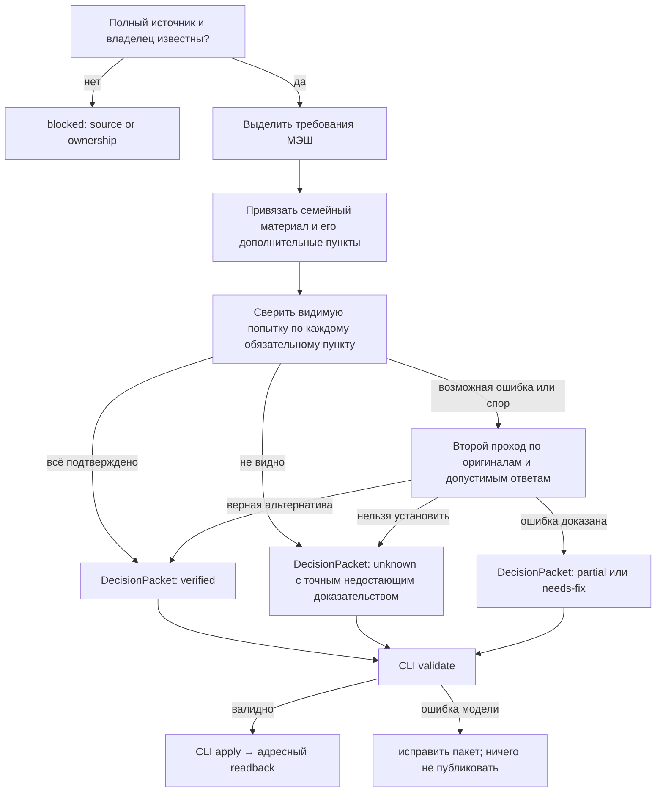

# Операторское ядро Education {#operator-core}

Статус: **единый CLI-контракт введён; существующие доменные обработчики подключаются поэтапно**. Этот документ описывает фактическую границу между механической работой CLI и решениями учебного агента. Он связан с [глобальной синхронизацией](../product/global-sync.md), [исходниками и семейными правами](shared-artifact-pipeline.md), [графом самопроверок](../product/assessment-decision-graph.md) и [основаниями проверки](../product/review-criteria-provenance.md).

## Почему нужен единый путь

Переписка 9–16 октября и история изменений показывают пять повторяющихся сбоев:

| Повторяющаяся работа | Наблюдавшийся сбой | Закреплённая граница |
| --- | --- | --- |
| Сбор МЭШ, оценок и расписания | Агент снова соединял `collect`, числовой срез, публикацию и обратное чтение вручную; подробности оценок однажды исчезли | Неизменяемый снимок → сравнение по ID/ревизии → адресная запись → чтение обеих ролей; операция и метрики в одной квитанции |
| Разбор русских, английских и математических работ | Учебник расширял обязательное задание МЭШ; обрезанное фото превращалось в «не сделано» | Для каждого требования: источник МЭШ, контекст материала, фактически видимое, `confirmed / not-met / unknown`; сомнение запускает второй проход |
| Тесты и работа над ошибками | Порог 85%, обязательность и связанный тест неоднократно расходились со статусами | Один граф решения и проверенный `quiz.json` с закрытым планом; создание через `validate → create → readback` |
| Карточки и ролевые статусы | Исчезали лист учителя, оригинал номера, комментарии к оценке и переключатели | Общая проекция из сохранённого результата, контракт компонентов и интеграционные тесты прежних сценариев |
| Операторская очередь | Одни и те же ID приходилось искать и закрывать вручную; длительность запуска было трудно объяснить | Устойчивый ID, фаза, входная ревизия, причина блокировки, повторный scan, тайминги по этапам |

Это не пять разных предметных процессов. Общий граф содержит шесть стадий: **обнаружить → захватить исходник → связать источники → вынести предметное решение → применить → перечитать**. Русский, литература, английский и математика различаются содержательным адаптером решения, но формат доказательства, статуса и публикации общий.

## Модель данных и границы {#data-model}

| Сущность | Минимальное содержание | Кто её создаёт | Кто может менять |
| --- | --- | --- | --- |
| `SourceRecord` | семейный владелец, ID МЭШ/попытки/фото, полный оригинал, время, SHA-256, ревизия, полнота | CLI-адаптер источника | Никто; новая ревизия создаёт новый захват |
| `EvidenceBundle` | точное назначение МЭШ, подтверждённое семейное издание, фрагменты оригинала, видимая попытка, ссылки на ревизии | CLI собирает ссылки; агент подтверждает смысл | Только новая ревизия с происхождением |
| `DecisionPacket` | структурированный `review.json`, `quiz.json` + `assessment-plan.json` или адресный план дня; статус каждого обязательного пункта и один следующий шаг | Агент после чтения доказательств | Агент создаёт новую ревизию; CLI валидирует форму и семейную связь |
| `OperationRequest` | `schemaVersion`, зарегистрированный `operation`, типизированный `input`; никаких произвольных команд | Агент или механический рецепт | Неизменяемый файл запроса |
| `OperationReceipt` | отпечаток запроса и содержимого, время, фаза, счётчики, закрытый stdout, результат применения | CLI-ядро | Только переход `started → succeeded` или `started → needs-readback` |
| `Projection` | адресные документы Firestore ребёнка и родителя без чужой семьи и закрытого ключа | Доменные CLI-адаптеры | Только подтверждённая публикация с обратным чтением |

`SourceRecord` и `EvidenceBundle` уже представлены снимками `.local/diary`, оригиналами, семейным графом, `day-source` и закрытыми файлами. Единого физического `EvidenceBundle` для всех предметов пока нет. `DecisionPacket` уже имеет работающие предметные схемы; новый CLI не вводит вторую конкурирующую схему содержания. Новые `OperationRequest` и `OperationReceipt` живут в `operator/` и закрытом `.local/operator-runs/`.

### Источник истины для проверки

1. Дословное назначение МЭШ и прямое уточнение учителя определяют **обязательный объём**.
2. Семейный учебник, лист и методика уточняют содержание, но дополнительные действия остаются опциональными, пока учитель их не назначил.
3. Фото/ответ ребёнка доказывает только видимое. Отсутствующее в кадре — `unknown`, а не `not-met`.
4. Неполный или спорный вывод требует второго чтения всех оригиналов и сильнейшей добросовестной трактовки в пользу ученика.
5. Публикуемый статус следует из отдельных требований, а не из общего впечатления о работе. Учебный совет не подменяет школьную оценку.

## Граф решений для агента {#decision-graph}

Для теста `DecisionPacket` проходит [граф самопроверок](../product/assessment-decision-graph.md): ниже 85% — адресное продолжение после полной проверки, при 85–99% — только по запросу родителя, при 100% — без работы над ошибками. План содержит текущую тему, подтверждённые старые ошибки, отдельное интервальное повторение и перенос. Для письменной работы используется общий `assessmentBasis`/`requirementChecks`; предметный адаптер меняет критерий, но не происхождение требования.

## Контракт операции {#operation-contract}

Вход CLI — JSON-файл вида `{"schemaVersion":1,"operation":"grades.snapshot","input":{"sourceDate":"2026-10-19","reportPath":"reports/2026-10-16-education-sync/baseline.md"}}`. Команда `npm run education -- catalog` возвращает фиксированный реестр, `npm run education -- run REQUEST.json` делает чтение/предпросмотр, `--apply` разрешает запись, `status` собирает проектный статус, `discover --apply` начинает очередь и инвентаризацию, `finalize --apply` повторяет inbox и очередь. `result RUN_UUID` читает безопасную сводку квитанции. Произвольные скрипты, SQL/Firestore-пути и имена исполняемых файлов во входе запрещены.

Операции в реестре: `project.plan/collect`, `inbox.snapshot`, `queue.list/scan`, `grades.snapshot/publish`, `calendar.publish`, `day.audit`, `quiz.validate/publish`, `review.validate/publish`. Они делегируют уже существующим доменным CLI; не делают скрытой педагогической оценки. `quiz.publish` всегда требует явный `personId` из закрытого реестра семей: выпуск не полагается на случай, когда ученик пока один. Переход `project.phase complete` пока оставлен в предметной команде: общий CLI не принимает произвольную строку как доказательство обратной проверки. Пакет `quiz.publish` или `review.publish` сначала проходит соответствующий валидатор. Квитанция сохраняется с правами `0600`; stdout с личными ссылками остаётся только там, в обычный вывод попадают разрешённые агрегаты. Отпечаток теста включает JSON и закрытый assessment plan. Та же успешная публикация повторно не создаётся; исход с потерянным подтверждением требует readback, а не слепого повторения.

## Метрики и критерии завершения {#execution}

Для каждой операции квитанция фиксирует `elapsedMs`, байты вывода и код/причину ошибки. Доменные обработчики добавляют `phaseMs`, число SDK-вызовов и доставленных документов, где такие измерения уже существуют. Это **не** счётчик оплаченных Firestore reads: при оптимизации сравнивай одинаковые сценарии и отдельно смотри консоль Firebase. Публикацию можно назвать подтверждённой только по адресному readback; успешный выход команды без такого доказательства означает лишь «применено». Для `quiz.create` readback назначения встроен, для `review.publish` читаются закрытая и ученическая проекции и фото; для остальных применяй их доменный аудит или фазу `project.phase complete`. Квитанция `reused` означает подтверждение **прошлой публикации того же пакета**, а не новое доказательство актуальности Firestore: перед объявлением текущего статуса сравни источник и адресную проекцию. По возможности валидируй перед записью; при ошибке старый проверенный результат остаётся доступным.

## Состояние и следующие ограничения

Введены CLI-ядро, типизированный реестр, закрытые квитанции, метрики времени, защита от повторной публикации одного теста/разбора и отдельная проверка `submissions validate`. Старые команды продолжают работать, чтобы не менять живые данные или UI. Это первая совместимая оболочка, а не объявление всей синхронизации автоматической: `project.collect` ещё требует человеческой сверки нового ДЗ и семейного издания; числовой `grades:snapshot` пока обслуживает прежнее локальное рабочее пространство; единого хранилища `EvidenceBundle` и атомарной аренды педагогической проверки нет. Эти пункты нельзя закрывать пустым отчётом или новой карточкой по догадке. Следующий перенос — общий семейно-адресный числовой срез и автоматический рецепт публикации только бесспорных изменений расписания/оценок, после тестов на две семьи и повторный запуск.
