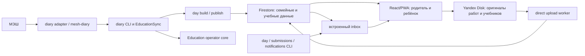
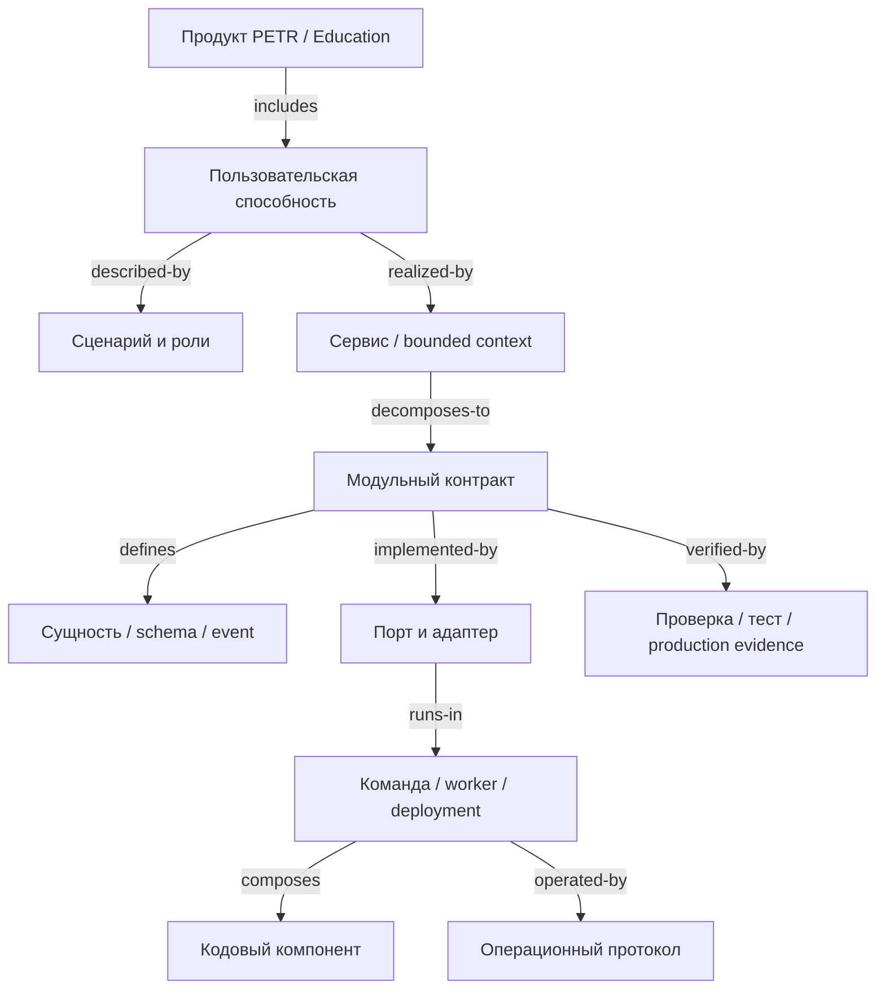

# Ревизия графа спецификаций PETR и Education

**Дата снимка:** 2026-10-16
**Статус:** обзор и план реорганизации; массовое перемещение документов не выполнялось.
**Область:** авторские документы PETR и репозиторий `education-quizzes`, его контракты, карта файлов, кодовые ссылки и runtime-конфигурация.

## Краткий вывод

Спецификации уже существуют и во многих локальных областях хорошо связаны с кодом. Проблема — не отсутствие документации вообще, а отсутствие **единой системы над существующими графами**: продукта, учебной модели, данных, адаптеров, интерфейса, инструментов оператора, runtime и тестовых свидетельств.

Сегодня параллельно работают:

1. **Граф учебных данных PETR** — цели, наблюдения, работы, события и производные представления ученика; его карта — [`docs/data/document-graph.md`](petr-private:docs/data/document-graph.md).
2. **Граф продукта Education** — пользовательские контракты, архитектурные документы и связь каждого файла репозитория с ближайшей спецификацией; его вход — [`docs/product/README.md`](../product/README.md), полный индекс файлов — [`docs/product/file-map.md`](../file-map.md).
3. **Реализация и инструменты** — React/PWA, Firestore, МЭШ, Яндекс.Диск, операторские CLI и ручные навыки. Их документы связаны локально, но нет одной карты сквозных компонентов и повторно используемых контрактов.

Их не следует сливать в один огромный документ или в графовую базу. Нужен небольшой индекс системы с типизированными ссылками на существующие контракты и отдельными областями владения. Сначала нужно классифицировать и нормализовать документы, затем менять их связи; физические перемещения — только после этого.

## Объём и способ ревизии

Снимок инвентаризации содержит:

| Область | Документы | Что представляют |
|---|---:|---|
| `education-quizzes/docs/architecture/` | 26 | Данные, синхронизация, адаптер МЭШ, Firestore, операторское ядро, local-first и Telegram-целевая архитектура |
| `education-quizzes/docs/product/` | 67 | Пользовательские сценарии, данные продукта, интерфейс, выпуск, карта файлов и решения UI |
| `education-quizzes/docs/research/` | 18 | Исследования и основания; сами по себе не являются текущими нормами реализации |
| `PETR/docs/` | 23 | Архитектура учебного помощника, продуктовые процессы, ADR, исследования и учебный граф |
| `PETR/skills/` | 14 | Исполняемые операционные протоколы агента; часть напрямую вызывает CLI Education |
| **Всего в этих группах** | **148** | Без данных ученика, событий, работ, отчётов, примеров и иных коллекций PETR |

Это учёт Markdown-документов в указанных деревьях **до добавления этого отчёта**, а не утверждение, что все документы одинаково являются спецификациями. Внутри есть живые контракты, целевые архитектуры, датированные аудиты, ADR, исследования, решения по интерфейсу и runbooks; для них нужны разные статусы и связи.

`education-quizzes/docs/product/file-map.md` ведёт от файлов к ближайшему контракту. На момент этой ревизии `npm run check:spec` подтвердил покрытие 495 файлов назначением, спецификацией и потребителем; проверка UI-контрактов не нашла расхождений. Это сильная файловая карта, но она не является типизированным графом отношений между самими спецификациями.

В найденных 252 кодовых файлах есть 569 ссылок или `@see` на спецификации. Это подтверждает, что документация применяется в кодовой базе; число не измеряет смысловую полноту и не означает, что каждый файл обязан иметь комментарий. Главная проверяемая связь сейчас — карта файлов плюс точечные кодовые ссылки.

## Существующая система документов

### PETR: обучение и продуктовые процессы

| Подграф | Основные узлы | Для чего предназначен | Состояние связи |
|---|---|---|---|
| Учебные цели и доказательства | `learner/`, `events/`, `work/`, `assessments/`, `reports/`, `library/`; [`document-graph.md`](petr-private:docs/data/document-graph.md), [`linked-history.md`](petr-private:docs/data/linked-history.md) | Приоритет источников, история событий, попытки, прогресс и актуальные представления | Сильная отдельная модель; не описывает runtime-системы Education |
| Модель учебного помощника | [`tutor-system.md`](petr-private:docs/architecture/tutor-system.md), [`adaptive-kernel.md`](petr-private:docs/architecture/adaptive-kernel.md) | Педагогические слои, адаптация и первые итерации | Концептуальная архитектура; не является компонентной картой `education-quizzes` |
| Учебные потоки | [`homework-loop.md`](petr-private:docs/product/homework-loop.md), [`education-daily-workflow.md`](petr-private:docs/product/education-daily-workflow.md), [`intake-interview.md`](petr-private:docs/product/intake-interview.md) | Процедуры продукта и агента | Пересекаются с Skills и Education-контрактами; разное назначение не всегда оформлено явно |
| Skills/операционные протоколы | `skills/education-sync/`, `homework-review/`, `online-quiz/` и другие | Пошаговое исполнение в текущей сессии | Действующие процедуры; CLI-команды и продуктовые инварианты принадлежат нескольким системам документов |
| История решений | `docs/decisions/0001…`, `0002…`, события и архивы | Почему были приняты решения | Хороший источник истории, но связь «решение → текущий контракт → код» не стандартизована во всех подграфах |

PETR уже имеет `document-graph.md` и сгенерированный `document-index.md` на 1 270 строк. Первый описывает учебные сущности и связи, второй обеспечивает обнаружение файлов. Индекс не является архитектурной картой продукта и не должен превращаться в неё.

### Education: продукт и технические контракты

| Область | Действующие узлы | Что уже описано |
|---|---|---|
| Пользовательские поверхности | `day-page.md`, `dashboard.md`, `quizzes.md`, `materials.md`, `grades.md`, `pwa.md` | Сценарии родителя/ребёнка, статусы, чтение публикаций и ограничения UI |
| Дизайн и компоненты | `design-system.md`, `component-system.md`, `status-presentation.md`, `ui-change-control.md`, `ui-kit.md` | Общие токены, `Shell`, компоненты, допустимые изменения и проверка интерфейса |
| Доступ и семья | `family-data-model.md`, `access-and-state.md`, `firestore-data-model.md`, `family-library.md` | Семейные роли, источники, поля и часть связей/прав доступа |
| Источники и синхронизация | `school-diary-port-adapter.md`, `plan-generation.md`, `global-sync.md`, `education-pipeline.md`, `change-detection-and-reconciliation.md` | МЭШ, ручная синхронизация, сбор, публикация, будущая сверка и ограничение наблюдателя |
| Работа и медиа | `storage-privacy.md`, `family-artifact-access.md`, `shared-artifact-pipeline.md`, `review-criteria-provenance.md` | Фото/файлы, семейный доступ, стадии разбора и происхождение критерия |
| Операторские инструменты | `operator-core.md`, `global-sync.md`, `education-pipeline.md`, `skills/education-sync/` | Типизированные CLI-операции, очереди и человеческие проверки |
| Подписки и уведомления | `activity-and-inbox.md`, `backend-driven-ui.md`, `local-first-sync.md` | Firebase inbox, подписки интерфейса, ревизии и целевые каналы |
| Стоимость чтений и производительность | `firestore-read-paths.md`, `firestore-read-sites.json`, датированные audit/research/latency документы | Поиск чтений, гипотезы оптимизации и измерения на конкретные даты |
| Telegram-бот | `telegram-notification-service.md` и 7 дочерних документов | Целевая Ports & Adapters архитектура; не реализованный сервис |

У каталога продукта уже есть Mermaid-схема, таблица контрактов и отдельная таблица состояния реализации. Но схема показывает только выбранные узлы, не все сервисы/границы; связь между продуктовым сценарием, данными, адаптером, CLI, экраном и проверкой не представлена как полный проверяемый граф.

### Карта текущих runtime-потоков

В диаграмме специально нет пути в Telegram: Telegram-адаптер и bot runtime пока только задокументированы как цель. `npm run notifications` ведёт в `scripts/notifications.mjs`, который публикует/дополняет встроенный Firebase inbox. Он не запускает grammY и не является новым Telegram-сервисом. Это имя команды — риск будущей путаницы.

## Покрытие требований, архитектуры и кода

| Слой | Оценка | Что подтверждено | Чего не хватает для единого графа |
|---|---|---|---|
| Цели и сценарии продукта | **Хорошо локально** | Подробные контракты страниц, ДЗ, тестов, проверки, семейных ролей; PETR хранит цели/историю | Один системный продуктовый контекст, который связывает пользовательскую ценность с Education-модулями и сервисами |
| Дизайн-система | **Хорошо** | Токены, оболочка, компоненты, статусы, UI gates, точки `@see` | Связь каждого пользовательского потока с API/данными и сквозным доказательством; разграничение глобального UI и предметных маршрутов уже частично ручное |
| Данные и схема | **Хорошо, с явной дырой** | Firestore entity links, family model, правила, local-first ревизии, read-sites registry | `firestore-data-model.md` прямо отмечает, что вторичные поля в типах не сведены в полную машиночитаемую schema; источник истины для каждого поля и версии не объединён в реестр |
| Источники/адаптеры | **Хорошо для МЭШ, неодинаково для остальных** | Есть порт МЭШ и `mesh-diary`; описаны Firebase сигналы и Yandex upload | Нет общей карточки адаптера: владелец данных, auth, normalization, freshness/completeness, retry, reconciliation и поддерживаемые события по каждому источнику |
| События/уведомления | **Частично** | Встроенный inbox имеет producers, типы, read receipts, приватность и UI; есть target Telegram contract | Нет общего channel-neutral event catalog. Два канала/процесса могут дублировать классификацию, routing/privacy и delivery policy |
| Синхронизация и фоновые процессы | **Частично** | Ручной CLI путь и некоторые local workers задокументированы; автономный observer отмечен как не реализованный | Нет единого runtime catalogue: кто запускает процесс, schedule/trigger, lease, recovery, readiness, пределы параллельности, источник и владелец |
| Операторский CLI/tooling | **Хорошо для существующего CLI** | `operator-core.md`, operation registry, recipes, receipts, metrics, skill runbooks | Нет общей карты команд и их read/write scopes, требуемых секретов, операций Firestore и соответствующих контрактов; Telegram runtime пока находится вне этого ядра |
| Privacy/security | **Разнесено** | Firestore rules, token access, private media, source secrets, family authorization | Общая trust-boundary модель и каталог чувствительности/retention для всех сущностей и сервисов; заметить, что Admin SDK обходит Security Rules, уже удаётся только по нескольким документам |
| Deployment/technology | **Частично/открыто** | PWA deployment на GitHub Pages, Firestore rules и локальные процессы описаны; `package.json`, `.env.example`, `.gitignore` есть | Нет `.nvmrc`/`.node-version`, Docker/host manifest или единого server runtime/deploy contract для фоновых процессов. MESH env template не является bot runtime config. Telegram host специально оставлен невыбранным |
| Качество и свидетельства | **Хорошо на уровне проверок кода** | `check:spec`, UI gate, TypeScript, линтер, тесты, read index и self-review | CI/проверки не доказывают, что каждая реализация семантически соответствует каждой норме; нет стандартизованной связи `requirement → contract → code symbol → test/evidence` |
| Статус/актуальность документов | **Неодинаково** | Некоторые документы имеют status/implementation sections; исторические audits датированы | В исходном снимке только 6 из 111 Education Markdown-файлов имели YAML frontmatter; active, target, decision, research и historical часто различаются по тексту, а не по общему машинному полю |

## Пробелы и пересечения, требующие реорганизации

| Наблюдение | Риск | Предлагаемое действие |
|---|---|---|
| Есть отдельный PETR learner graph и Education spec/file graph, но нет надсистемного корня | Нельзя увидеть полный путь от цели семьи до кода/операции и повторно использовать контракт по графу | Добавить компактный системный индекс и явные типы узлов/связей, сохраняя области данных отдельными |
| `README.md` продукта одновременно навигация, схема и частичная карта реализации | Схема устаревает вручную и охватывает не все модули | Оставить её навигационным entrypoint; граф-связи держать в машиночитаемом manifest, генерировать видимую карту |
| `file-map.md` соединяет 491 файл с ближайшим контрактом, но почти не выражает отношения spec→spec | Переиспользование, дубликаты и подмодули приходится находить глазами | Добавить typed edges: `implements`, `uses-contract`, `owns-data`, `consumes`, `verified-by`, `supersedes`, `operated-by` |
| Два notification понятия: встроенный inbox и Telegram transport | Повторное использование имени скрывает разные системы и может привести к повторным/неверным событиям | Обозначить встроенный inbox как продуктовый канал; Telegram как внешний delivery channel. Выделить общий catalog подтверждённых domain events только если обеим сторонам нужен один и тот же контракт |
| Связанные темы повторяются в продуктовых контрактах, operator docs, Skills и датированных audits | Изменение нормы может обновить только один документ | Развести normative contract, decision/history, research и execution runbook; указать `sourceOfTruth`/`dependsOn` и область каждого |
| Схема Firestore описана подробно, но поля не полностью машиночитаемы | Валидатор, rules, types и документы могут расходиться | В отдельном следующем этапе проверить возможность schema catalog/typed schema; сначала задать owners и поле-происхождение, потом генерировать артефакты |
| Порт МЭШ — полный отдельный архитектурный контракт, остальные источники описаны разрозненно | Новому источнику каждый раз проектируется новая структура без общей проверки | Создать общий шаблон adapter contract и заполнить только фактические адаптеры: MESH, Firestore listener, Yandex upload, Telegram delivery |
| Обе группы документов находятся в разных Git-границах | Межрепозиторные относительные ссылки могут работать в локальном PETR, но исчезнуть в чистом checkout Education; изменение родительского документа не обязательно проходит CI Education | Разделять графы по владельцу репозитория; межграфовые ссылки делать стабильными external references и проверять отдельно. Не помещать личный learner graph в публичную историю Education |
| Общее правило Node/runtime отсутствует | Установка/CLI может работать на несовместимом runtime, host assumptions неявны | Спецификация toolchain для репозитория: Node/npm version, package boundary, secrets, local/dev/CI/deploy; затем проверить `.nvmrc`/CI/host |

## Целевая структура единого графа

Граф должен связывать **не файлы ссылками вообще**, а именованные контрактные узлы. Файлы являются текущими представлениями этих узлов. Один файл может содержать несколько секций/узлов, а одна продуктовая потребность может ссылаться на набор независимых контрактов.

Повторное использование получается через одно каноническое spec ID и входящие typed edges. Например, единый MESH adapter contract можно использовать в `diary sync`, EducationSync и, при проверке пригодности, Telegram observer; это не означает, что у всех трёх одинаковые расписание, auth или потребительский смысл.

### Типы узлов

| Тип | Пример | Правило |
|---|---|---|
| `product` | PETR, Education | Ценность, аудитории и границы продукта |
| `capability` | семейный план, проверка работы, уведомление родителя | Пользовательский результат; не технический пакет |
| `journey` | подключить семью, опубликовать ДЗ, получить изменение | Сценарий actor → действие → результат/ошибка |
| `service` | PWA, diary sync CLI, Telegram observer | Runtime или bounded context с конкретной ответственностью |
| `contract` | Firestore schema, MESH port, notification event | Нормативное поведение и совместимость |
| `data` | `dayPages`, `familyLink`, `DomainEvent` | Владелец, поля, source of truth, privacy/retention |
| `adapter` | MESH, Firestore, Yandex Disk, Telegram Bot API | Перевод внешнего интерфейса в порт; auth и failure contract |
| `runtime` | Vite PWA, локальный CLI, Node worker | Entrypoint, конфигурация, secrets, lifecycle, deployment |
| `implementation` | `src/lib/dayStore.ts`, `scripts/day.mjs` | Символ/файл; владелец и связываемый contract ID |
| `verification` | Vitest, `check:spec`, live audit | Что именно проверяет и что не доказывает |
| `procedure` | `skills/education-sync/SKILL.md` | Кто и в каком порядке выполняет операцию |
| `decision`/`research`/`evidence` | ADR, исследование, датированный read audit | Основание/история; не должны выглядеть как текущий нормативный контракт сами по себе |

### Рекомендуемые типы рёбер

| Ребро | Направление | Пример вопроса, на который отвечает |
|---|---|---|
| `contains` | продукт → capability; service → module | Из каких частей состоит узел? |
| `realized-by` | capability → service | Где исполняется пользовательский результат? |
| `describes` | journey → capability/contract | Какое поведение описывает сценарий? |
| `depends-on` | contract → contract | Какой инвариант нужно читать вместе? |
| `owns` | service → data | Кто владеет записью/полем и меняет её? |
| `consumes` | implementation/service → data/contract | Какие данные или события читает узел? |
| `implements` | implementation/adapter → contract | Где контракт реализован? |
| `calls` | implementation → implementation/port | Как проходит конкретный путь? |
| `verified-by` | contract → test/check/evidence | Чем проверяется правило? |
| `operated-by` | runtime/service → procedure | Как безопасно выполнить операцию? |
| `motivated-by` | contract → decision/research | Почему существует правило? |
| `supersedes` | новый узел → прежний узел | Какой исторический контракт заменён? |

## Сводная таблица реорганизации

| Этап | Что сделать | Что переиспользовать | Результат / критерий выхода |
|---|---|---|---|
| 0. Инвентаризация (этот документ) | Зафиксировать файлы, категории, текущие карты, покрытия и пробелы | `document-graph`, `product/README`, `file-map`, `self_review`, `check:spec` | Принят объём и целевой граф; нет массовых перемещений |
| 1. Единый словарь и статусы | Дать контрактным узлам стабильные ID; ввести единые поля: kind, status, owner, scope, source-of-truth, reviewed-at, implementation-state | Текущие frontmatter, статусные разделы, ADR и текущая модель decision provenance | Любой документ различает active/target/proposed/research/historical и одного владельца нормы |
| 2. Нормализация корней | Развести PETR learner-data graph и продуктовый/system graph; оставить `README` картой входа, добавить канонический `product/system-overview` и тех-индекс | Действующие графы, не переносить личные документы в Education repo | Есть корень продукта и отдельные доменные subgraphs с явной границей репозиториев |
| 3. Контрактные подграфы | Разложить данные, source adapters, UI design, CLI/runtime, inbox/events, storage/privacy и Telegram по владельцам | `school-diary-port-adapter`, `firestore-data-model`, `activity-and-inbox`, `operator-core`, design system | Каждый модуль имеет один normative spec, а исторические документы связаны как основания |
| 4. Реестр и граф | Создать лёгкий `spec-graph.yaml/json` с typed edges, отдельный на repo; строить Mermaid/index автоматически | Текущие markdown и проверяющие скрипты | Нет ручного дублирования списка связей; валидатор проверяет IDs/targets/cycles/obsolete nodes |
| 5. Трассировка к коду | Добавить `@spec <id>`/metadata к entrypoints или в машинный catalog; линковать tests/checks/runbooks | file-map rows, JSDoc `@see`, check:spec | Можно пройти product need → contract → code → verification → procedure и обнаружить сироты |
| 6. Выравнивание и повторное использование | Только после графа выявить одинаковые data/event/adapter contracts; объединять по одинаковому смыслу и владельцу | Данные, UI, MESH и event contracts | Устранить настоящие дубли без искусственного общего слоя |
| 7. Поддержание | CI проверяет links, IDs, status, ownership, source/code/test refs; периодически делать semantic review | `check:spec`, `check-ui-contract`, `check:reads`, `self_review` | Добавление кода или спецификации обновляет граф; понятны устаревшие решения |

## Необходимые проверки после реорганизации

1. Каждый нормативный контракт имеет уникальный ID, owner, scope, актуальный статус и reviewed date.
2. Каждый узел реализации связан с ближайшими нормативными контрактами; каждое требование с исполняемым поведением связано с кодом/процедурой и подходящим свидетельством.
3. Кодовые и тестовые ссылки разрешаются из чистого clone соответствующего репозитория, без зависимости от локальных PETR-файлов.
4. Межрепозиторные ссылки имеют тип и доступный canonical target; приватные учебные материалы не копируются в Git Education.
5. У каждой сущности/поля есть владелец записи, источник истины, потребители, чувствительность и совместимость/миграция.
6. У каждого runtime есть entrypoint, версия Node/npm, конфигурация, secrets source, запуск/остановка, retry/recovery и место эксплуатации либо явная отметка `not deployed`.
7. Архивный audit или research не может незаметно стать актуальным контрактом; замена оформляется `supersedes`.
8. Повторный аудит реально проверяет дубли: одинаковые события, поля, владельцы или правила доставки; похожее имя не считается одинаковой семантикой.

## Ограничения этого снимка

- Проверены списки Markdown-документов, карта репозитория, основные продуктовые/архитектурные контракты, source references, package scripts, runtime/config файлы и текущие notification producers.
- `check:spec` проверяет покрытие файлов и UI-контракт; он не доказывает смысловую полноту всей системы.
- Число прямых ссылок в коде — ориентировочная выборка regex, а не анализ AST. Отсутствие `@see` не означает отсутствие строки в file-map.
- Поля и реальные Firebase документы не перепроверялись по живым данным; этот обзор не утверждает, что текущие схемы соответствуют production на каждую запись.
- Полная автоматическая сверка каждого утверждения документа с каждым компонентом/тестом — отдельный этап графа, не результат этого аудита.
