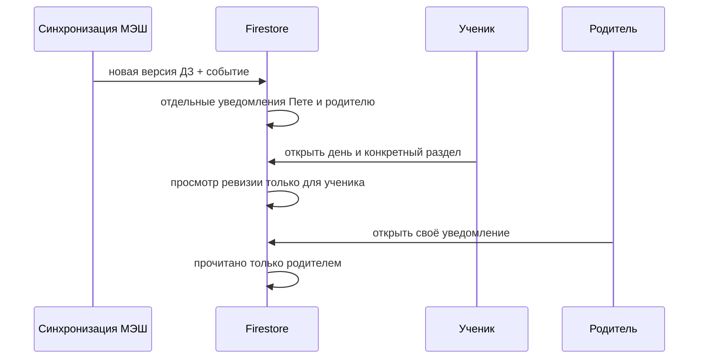

# Education: действия, просмотры и новое

Связанные контракты: [модель семьи](../families/README.md), [экраны из данных](../synchronization/backend-driven-ui.md), [dashboard](../school-diary/dashboard.md). Карта: [спецификации](../../product/README.md).

## Состояние реализации

Адресный inbox работает для изменений ДЗ, разборов фото, уточнений вердикта, родительского зачёта и выпусков продукта. Производители записывают короткие документы в `users/{personId}/inbox`, а клиент показывает их по живой подписке. Системные Web Push и журнал навигации остаются неактивными. Клиентские функции записи действий и просмотров подготовлены, но страницы их не вызывают. Для полного журнала открытий файлов дополнительно нужен [медиа-шлюз](../families/family-artifact-access.md).

## Школьные замечания и опоздания

При публикации дня `scripts/day.mjs` берёт последний **полный** снимок МЭШ и передаёт комментарии к оценкам в `diary/application/school-alerts.mjs`. Только явные формулировки об опоздании или дисциплинарном замечании создают родительское событие `school_late`/`school_remark`; тема урока, похвала и пустой комментарий остаются обычными данными. Сохраняются дата, предмет, исходный ID записи и дословный комментарий. Минуты показываются только если они названы в комментарии. Уведомление адресовано только активным взрослым семьи, имеющим доступ к ребёнку; ребёнку оно не посылается. Устойчивый ключ по ID записи заменяет изменённое замечание и исключает дубли при повторной синхронизации. Непрочитанные события видны в колокольчике и выделенном блоке сверху родительского кабинета; открытие помечает уведомление прочитанным.

Текущий доступ МЭШ подтвердил комментарий к оценке «опоздал на 10 мин» от 01.10.2026 по английскому. Отдельный метод уведомлений в проверенном профиле вернул пустой набор; подтверждённого доступа к общей ленте посещаемости и другим типам школьных сообщений пока нет. Поэтому охват сейчас ограничен комментариями к оценкам. Нельзя показывать «нет замечаний» как итог полного журнала школы. Текущий `day publish` связывает их с владельцем опубликованного дня через `family-access.json`; независимый выпуск по каждой семье остаётся отдельной работой.

## Журнал действий

`families/{familyId}/activity/{eventId}` — добавляемый один раз факт. Событие содержит `schemaVersion`, `actorPersonId`, `deviceUid`, `childId`, `type`, `viewId`, `sectionId`, `entityId`, `sessionId`, `occurredAt` (серверное время). Основные типы: `page_opened`, `section_opened`, `day_opened`, `task_opened`, `test_started`, `test_submitted`, `submission_uploaded`, `notification_opened`. Сами изменения в предметных документах порождают уведомления `homework_published`, `homework_changed`, `homework_removed`, `grade_added`, `grade_changed`, `review_started`, `review_paused`, `review_ready`, `review_updated`, `parent_accepted`, `parent_reopened`, `parent_requirement_mandatory`, `parent_requirement_optional`, `parent_guidance` и `product_update`; отдельный журнал аналитики для этих серверных событий пока не заполняется. `parent_guidance` создаётся в одной записи с неизменяемым `dayGuidance`; правило сверяет переданный текст с выбранным этапом закрытого родительского маршрута.

Клиент не пишет в событие текст задания, ответы, фото, токены ссылок, OAuth-ключи или полный URL. Секреты и персональные материалы остаются в своих защищённых документах. `sessionId` — случайный идентификатор сеанса, не ключ доступа. Повторный показ того же раздела в одном сеансе не создаёт поток одинаковых событий; действия отправки сохраняются отдельно и связываются с предметной записью. Сбой записи аналитики не отменяет отправку работы.

Клиентские события описывают навигацию и взаимодействие, но не доказывают, что тест сдан или файл сохранён: такой итог подтверждается соответствующим документом и серверным событием. Родительский отчёт различает эти два источника.

## Просмотр и прочтение

Посещение страницы **не означает**, что ребёнок прочёл все блоки и выполнил ДЗ. `users/{personId}/views/{viewKey}` фиксирует увиденную ревизию конкретного раздела только после его открытия; действие хранит также `seenAt`. Новизна вычисляется относительно ревизии источника (`sourceRevision`), а не сравнением двух часов. Для индивидуальных уведомлений `users/{personId}/inbox/{notificationId}` хранит адресата, ссылку на предметное событие, `createdAt`, `readAt?`; открытие уведомления отмечает только его.

При публикации изменённого ДЗ `scripts/day.mjs` сравнивает новый индекс с предыдущим Firestore-индексом. Для добавленного, изменённого или снятого предмета каждому активному участнику семьи, имеющему доступ к ребёнку и нужную роль, создаётся личная запись. Первичная публикация индекса не вызывает шквал уведомлений. ID записи вычисляется из ребёнка, даты, предмета, типа, текста и времени источника; повторная публикация без изменения не создаёт дубль. Разбор фото теперь сам публикует событие при начале и готовом результате; новая оценка МЭШ создаёт запись при сравнении опубликованных срезов одного дня. Родительское прочтение не меняет состояние ученика, и наоборот.

## Что создаёт уведомление и как не засорять центр

`submissions progress` создаёт **одну** запись `review_started` для набора фото и связанных заданий; смена внутренних фаз не создаёт новых записей. При остановке та же запись становится `review_paused` с понятной причиной в карточке, при возобновлении возвращается к `review_started`. `submissions review` заменяет эту же запись на `review_ready`, сбрасывая `readAt`, чтобы готовый результат снова был виден. Несколько номеров на одном снимке объединяются в одном событии; текст не содержит ответа или ключа. `submissions feedback` создаёт отдельное `review_updated`, если уже опубликованный вывод исправлен. ID выводится из семьи, ребёнка, попытки и версии: повторная публикация не дублирует событие. Родительское решение `accept/reopen` и уведомление ученика записываются в одной транзакционной пачке Firestore; клиент не может писать произвольный текст от имени проверки.

Новая оценка создаёт `grade_added` после изменения подтверждённого среза; исправление или замена при прежней длине создаёт `grade_changed`. Порядок отметок не считается изменением. Первое опубликование старого снимка не вызывает уведомление. До выпуска срез сверяется с полным снимком МЭШ по [контракту оценок](../school-diary/grades.md#mesh-reconciliation).

Команда `npm run notifications -- publish .local/release.json` публикует адресный `product_update` каждому активному профилю из закрытого проверенного описания с короткими пунктами «что изменилось». Ей не нужна новая сборка PWA. Для **значимого изменения сайта** стандартный выпуск — `npm run publish:pages -- --release-note .local/release.json`: публикация проверяет описание до сборки, ждёт, пока новый JS появится на Pages, затем отправляет новость. Ошибка Firestore не считается успешным выпуском: тот же вызов можно повторить с тем же `releaseId`, существующие уведомления сохранят `readAt`. Для чисто технического или незаметного изменения указывают `--silent-reason` с конкретной причиной. Не присылай выпуск при каждом косметическом коммите: сообщение нужно, когда изменение влияет на действия ученика/родителя или устраняет заметную ошибку. Если приложены «до/после», файлы сначала переносятся на Яндекс.Диск, а документ inbox получает только `provider`, `path`, `publicUrl`. Снимки продукта должны быть очищены от личных ссылок и данных ребёнка до публикации публичной ссылки. Для существующего разбора `backfill-review` проверяет живой `dayProgress` и публикует один источник-связанный итог. `backfill-parent` переносит в личный inbox только действующее решение родителя той же версии проверки; повторный запуск не создаёт дубль.

Обычная запись имеет `type`, `entityId`, `sourceRevision`, `createdAt`, `familyId`, `childId`; при наличии добавляются `date`, `subject`, `taskId`, безопасные `title`, `body`, `changes[]`, `media`. `readAt` принадлежит одному адресату. В колокольчике показываются только действия, которые меняют понимание «что делать» или завершённость работы: новое/изменённое ДЗ, новая оценка, старт и итог разбора в одной записи, исправленный вердикт, решение родителя, значимый выпуск продукта. Технические промежуточные шаги, каждая загрузка части фото и простое повторное открытие страницы не создают уведомлений.

## Центр обновлений внутри приложения

На повторном запуске колокольчик и число непрочитанных тем сразу берутся из кеша данного профиля. Подписка `users/{personId}/inbox` запускается **только после** восстановления Firebase Auth и личной сессии: кешированное имя профиля само по себе не даёт права вызывать `currentEducationPersonId()`. Пока сессия восстанавливается, кешированная панель не очищается и техническая ошибка не показывается. Успешный снимок заменяет данные и очищает прежнюю ошибку. Холодный запуск без кеша ждёт восстановленной сессии перед первой подпиской. Это порядок чтения, а не новая схема Firestore.

`NotificationBell` в общем заголовке подписывается на `users/{personId}/inbox`. Счётчик показывает непрочитанные **темы**, а не каждое сообщение одного разбора или каждую подсказку. Основной список показывает новые темы; прочитанные уходят в раскрываемую «Историю», но не удаляются. События по одному заданию группируются по семье, ребёнку и `taskId`; изменения ДЗ — по дате и предмету; новости продукта собраны в одну тему. В раскрытии доступны все исходные события и их время. Это проекция клиента: исходные документы и персональные `readAt` не объединяются и остаются доступны старым клиентам. Открытие колокольчика ничего не помечает прочитанным; открытие темы помечает все её непрочитанные события одной пакетной записью и раскрывает подробности. Отдельное действие открывает точное задание либо день. Снимки «было/стало» хранятся на Яндекс.Диске, в Firestore находятся только ссылка и метаданные. При открытом приложении новое событие появляется без перезагрузки и без навязчивого тоста. Это **внутреннее** обновление: при закрытом приложении оно не появляется на экране блокировки. Для нового типа события требуется привязать его к источнику, адресату и экрану назначения; нельзя показывать готовый текст ответа или персональные секреты в краткой записи.

В шапке открытого колокольчика рядом с «Обновления» находится «Прочитать все». Команда доступна после восстановления личной сессии даже при нулевом счётчике первых 100 событий: более старые непрочитанные записи могли не попасть в живой список. По явному нажатию она проходит адресную личную очередь страницами по 400 документов и отмечает `readAt` только у ещё непрочитанных событий; предел 100 документов у живой подписки не ограничивает действие. Новые события, пришедшие после начала обхода, остаются непрочитанными. Записи не удаляются и остаются в «Истории»; чужая сессия не продолжается следующей страницей. При ошибке уже подтверждённые сервером страницы сохраняют результат, а остальные остаются непрочитанными; интерфейс показывает ошибку и позволяет повторить. Открытие колокольчика по-прежнему не отмечает ничего. Это изменение существующего личного `readAt`, без новой схемы и без изменения прав.

Школьный блок на главной взрослого ждёт серверного подтверждения `readAt`, прежде чем показать опоздание или замечание: старый кеш не должен на секунду возвращать уже прочитанное сообщение. Краткий кеш запуска для профиля лишь объединяет одновременные запросы экрана входа и колокольчика; он истекает через три секунды и очищается при отзыве личной сессии. Это не заменяет проверку доступа Firebase и не является полным локальным снимком ДЗ. Открытие урока с меткой «Новое ДЗ» подтверждает и соответствующие адресные новости в колокольчике пакетной записью; соседние предметы и другие дети остаются непрочитанными.

Основание выбора: [Apple Human Interface Guidelines](https://developer.apple.com/design/human-interface-guidelines/notifications) рекомендует при открытом приложении добавлять новое содержание и обновлять счётчик без отвлекающего баннера, не дублировать одно событие и показывать в счётчике именно непрочитанные записи. Цвет и точка не являются единственным признаком новизны: рядом остаётся текст события. Системное разрешение на уведомления для такого внутреннего списка не требуется.

## Отчётность и срок хранения

Журнал позволяет ответить, когда и кем был открыт день, конкретный раздел или задача, начат тест, загружена работа и прочитано уведомление. Для родителя это история действий ребёнка с серверным временем и ссылкой на предметную запись; отсутствие события означает только отсутствие зафиксированного действия. Сводки строятся сервером из журнала, а не доверяются клиентскому счётчику. Нужен явный срок хранения сырых посещений и агрегатов перед включением сбора для других семей; пока схема и правила подготовлены, но сбор не активирован.
