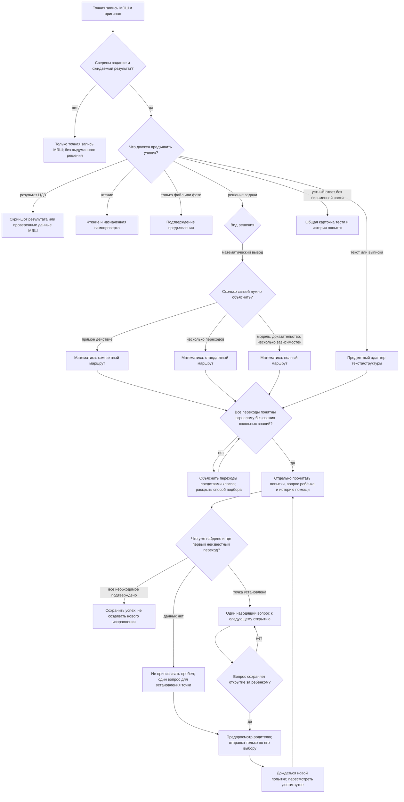

# Выбор карточки задания {#decision-graph}

Карточка строится из данных проверенного задания. Название предмета само по себе не задаёт ни способ решения, ни обязательные действия ученика. Общие правила одинаковы для математики, спецкурса и будущих предметных адаптеров; отдельный адаптер задаёт только способ объяснения и проверки **нужного вида результата**. Действующие границы источников — в [формировании плана](../synchronization/plan-generation.md), доступа — в [предметном разборе](subject-aware-guidance.md#data-contract), оформления — в [дизайн-системе](../../shared/design/README.md).

## Граф выбора

Сначала фиксируются `task.kind` и подтверждённый `outputKind` (`worked-solution`, `text-structure`, `structured-notes`, `evidence-only`, `reading`, `platform-result`). По одному слову «математика» нельзя автоматически назначить полный разбор. Номер спецкурса и номер обычной математики при одинаковом виде работы проходят **один математический адаптер**. Для листа спецкурса поверх него применяется отдельный [слой правил учительского файла](special-course-card-overlay.md#teacher-sheet). Особые правила семьи, школы и издания добавляются с областью применения и источником; они не переписывают общую карточку. Неподтверждённый вид остаётся `unclassified` и разбирается оператором до выпуска, а не угадывается интерфейсом.

Когда подтверждён устный ответ, чтение или подготовка к контрольной, выбор и наполнение теста проходят отдельный [граф самопроверок](../assessments/assessment-decision-graph.md#decision-graph). Письменная ветка карточки не превращается в тест по названию предмета.

## Общая оболочка для обеих ролей {#shared-shell}

Полный путь от записи МЭШ до опубликованной карточки и границы автоматической проверки зафиксированы в [сертификации пути карточки](card-flow-certification.md). Для нового сверенного математического листа `mathRoutePolicyVersion: 2` требуется независимая `sourceInventory`: каждый исходный файл и SHA-256, запись проверки каждого файла, вид результата, все варианты и печатные номера. `day validate` сравнивает опись с карточкой; `needs-review` остаётся точной записью МЭШ без интерпретации. {#source-inventory}

Ребёнок и взрослый видят один ID задания, точную формулировку, оригинал с номером страницы/листа, что действительно требуется сделать, куда предъявить результат, состояние попытки и историю. У взрослого дополнительно есть закрытый источник-пакет, подготовленный разбор, сопоставление работы по этапам и отправка одного выбранного уровня помощи. У ребёнка полный ключ, следующий шаг и закрытые критерии **не находятся в документе страницы**; выбранная родителем подсказка приходит отдельным событием. Общие `ProblemStatement`, `ProblemTaskCard`, `WorkReview`, загрузчик изображений и токены Education переиспользуются; предметный адаптер не создаёт вторую шапку или вторую модель загрузки.

## Варианты и задачи листа {#practice-variants}

Если оригинал прямо разрешает выбор («Реши сколько получится»), каждый выбираемый пункт может использовать существующую группу практики с `optionalByTeacher:{sourceRef,excerpt}`. Это точная опора на назначенный файл,а не догадка агента или решение от имени родителя. По умолчанию такие пункты исключены из обязательных счётчиков;родитель может включить любой прежним тумблером без видимой подписи. Более позднее семейное решение имеет приоритет. Без этого поля прежние варианты остаются обязательными. Отсутствие обязательных пунктов не создаёт verified и не доказывает освоение. Оригинал,нумерация,подсказки,сдача по каждому пункту и история сохраняются. `practiceRequired` — общий селектор для карточек,расписания,dashboard и всех счётчиков;readback проверяет сохранение источника выбора.

Одна запись МЭШ остаётся одним `taskId`, даже если учитель приложил лист с несколькими вариантами. Сверенный источник определяет `practiceVariants[]`; у каждого варианта есть устойчивый ID и свои нумерованные `problems[]`. Номер может повторяться **между вариантами**, но не внутри одного. ID пункта включает вариант. Полный лист показывается один раз, а внутри каждого варианта — компактный список отдельных задач с точным фрагментом, условиями и результатами. Обычный лист без вариантов использует те же `ProblemGroup`, `ProblemTaskCard` и `ParentTaskGuide` без лишнего уровня UI.

Подготовка к контрольной остаётся `kind=check`, если МЭШ не назначал письменную сдачу. `practiceVariants` создают семейную тренировку, не меняя слова учителя. Родитель может до первой работы сделать любой вариант необязательным через общий `RequirementSwitch`; первоначально включены оба. Выбор хранится как отдельное семейное событие и исключает задачи этого варианта из счётчиков «осталось» и «X из Y», сохраняя доступ к листу и добровольной загрузке. Фото из любого пункта анализируется целиком: фактически найденные решения получают отдельные `photoCoverage` и проверки. Нельзя автоматически закрывать соседний номер по факту загрузки.

Граф применяется к любому предмету, где источник содержит независимые пункты: предмет выбирает лишь адаптер объяснения и критерий проверки. Биология и другие предметы подключаются после проверки их конкретных источников и типов ответа; пока действующий валидатор математических решений охватывает математику и спецкурс. Устный материал, чтение и ЦДЗ не превращаются автоматически в нумерованные письменные задачи.

## Математический адаптер {#math-adapter}

Во всех трёх вариантах родитель может понять путь от условия к ответу; ответ раскрывается только в последнем блоке, а проверка находится внутри него и сначала свёрнута. Число видимых блоков зависит от реальной задачи, **не от ярлыка «спецкурс»**:

| `routeProfile` | Когда выбирать | Видимые блоки |
|---|---|---|
| `compact` | Одно прямое действие или короткий пример, где отдельные «дано» и «связи» повторили бы условие | Решение → Ответ |
| `standard` | Несколько вычислительных переходов; данные полезно выделить, а отдельная модель связей не нужна | Дано → Решение → Ответ |
| `extended` | Несколько взаимосвязанных величин, модель, доказательство или неочевидный переход | Дано → Связи → Вычисление → Ответ |

Это выбор плотности **показа**, а не разрешение пропустить обоснование. В компактном решении всё равно названы нужные данные, откуда взялось действие и почему получен результат. В стандартном блок «Решение» содержит связи вместе с вычислениями. Если они туда не помещаются без потери смысла, выбирается `extended`. Оператор записывает `depthReason` для `compact` и `standard`; исторический утверждённый маршрут без `routeProfile` считается `extended`. Класс, предмет или длина текста не выбирают профиль автоматически. В 6 классе может быть полный маршрут; в старших классах также может быть компактная задача.

Каждому видимому этапу присваивается устойчивый `stageId`, точный источник, ожидаемая запись, объяснение, текст наводящей подсказки и текст прямого раскрытия. После фото сопоставление идёт по тем же ID. Сжатие блоков не даёт права помечать невидимый промежуточный шаг ошибкой и не должно раскрывать ответ раньше времени. Для листа из нескольких коротких примеров допускается общий компактный список номеров с раскрытием выбранного примера; это отдельная композиция списка, а правила источника, результата и проверки те же.

## Понятный разбор и настоящая подсказка {#explanation-and-hint}

Ревизия наполнения: `parent-readable-hints-2026-10-25`. Два обязательных результата проверяются отдельно. Полное родительское объяснение должно быть воспроизводимо взрослым, который давно не решал школьные задачи; способ решения использует знания подтверждённого класса ребёнка. Для шестиклассника арифметический путь предпочтительнее необъяснённого метода старших классов. Термины и символы вводятся до использования. Каждая строка отвечает на «откуда это взялось» и «почему теперь можно сделать это». «Подбери», «очевидно», «из формулы получаем» и «решаем уравнение» без показанного перехода не проходят содержательную проверку. Для перебора нужны порядок вариантов, причина полноты и условие остановки. `compact` сжимает оболочку, а не объяснение.

Вторая ветка — помощь конкретному ребёнку. Перед её выбором оператор отдельно записывает в закрытой записи запуска: что подтверждено попыткой, что только сообщено семьёй, какая помощь уже получена, чего пока не видно и какое ровно одно открытие нужно следующим. Успешный предшествующий шаг не объясняется повторно как помощь. Если ребёнок уже получил формулу, вопрос о её выводе не устраняет затруднение в использовании. Если свидетельств нет, выбирается вопрос для установления точки, а не выдумывается ошибка. Иной верный способ имеет тот же статус, что и образец.

`hintPreview` — один вопрос или маленькое действие, направляющее внимание к следующему неизвестному переходу. Оно не сообщает этот переход, новую решающую связь, операцию, числа для подстановки или ответ. Уже найденный ребёнком факт можно использовать, но его известность должна иметь основание. `revealPreview` — отдельное прямое раскрытие выбранного шага; его нельзя называть подсказкой. Например, после полученной формулы вопрос «Почему здесь делим на два?» возвращает назад; вопрос «Как можно проверить по твоей формуле предположение о числе участников?» обращён к использованию найденного. Такой вопрос применим только если вопрос ребёнка или попытка подтверждает именно эту точку. Если он снова не помогает, следующая попытка требует более раннего малого аналога или более узкого вопроса, а не повторения прежней фразы. Готовый алгоритм остаётся в родительском объяснении или явно выбранном полном раскрытии.

Перед публикацией оператор читает родительскую ветку без подразумеваемых школьных знаний, затем отдельно ученическую проекцию с позиции текущей попытки. Полнота родительского ключа не разрешает автоматически отправлять его ребёнку. Количество этапов, заполненные поля и успешная структурная валидация не подтверждают качество этих двух текстов; смысловую проверку выполняет оператор.

В закрытом плане также отдели исходные знания от нового приёма: какие арифметические действия предполагаются знакомыми, а какую идею нужно объяснить впервые. Сам номер класса не доказывает, что ребёнок знает способ подсчёта пар или умеет организовать перебор. Если сведения о пройденном неизвестны, это отмечается без утверждения о пробеле или обязательном владении методом. Если все необходимые шаги уже подтверждены, результат сохраняется без нового исправления или вопроса ученику; обновление родительского объяснения само по себе не создаёт открытый пробел.

## Подключение следующего адаптера {#extension}

Для русского, литературы, географии или другого задания сначала подтверждаются `outputKind`, применимые школьные/учительские требования и тип допустимых ответов. Затем определяется родительский разбор и ученическая карточка на общей оболочке. Один предмет может использовать несколько адаптеров. Методика помогает объяснить работу, но не создаёт обязательный объём, число пунктов или единственный «правильный» авторский текст без назначенного критерия. [Единая модель и проекции](subject-card-viewmodel.md#projections) фиксируют, какие данные получает каждая роль.

### Предметные ветки {#subject-adapters}

Все письменные ветки ниже используют **один** `ParentTaskGuide` и общие `WorkReview`, `AssignmentBrief`, `MaterialReader`, `TaskGuidance`. `day/card-policy.mjs` хранит конечные ID этапов; содержание каждого этапа приходит из закрытого документа Firebase после сверки источника. Письменное новое задание не математического вида получает `cardPolicyVersion: 1` и до выбора ветки остаётся `needs-review`.

| Подтверждённый результат | `cardPattern` и этапы | Граница |
|---|---|---|
| Литература: короткие тема и идея | `short-interpretation`: тема → идея и опора в тексте | Разные текстом обоснованные толкования допустимы. Для «Кубка» только эти две записи назначены в МЭШ. |
| Литература: развёрнутый ответ | `evidence-response`: мысль → фрагмент → связь → итог | Используется лишь если назначен такой ответ, не для простого чтения. |
| Биология: выписка понятий и функций | `concept-function`: повторяемые именованные пары | Форма таблицы, дополнительное строение клеток и ЦДЗ не добавляются к § 5. |
| Английский: словарь или письменное упражнение | `vocabulary-list` и `written-exercise`: повторяемые этапы с устойчивыми ID, каждый привязан к назначенной странице или точной записи МЭШ | Учебник и рабочая тетрадь разделяются по изданию и странице. Помета раздела тетради без номеров не делает все его упражнения обязательными. Устное заучивание не подменяется фото тетради. |
| История: работа с источником | `source-analysis`: происхождение → тезис → доказательство → предел | Устный опрос идёт через общую карточку теста. |
| География: карта/данные | `map-analysis`: вопрос → источник → наблюдение → вывод | Явное ЦДЗ идёт через подтверждение платформы или скриншот. |
| Новый предмет / неизвестный письменный вид | `source-evidence`: назначение → видимое подтверждение | Без доказанного критерия нет готового «эталона». |
| Несколько отдельно назначенных номеров | `source-units`: один этап `mesh-<номер>` на каждый номер из подтверждённых шагов МЭШ | Выполнение одного номера не скрывается за неизвестным статусом другого; дополнения учебника остаются по желанию. |

Чтение и устные задания используют [единый компонент теста](#quiz-adapter); выразительное чтение не оценивается одним процентом теста. Прототипы, которые привели к этим веткам, сохранены в [исследовании литературы](../../research/literature-card-options.md) и [сравнении предметов](../../research/parent-card-subject-options.md). Они не становятся дополнительными домашними заданиями.

### Единая карточка теста {#quiz-adapter}

Родительский выбор обязательности активного теста принадлежит общему `QuizCard` для каждого предмета и не добавляется в предметный адаптер. Источник выбора и влияние на счётчики — [в контракте тестов](../assessments/quizzes.md#optional-quiz); варианты исходного листа имеют отдельные переключатели и не исчезают вместе с тестом.

`src/components/QuizCard.tsx` получает один `QuizCardAttempt` или цепочку попыток. Во всех предметах и на обеих ролях одинаковы подписи «не начат / в процессе / отправлен», `отвечено/всего`, процент **набранных баллов** после проверки, история и действия. `src/DayPage.tsx` лишь добавляет точное МЭШ и страницы, `src/App.tsx` — действия личного списка. При неизвестном балле процент не рисуется. Содержание теста, источник и связь повторной попытки задаются данными Firestore; отдельного JSX теста для литературы или истории нет.

### Утверждённый родительский вид русского языка {#russian-adapter}

Устное и письменное внутри одной записи МЭШ становятся **двумя связанными карточками**, без дублирования задания. Для устной части используется общий `QuizCard`/`QuizProgress` из `src/components/QuizCard.tsx`: нынешняя попытка (не начата, идёт с числом отвеченных вопросов, закончена с результатом), предыдущие попытки с процентом и переход к результату. Родительская основная кнопка — «Посмотреть вопросы» или «Посмотреть результат», рядом только компактная иконка «Скопировать ссылку Пете». Надписи «Открыть родительский просмотр» и отдельного нового блока истории нет. Тест Education не выдаётся за отметку МЭШ и не является скрытым обязательным пунктом письменного задания.

Письменные виды — **разные конфигурации общей оболочки** `ParentTaskGuide`/`WorkReview`, с текущей шапкой Education, оригиналом учителя/учебника, точной записью МЭШ, загрузкой и историей. Сначала видны условие, факт наличия фото и краткая сводка; подготовленный разбор раскрывается по частям. После работы отдельный слой показывает подтверждённое у ребёнка, первый конкретный пробел и степень уверенности. Родитель может передать выбранный наводящий вопрос или раскрытый фрагмент после предпросмотра. Отправка по умолчанию не раскрывает готовый ответ. [Повторяемый протокол наполнения](russian-language-route.md#pipeline) задаёт точный порядок и границы проверки.

| Вид письменной работы | Родительские раскрываемые части | Сопоставление после фото |
|---|---|---|
| Вставить буквы и объяснить выбор | Правило → применение к каждому слову → верная запись | По каждому слову отдельно: буква, применённое правило, первое место ошибки; верный ответ без объяснения обозначается отдельно |
| Разобрать предложение | Основа → связи и вопросы → остальные члены/признаки только по условию | Подтверждённые связи и конкретная неверная связь, а не один общий балл |
| План текста | Тема и мысль → тип и стиль → план, с цитатой/страницами назначенного текста | Каждая часть отдельно; спорная форма плана не становится недоделкой без критерия учителя; родитель выбирает обязательность спорного пункта |
| Сочинение или развёрнутый ответ | Главная мысль → обоснование/примеры → связность/вывод → грамотность, если требуется | Структура и содержание отделены от орфографии; не пишем текст за ребёнка и не назначаем объём или число аргументов без источника |

Тексты в согласованном интерактивном макете для орфографии, разбора и сочинения — **демонстрационные, не работа ученика и не ключ к ней**. Реальная карточка собирается оператором/LLM по источнику, а схема этапов, проверка полноты, безопасная проекция и React-компонент общие. `day/card-policy.mjs` фиксирует четыре паттерна; `day/build.mjs` ставит версию политики новым письменным русским заданиям; `scripts/day.mjs` запрещает публикацию сверенной записи без выбранного паттерна, этапов, привязанных источников и подготовленной выборочной помощи. Упр. 169 переведён на `text-plan` в действующей странице 11 октября с теми же ID; старые страницы не меняются без полной предметной сверки. Сопоставление фото использует явный `review.items[].stageId` либо проверяемый список `reviewLabels` для прежнего разбора; сходство строк само по себе не оценивается. Другие предметы остаются в обсуждении, как указано в [исследовательских вариантах](../../research/parent-card-subject-options.md).

## Реализация и границы {#implementation}

`day/card-policy.mjs` хранит общий граф выбора по проверенному `outputKind`, конечные предметные паттерны и три профиля математического маршрута. `scripts/day.mjs` проверяет форму маршрута и источники; `ParentTaskGuide.tsx` отображает его на существующей карточке без нового предметного JSX. `QuizCard.tsx` теперь используется в ДЗ и в личном списке. Факты, разборы и сообщения о выпуске приходят через подписки Firestore; новый код интерфейса и правила безопасности требуют отдельного выпуска. Семейные модули с динамической загрузкой и общая композиция множества коротких примеров ещё не реализованы. Новые предметные ветки становятся видны **только** после публикации конкретного сверенного `parentGuide`; запись шаблона в коде не является готовым разбором всех исторических работ.
