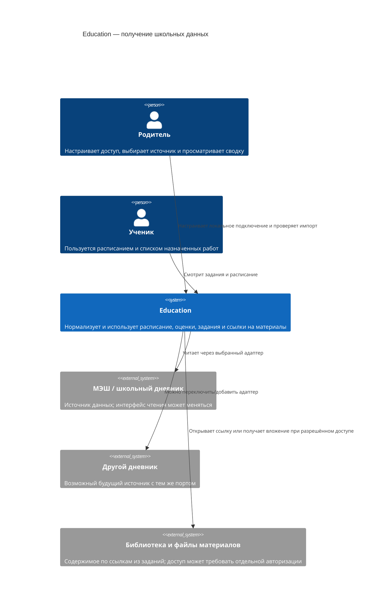
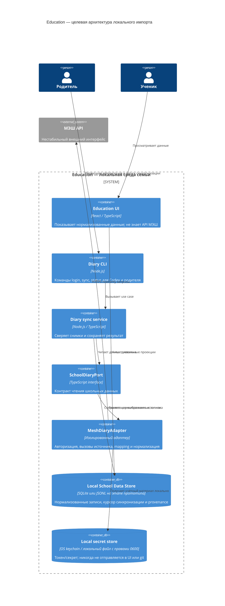
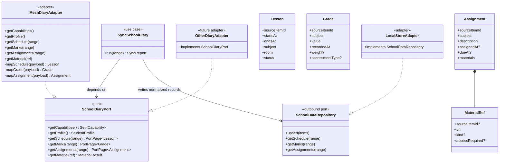
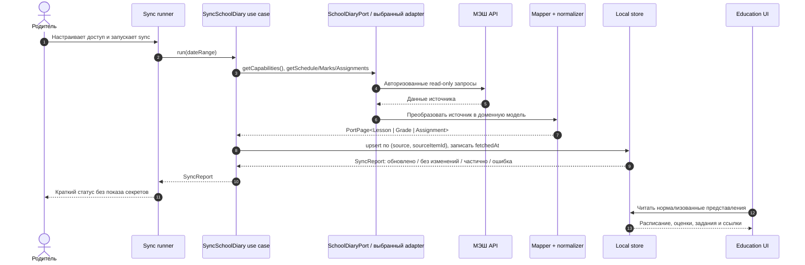

# Порт школьного дневника

Этот модуль — каноническое место исходного контракта. Полный текст спецификации сохранён ниже; таблица показывает кодовую границу и обмен данными.

| Код | Вход → результат | Контракт |
|---|---|---|
| [`diary/cli.mjs`](../../../diary/cli.mjs) | учётная запись и параметры → сбор/сохранение снимка МЭШ | [README.md](README.md) |
| [`diary/application/sync.mjs`](../../../diary/application/sync.mjs) | полный снимок → сверенный дневник | [README.md](README.md) |
| [`src/components/HomeworkOverview.tsx`](../../../src/components/HomeworkOverview.tsx) | опубликованный дневной план → сводка ДЗ | [dashboard.md](dashboard.md) |
| [`src/lib/dayStore.ts`](../../../src/lib/dayStore.ts) | Firestore day documents → состояние страницы дня | [day-page.md](day-page.md) |
| [`sync/school-calendar.mjs`](../../../sync/school-calendar.mjs) | персональный МЭШ-календарь → подтверждённые периоды каникул | [school-calendar.md](school-calendar.md) |


## Подключение школьного дневника: порт и адаптеры

**Состояние пилота.** Граница МЭШ локализована в `diary/adapters/mesh.mjs`, а `diary/application/sync.mjs` сохраняет снимки и diff. Формальный `SchoolDiaryPort`, общие доменные сущности и репозиторий канонических записей ниже остаются **целевой архитектурой**, не описанием готового кода. Страница дня публикуется из локального `.local/day-source-<дата>.json` в Firestore; фото и тесты живут в отдельных коллекциях. Ученический браузер не вызывает МЭШ и не получает его токен. Смежные правила собраны в [карте спецификаций](../../product/README.md).

<a id="diary-adapter"></a>
## Цель

Подключить МЭШ как первый источник расписания, оценок, домашних заданий и ссылок на материалы. Остальная Education-система должна работать с собственной моделью школьных данных, а не с типами и ответами конкретного API. Если источник сменится, добавляется или заменяется адаптер; порт и потребители остаются прежними.

На 07.10.2026 в проверенных источниках не найден опубликованный и гарантированный для родительских интеграций API дневника. Сторонние клиенты сообщают, что обращаются к API МЭШ, но описывают его как изученный по работающим клиентам/приложениям. Считаем его внешним нестабильным интерфейсом, даже если конкретные endpoint доступны.

## Варианты

| Вариант | Граница | Плюсы | Минусы | Когда подходит |
|---|---|---|---|---|
| A. Вызовы МЭШ из интерфейса | React-страницы сами вызывают API источника | Мало кода в начале | Утечка токенов в браузер; детали МЭШ распространяются по UI; замена источника затрагивает много мест | Не использовать для личных данных ребёнка |
| B. Адаптер внутри монолита | Use case вызывает стабильный `SchoolDiaryPort`; адаптер переводит API МЭШ в общую модель | Самая малая полезная абстракция; легко переключать источник; не нужен отдельный публичный API | Процесс автоматической синхронизации всё ещё надо где-то запускать | Рекомендуемый первый шаг: один пользователь, локальный read-only сбор |
| C. Отдельный connector service | Локальный или закрытый сервис реализует порт и отдаёт REST API | Несколько приложений могут читать один набор нормализованных данных; понятен контракт HTTP | Дополнительная эксплуатация, авторизация и обновления; раннее усложнение | Добавить, когда появится второй реальный потребитель или удалённый клиент |
| D. Общая библиотека SDK | Все источники и доменные типы объединены в публикуемом пакете | Удобно переиспользовать в нескольких репозиториях | Версионирование пакета и обратная совместимость до доказанной необходимости | Рассмотреть при втором приложении/команде |

**Решение для прототипа:** вариант B, порт-адаптеры (Hexagonal Architecture / Ports and Adapters), плюс anti-corruption layer в адаптере. Вначале это наш локальный CLI, прикладной сервис синхронизации в том же процессе и локальное хранилище. Сторонний клиент МЭШ может использоваться только внутри `MeshDiaryAdapter` после проверки кода; он не задаёт интерфейс Education. Публичный HTTP API не входит в прототип; при необходимости его можно добавить поверх тех же use case и порта (вариант C), не меняя контракты поставщика данных.

## C4 — контекст системы



## C4 — целевые контейнеры и граница заменяемости



UI, Firestore и статический GitHub Pages сайт не должны хранить токены МЭШ. Первый коннектор запускается локально. Если позже потребуется синхронизация с хостингом, отдельно пересматриваем размещение, секреты, авторизацию родителей и минимизацию данных до начала разработки этого deployment-варианта.

<a id="family-onboarding-research"></a>
## Подключение других семей без смены тарифа: исследование 11.10.2026

Подтверждённое требование: синхронизацию по-прежнему запускает единственный оператор локально. На действующем Firebase можно реализовать приглашения, очередь заявок, их статусы и делегированные лимиты. Браузер записывает заявку в Firestore, локальный процесс читает её, подтверждает МЭШ и публикует в Firestore только результат и связи семьи. Для списания лимита вместе с выпуском приглашения нужны атомарная транзакция и правила, проверяющие обе записи; [Firestore поддерживает такую проверку `getAfter`](https://firebase.google.com/docs/firestore/manage-data/transactions). Это не требует постоянно работающего собственного сервера. Выключенный компьютер означает, что заявки ожидают оператора, а не что они потеряны.

Приглашение и вход в Firebase не дают токена МЭШ. Браузер Education не может прочитать уже открытую вкладку mos.ru или её cookies; [ограничение одинакового источника](https://developer.mozilla.org/en-US/docs/Web/Security/Defenses/Same-origin_policy) этому препятствует. «Секрет Firebase» также не даёт доступа к МЭШ: [ключ клиента Firebase публичен по назначению](https://firebase.google.com/docs/projects/api-keys), а административный ключ нельзя встраивать в сайт. Правила Firestore не вызывают внешний API. Вход через Госуслуги может [подтвердить учётную запись mos.ru](https://www.mos.ru/upload/documents/files/6783/Gosyslygi.pdf), но сам по себе не выдаёт Education права читать дневник. То же различие действует для Яндекс ID.

Лучший полностью браузерный путь возможен только при разрешённом для нашего приложения OAuth/OIDC-подключении Mos ID с правом чтения нужных данных МЭШ, зарегистрированным адресом возврата, публичным клиентом с PKCE и разрешёнными браузерными запросами. [Стандарт для браузерных OAuth-клиентов](https://www.rfc-editor.org/rfc/rfc10017.html) описывает эти условия; [московский регламент](https://www.mos.ru/upload/documents/files/158/64-16-18322ot05052022.pdf) предусматривает заявку на подключение системы к СУДИР. Одного факта, что Mos ID используется сторонними сервисами, недостаточно для вывода о доступе к API дневника. Зарегистрированный клиент, необходимые права МЭШ и пригодность браузерного обмена токенов **не подтверждены**. Встроенный OIDC-провайдер Firebase требует [Identity Platform](https://firebase.google.com/docs/auth/web/openid-connect) и не является готовым решением на нынешнем тарифе.

Текущий `mesh-diary`-адаптер выполняет сценарий мобильного клиента: регистрацию устройства, пароль, SMS, серверный обмен токенов и ручное управление cookies. Его нельзя просто перенести в React: браузер не даёт JavaScript читать `Set-Cookie` и назначать заголовок `Cookie` для такого потока. К тому же зарегистрированный адрес возврата мобильного клиента не является адресом нашего сайта. Этот код остаётся внутри локального адаптера; использование его для других семей требует отдельной проверки устойчивости и условий доступа.

Реалистичный бесплатный прототип имеет две ступени. Сначала приглашённый оставляет **заявку без пароля МЭШ**; оператор видит очередь. Для удалённого подтверждения затем выбирается один из способов: разрешённый официальный OAuth-поток; локальный помощник на устройстве взрослого, передающий оператору ограниченный зашифрованный результат; либо короткая парная сессия браузера с работающим локальным процессом оператора через Firestore как зашифрованный канал. Последний вариант технически возможен, но заставляет наш интерфейс принимать учётные данные mos.ru и требует отдельного аудита безопасности, короткого срока жизни сообщений и удаления секретов. Без одного из этих каналов локальный скрипт не сможет установить, кто воспользовался приглашением и какие дети доступны ему в МЭШ.

На момент первоначального исследования приглашения и очередь ещё не были созданы. Официальный путь Mos ID → МЭШ по-прежнему не подтверждён; ниже описан локальный путь с явно передаваемыми полномочиями. Токены МЭШ хранятся только у локального оператора, а Firebase служит временным каналом шифрованной передачи.

**Реализация локального подключения (npm-пакет, правила Firebase и экран управления опубликованы 11.10).** Пакет `packages/education-connect` запускается через `npx education-connect --invite <код>`; вход mos.ru и SMS происходят в терминале взрослого. Административная команда `npm run connect -- issue|list|revoke|receive|disconnect|seed-current|process-requests|process-revocations` выпускает одноразовое приглашение, принимает подтверждённый родительский доступ и обрабатывает заявки из кабинета. `connectionInvites/{code}` хранит только открытый ключ, срок и статус; целевая семья, создатель и закрытый ключ находятся в локальном реестре оператора. `connectionInvites/{code}/handoff/current` принимает однократно только зашифрованный пакет. Клиент пишет его через анонимную Firebase Auth и ограничения Firestore. Закрытый ключ приглашения и полученные полномочия остаются в `.local/` оператора. Перед обработкой оператор повторно проверяет срок приглашения, родительскую роль и всех детей по МЭШ, привязывает уже известные идентификаторы к существующей семье и только затем создаёт недостающие профили. Для присоединения к существующей семье нужно подтверждённое совпадение ребёнка МЭШ; одного приглашения недостаточно. `seed-current` связывает действующих ребёнка и взрослого с ID МЭШ до повторного подключения. `sourceIdentities` и `sourceAccounts` доступны только Admin SDK. Второй взрослый получает собственный профиль и уже существующие переходы к календарю ребёнка. Компонент `ConnectionInvite` показывает команду и состояние заявки; `FamilyAccessCards` показывает журнал создателя и заявки, которые оператор исполняет локально. Пакет использует тот же `packages/education-connect/lib/mesh.mjs`, что и `diary/adapters/mesh.mjs`; пароль и SMS в Firebase не передаются. Текущий пакет поддерживает только МЭШ, его название не закрепляет сервис в публичном интерфейсе. Синхронизация подключённых семей пока запускается оператором вручную.

**Проверка переносимости 11.10.2026.** Копия локального `secret.json` была запущена с отдельным рабочим каталогом и `HOME`, затем в Docker `node:22-alpine` с отдельной ОС и доступом только к копии секрета, коду адаптера и зависимостям. В обоих случаях команда `diary verify` без повторного ввода пароля и SMS подтвердила родительскую роль и связь с одним учеником. В копии перед запуском заменили краткоживущий `token` заведомо недействительным значением; проверка всё равно прошла, а сохранённое значение токена было заменено новым. Это подтверждает техническую пригодность переноса текущего набора полномочий между изолированными средами на момент проверки. Это не гарантирует длительный срок действия, отсутствие отзыва доступа или стабильность неофициального протокола МЭШ. Секреты в вывод проверки и Firestore не передавались; временные копии удалены после запуска. Перед подключением других семей требуется отдельный протокол согласия взрослого, одноразовое приглашение, шифрование передаваемых полномочий для оператора, проверка принадлежности детей и отзыв подключения.

**Текущий поток:** `diary CLI` → снимки `.local/diary/` → `day/build.mjs` и ручная редактура `.local/day-source-<дата>.json` → `dayPages` Firestore → страницы на GitHub Pages. `dayUploads` и документы тестов дополняют опубликованный план; файлы работ архивируются на Яндекс.Диске. Локальный исходник сейчас является единственным редактируемым источником плана. Повторный выпуск сохраняет отдельные фото и попытки, но при исчезновении задания из МЭШ старый пункт пока остаётся без отметки об отмене. Для этого нужна отдельная семантика изменения назначения, а не молчаливое удаление. При чтении расписания события без предмета, ДЗ и признаков урока остаются календарными событиями: сборщик не отправляет их в `lesson_schedule_items`. Обычный урок, даже с пустой краткой строкой ДЗ, требует подробной карточки до полного снимка.

### Целевая структура кода и текущее расположение

```text
education-quizzes/
  diary/                    # наш код; хранится в Git
    domain/                 # Lesson, Grade, Assignment и другие общие типы
    ports/                  # SchoolDiaryPort и SecretStorePort
    application/            # SyncDiary, сравнение снимков, статус
    adapters/mesh/          # единственное место, знающее API МЭШ
    adapters/local-store/   # сохранение нормализованных снимков
    cli/                    # команды login, sync, status
  .env.example              # имена и смысл локальных настроек, без значений доступа
  .env.local                # выбранный provider, часовой пояс, путь к данным; исключён из Git
  .local/diary/             # секреты с правами 0600 и личные снимки; исключено из Git
```

Первый CLI реализован в `diary/cli.mjs`, адаптер — в `diary/adapters/mesh.mjs`, снимки и diff — в `diary/application/` и `diary/local-store.mjs`. Папок `diary/domain/` и `diary/ports/` пока нет: дерево выше задаёт направление рефакторинга. Команды: `npm run diary -- doctor`, `login`, `verify`, `sync --date YYYY-MM-DD`, `files --date YYYY-MM-DD`, `status`. `verify` сверяет роль `ParentProfile` и связь выбранного ученика с родителем. Для расписания используется идентификатор ученика, а идентификатор владельца токена хранится отдельно. ДЗ выбранного дня берётся из подробных карточек расписания; короткий endpoint не считается достаточным без проверки даты урока. `.env.local` — конфигурация процесса, не хранилище пароля. Секрет хранится в `.local/diary/secret.json` с правами `0600`. Полная нормализация и сверка журнала оценок с официальным экраном ещё не реализованы.

Новая сессия Codex в этом проекте запускает ту же отслеживаемую команду CLI. Для работы на другом компьютере потребуется безопасный перенос сохранённых полномочий или новая авторизация. Проверка переносимости выше подтверждает, что текущий набор полномочий работает в отдельной среде, пока доступ к МЭШ не отозван.

<a id="full-grade-period"></a>
### Полный журнал оценок текущего периода

Адаптер одним запросом к `subject_marks` получает предметы с `periods`, выбирает период, охватывающий текущую дату Москвы, и требует `marks.length === count`. Это заменяет короткий `subject_marks/short`, который возвращал число всех оценок, но лишь несколько последних записей. Отметка сохраняет ID источника, дату, название формы контроля и комментарий. Оператор сверяет полный журнал с подтверждённым `grade-snapshot.json` по числу, среднему, значениям и весам до публикации; комментарий не привязывается по порядковому номеру к одинаковым оценкам. При отсутствии текущего периода данные другого периода не подставляются. Браузер МЭШ не читает: сведения входят в те же ролевые документы дня Firestore, без новой подписки при раскрытии оценки.

## Порт и модель данных

Порт описывает возможности, нужные Education, а не эндпоинты конкретного дневника. Возвращаемые коллекции должны различать пустой результат и неподдерживаемую возможность.

```ts
type DateRange = { from: string; to: string; timeZone: string };
type Capability = "schedule" | "marks" | "assignments" | "attendance" | "materials";

interface SchoolDiaryPort {
  getCapabilities(): Promise<Set<Capability>>;
  getProfile(): Promise<StudentProfile>;
  getSchedule(range: DateRange): Promise<PortPage<Lesson>>;
  getMarks(range: DateRange): Promise<PortPage<Grade>>;
  getAssignments(range: DateRange): Promise<PortPage<Assignment>>;
  getAttendance?(range: DateRange): Promise<PortPage<Attendance>>;
  getMaterial(ref: MaterialRef): Promise<MaterialResult>;
}

type PortPage<T> = {
  items: T[];
  nextCursor?: string;
  fetchedAt: string;
  source: SourceRef;
};
```

Дополнительные правила контракта:

- Идентификатор источника хранится как `sourceItemId`; он не становится глобальным ID записи.
- Доменные записи включают `source`, `collectedAt` и исходную дату/время события. Сырые payload, если нужны для диагностики mapping, отделяются от UI-модели, исключаются из Git и имеют ограниченный срок хранения.
- Оценка содержит значение, предмет, дату, вес и вид контроля только когда поставщик действительно их передал. Неизвестное поле остаётся `null`/отсутствующим, не вычисляется догадкой.
- Задание отделяет текст и срок сдачи от `MaterialRef[]`. Ссылка на материал не означает, что файл удалось скачать или что ссылка публична.
- Ошибки адаптера переводятся в общие типы: `AUTH_REQUIRED`, `RATE_LIMITED`, `TEMPORARY_FAILURE`, `UNSUPPORTED`, `PARTIAL_DATA`. Ошибка входа не должна превращаться в «нет заданий».
- Команды прототипа только читают. Отправка сообщений, сдача заданий, отметки об ознакомлении и любые изменения оценок не включаются в порт.

## UML — классы и подмена адаптера



Выбор адаптера делается конфигурацией/DI composition root (`provider: "mesh"`). Потребители зависят от интерфейса и общей модели, а не проверяют `if (provider === "mesh")`. Для замены провайдера меняются адаптер и конфигурация; если семантика нового источника отличается, это отражается в маппинге, поддерживаемых capabilities и метаданных, а не в UI.

<a id="visibility"></a>
Подтверждённые семейные поправки к расписанию применяются **после импорта** в use case подготовки дня, а не внутри `MeshDiaryAdapter`. Исходный `Lesson` сохраняется; закрытое правило видимости с причиной, датой действия и источником хранится в игнорируемом `.local/diary/lesson-visibility.json`. Ученический экран и счётчик проводимых уроков используют это правило, а родительский аудит может видеть расхождение. При смене дневника правило сопоставляется с общим предметом/уроком, а не с внутренним ID МЭШ.

Первый локальный слой этой политики — [lesson-visibility.mjs](../../../diary/application/lesson-visibility.mjs). `sync` сохраняет исходные строки, CLI `status` сообщает число проводимых уроков отдельно, а генератор дня использует тот же слой. Техническая строка расписания без предмета и без ДЗ остаётся в исходном снимке, но не становится уроком дня; строка с ДЗ без предмета останавливает выпуск для ручной сверки. Отсутствие среднего в МЭШ не должно превращаться в оценку `0`: это отдельная неполная capability.

<a id="sync"></a>
## Последовательность синхронизации



### Общая классификация календаря МЭШ

Общий `MeshDiaryAdapter.getSchedule` сохраняет полный календарный ответ: события могут пересекать несколько дней. Экспортируемый `isCalendarOnlyEvent(event, requestedDate)` подтверждает только известный calendar-only `OLYMPIAD` без предмета, ДЗ и типа урока, с валидным пересекающим день интервалом. Неизвестные/неполные записи не объявляются календарными по одному отсутствию полей. `getAssignments` использует ту же классификацию перед чтением карточки урока; raw schedule не фильтруется. Telegram использует этот общий механизм в [дневной проекции уроков](../../services/telegram-bot/adapters/mesh.md#календарные-события-и-дневная-область-уроков). Новые типы событий расширяют контракт по подтверждённой семантике источника и отдельным тестам.

## Контракт расширения

1. Пилот читает расписание, сводку оценок, задания и ссылки на файлы учителя. PDF и PNG из подробных карточек урока уже можно скачать локально командой `files`; цифровые интерактивные ресурсы и их доступность ещё не проверены. В формальном порте это разные capabilities.
2. Добавляем второй тестовый adapter, реализующий тот же порт (может быть fake/in-memory), чтобы отрабатывать сценарии без настоящей учётной записи МЭШ.
3. При реальной смене источника проверяем сопоставимость оценок, дедупликацию и ограничения по истории. Общий API не обещает одинаковые данные, если источник их не предоставляет.
4. Если будет нужен удалённый клиент, над use case добавляется версионированный HTTP facade (`GET /v1/schedule`, `/v1/marks`, `/v1/assignments`, `GET /v1/materials/{id}`). Сначала он остаётся локальным и защищённым; не публикуется открыто в Интернет.

## Основания и открытые вопросы

- Официальный «Дневник МЭШ» перечисляет расписание, подробности оценок, домашние задания, ссылки на материалы и скачивание вложений: [App Store](https://apps.apple.com/ru/app/%D0%B4%D0%BD%D0%B5%D0%B2%D0%BD%D0%B8%D0%BA-%D0%BC%D1%8D%D1%88/id1475774929).
- Примеры сторонних реализаций порта источника: [mesh-diary CLI](https://github.com/voenniy/mesh-diary), [SchoolMosPy](https://github.com/xd2dd/schoolmospy), [OctoDiary-py](https://github.com/OctoDiary/OctoDiary-py). Это свидетельства технической возможности, не гарантия официальной поддержки API.
- В пилоте выбраны локальные JSON-снимки, родительский вход через `mos.ru` и ручной запуск синхронизации. Расписание автоматического запуска и защищённое постоянное хранилище пока не выбраны.
