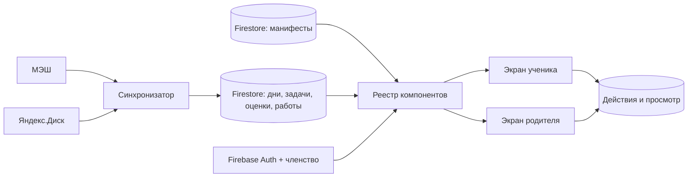

# Education: экраны из Firestore

Связанные контракты: [модель семьи](../families/README.md), [события и новое](../notifications/inbox.md), [local-first синхронизация](../../services/web-app/local-first-sync.md), [dashboard](../school-diary/dashboard.md), [страница дня](../school-diary/day-page.md). Карта: [спецификации](../../product/README.md).

<a id="implementation"></a>
## Состояние реализации

Типы манифеста, его проверка, подписка `watchScreenManifest` и ограниченный компонент `EducationScreen` подготовлены. На 10.10.2026 действующие маршруты дня и dashboard **не используют** `EducationScreen` и `watchScreenManifest`: их композиция ещё задана в компонентах `DayPage` и `DayDashboard`. Данные заданий, фото и проверок на этих маршрутах уже приходят из Firestore по подпискам. Публикация нового задания или результата не требует выпуска сайта; изменение набора и порядка секций через манифест пока не действует на этих маршрутах.

На 12.10.2026 действующие маршруты ещё **не** local-first: подписки идут напрямую к многим документам и коллекциям. Целевой протокол семейных каналов, ревизий и локальных IndexedDB-проекций описан [отдельно](../../services/web-app/local-first-sync.md#decision). До его внедрения эту страницу нельзя трактовать как свидетельство экономного чтения Firestore.

<a id="engine-invariant"></a>
## Инвариант движка

Education — клиентское приложение поверх модели конкретного ребёнка. Источники МЭШ, фотографии и документы сначала классифицируются, сверяются с оригиналом и получают устойчивые ID, ревизии и связи. Бинарные оригиналы и производные изображения живут на Яндекс.Диске; Firestore хранит ссылки, хэши, координаты фрагментов, метаданные, индекс, происхождение, задания, попытки, результаты и состояние учебной траектории. Каждый экран читает разрешённый срез этой модели через подписки и выбирает компоненты из конечного реестра. Новая дата, урок, лист, вопрос, фото, разбор или персональный ориентир публикуются как данные. Выпуск кода нужен только для нового типа компонента или изменения поведения самого движка.

Персонализация вычисляется для `familyId` и `childId` из проверенных попыток, ошибок, помощи, целей и давности проверки; исходное условие учителя и оригинал файла остаются неизменными. Отдельный представленный ребёнку ориентир хранит ссылку на навык, свидетельства, ревизию источника и собственную ревизию. Родитель и ребёнок читают одни учебные факты, но видят разрешённые своей ролью действия. UI не содержит имён, дат, номеров упражнений, путей к файлам или учебного маршрута конкретной семьи. Повторное использование означает один селектор состояния и один компонент для одинаковой сущности; различаются только данные и разрешённые действия.

Текущий путь `dayPages` ещё переходный: план и `support` по номеру находятся в ролевом документе дня, а не в нормализованных детских коллекциях v2. `DayPage` и `WeekendMathSlot` пока отдельно задают крупную компоновку. Нельзя описывать наличие манифеста и типов как завершённую миграцию. Следующий этап — перенести дни, задачи, доказательства и персональные представления в дочерние документы v2, сверить связи и затем подключить действующие маршруты к манифесту без потери старых работ.

<a id="legacy-evidence"></a>
## Общие факты на переходных экранах

`useDayEvidence` подписывает оба экрана на один набор токенов дня, фото и разборов. Он считает поток готовым только после первого снимка **обеих** коллекций и отбрасывает снимок прежнего набора токенов при переключении дня. `ProblemGroup` выводит сводку листа, а `ProblemTaskCard` — условие, разбор и кнопку фотографии для одного номера; экран передаёт ему галерею и действие загрузки. `WeekendMathSlot` берёт описание листа и названия предметов из документа дня; конкретный порядок номеров или совет для отдельного ребёнка не записывается в JSX. Новое состояние приходит через Firestore, без пересборки сайта.

<a id="manifest"></a>
## Манифест экрана

`families/{familyId}/ui/{viewId}` задаёт `schemaVersion`, `revision`, `audience`, порядок разделов, их видимость, подписи и ссылки на данные. Примеры `viewId`: `student-home`, `parent-home`, `student-day`, `parent-day`. У семьи могут быть общие настройки; содержание каждого ребёнка подставляется по `childId` из разрешённого контекста.

Для `parent-home` согласован порядок блоков: предупреждение о недостающих семейных книгах (если есть) → раскрывающийся список доступных детей с ближайшими делами → отдельные карточки семьи и доступа → компактная библиотека при полном комплекте. Нажатие на ребёнка открывает его текущий родительский календарь. [Состав и ограничения](../families/README.md#parent-home). Роль определяет разрешённые действия, а не только подписи: ученик не получает блок приглашений и членов семьи. `ParentHome` подключён через личный вход взрослого и опубликован на сайте; он пока читает переходные `dayDashboards`/`dayPages`. Манифест `families/.../ui/parent-home` ещё не управляет этой композицией.

Манифест **не хранит исполняемый код, HTML, CSS или произвольные Firestore-пути**. Блок ссылается на типизированный источник вроде `nearest-homework`, `week-days`, `recent-grades`, `pending-reviews`, `day-schedule`, `day-homework`. Клиент знает только конечный реестр компонентов и источников. Неизвестный `schemaVersion` или тип блока приводит к явному сообщению об обновлении, а не к молчаливой подмене или выполнению содержимого.



```json
{
  "schemaVersion": 1,
  "revision": 7,
  "audience": "student",
  "blocks": [
    { "id": "next-homework", "type": "homework-focus", "source": "nearest-homework", "title": "Что сделать к следующему уроку" },
    { "id": "days", "type": "day-strip", "source": "week-days", "title": "Дни" },
    { "id": "grades", "type": "grade-summary", "source": "recent-grades", "title": "Оценки" }
  ]
}
```

<a id="rendering"></a>
## Граница клиента

Код клиента определяет доступные элементы управления, ридер страниц, загрузку фото и прохождение тестов. Firestore определяет **какие** блоки показать, их порядок, допустимые настройки и конкретные учебные данные. Компоненты не содержат дат, имён, заданий или оценок конкретного ребёнка. Любой блок отображает загрузку, отсутствие источника и устаревшие данные явно. Различие ролей проверяется и при чтении манифеста, и в правилах доступа к исходным документам.

Для нумерованного листа учителя клиентский компонент [адаптивной карточки](../reviews/adaptive-problem-card.md) неизменен, а точный текст номера, ссылка на оригинал и уровень начальной помощи приходят как данные конкретного ребёнка. Новый разбор или исправление меняет педагогический слой через Firestore, без перевыпуска сайта. Оригинал не переписывается по траектории ученика.

Два экрана одного дня читают одни `days`, `tasks`, `submissions` и `grades`. Родительский манифест добавляет сведения о проверке и источниках, ученический — ближайшее действие. Подготовленный агентом текст у задания хранится вместе с `sourceRevision` и ссылкой на учебник; при изменении условия прежний разбор помечается требующим сверки. Сейчас `DayPage` ещё не подключён к этому манифесту: внутри карточки проверенный `cardPattern` и закрытый `parentGuide` уже выбирают общую конфигурацию маршрута из Firestore, а порядок крупных секций дня пока задан JSX. Это граница реализованного конструктора.

<a id="navigation"></a>
## Переходы

Пользователь выбирает день на dashboard и открывает существующий вид страницы дня для этого `childId` и даты. Кнопка «Назад» возвращает к dashboard, сохраняя выбранный день. Тесты и фото открываются из карточек заданий; их прогресс и статусы приходят из отдельных документов. Отсутствие подробного разбора не блокирует точный исходный текст МЭШ.

<a id="configuration"></a>
## Что настраивается

Можно менять состав и порядок известных блоков, названия, границы ленты, порог мягкого предупреждения об оценке, правила видимости и акцент родительского/ученического экранов. Изменения манифеста — серверная публикация с ревизией и историей. Нельзя настройкой обойти права, подставить чужой `childId` или скрыть обязательное указание, что ДЗ ещё не опубликовано.
