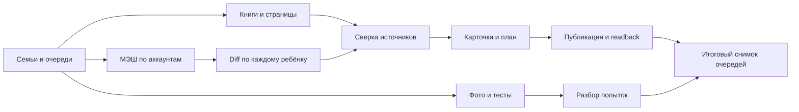

# Глобальная синхронизация Education {#global-sync}

Статус: **действующий целевой контракт; реализация по фазам**. Единственная пользовательская команда — просьба агенту «Запусти education-sync». Она относится ко **всем** активным семьям, детям, подключённым источникам и очередям проекта. Внутренние задания имеют контекст `(familyId, childId, sourceAccountId)`; пользователь не выбирает одного ребёнка для полного запуска. Стадии и повторное использование — в [графе общих артефактов](shared-artifact-pipeline.md#stages). Общие правила выпуска — [сквозной протокол](education-pipeline.md), изоляция — [семейная модель](../families/README.md#collections), команды — [операторская карта](petr-private:skills/education-sync/references/operator-runbook.md).

## Инвентаризация и очередь {#inventory}

Повторяемые механические шаги вызываются через [единое операторское ядро](../../services/operator-cli/README.md#operation-contract): `npm run education -- catalog` показывает допустимые операции, `status` снимает адресный обзор без записи, `discover --apply` сканирует очередь и инвентарь, `finalize --apply` повторно сверяет inbox и очередь. Вход для отдельной операции — типизированный JSON, результат — закрытая квитанция с временем и счётчиками. Это не заменяет предметное решение по новому заданию МЭШ и не завершает цикл при наличии исполнимых задач. Закрытие фазы `complete` пока остаётся в предметной команде после её собственной проверки обеих ролей.

Сбор `sync:project` использует [общее серверное ядро](../../shared/server-runtime.md): единый `@google-cloud/firestore` factory с явным project ID и проверкой локального/ambient ADC, полный paginated family graph, строгие family/child/account/identity predicates, свежую child-scoped Mesh session и общую телеметрию. `scripts/lib/admin-firebase.mjs` оставляет совместимый интерфейс старым вызывающим сторонам. Сбой чтения одной семьи остаётся отдельным partial failure: другие семьи могут продолжить работу, но результат не считается полным. Это инфраструктурное переиспользование в исходниках; оно не завершает общий учебный цикл и не подтверждает публикацию.

1. Прочитать активные `families/*/children/*`, `sourceAccounts`, `sourceIdentities`, локальные `.local/mesh-connections/*` и первый закрытый профиль. Сопоставить аккаунты с семьями и детьми через ID МЭШ, точную source registry пару, actor hash и действующее родительское членство, а не имена. Один ребёнок с двумя взрослыми — одна учебная работа с детерминированно выбранным действующим аккаунтом; второй источник служит резервом после отдельной проверки.
2. Снять `sync:inbox` по всем семьям, обнаружить незавершённые `.local/pending-*.json`, книги и страницы. Каждый начальный ID попадает в журнал даже при отсутствии МЭШ-доступа.
3. Создать закрытый `runId` и задачи с устойчивыми ключами `kind:familyId:childId:sourceId:date:revision`. Повторный запуск сверяет отпечаток входа и прежний результат; прежние фото, тесты и решения не удаляются. Недоступный аккаунт получает явное `blocked: auth-required`.

## Граф и параллельность {#dag}

### Закрытая очередь исполнителя

`npm run sync:queue -- scan` читает живые Firestore-источники **всех** семей: передачи PDF и фото, ожидающие фото и открытые ответы тестов, обращения за помощью, задания с `needs-review`, отсутствующие материалы и устные задания без назначенной самопроверки. Он записывает устойчивые `operatorSyncJobs/{sha256(kind,family,child,source)}`. Клиентский доступ к коллекции запрещён правилами; там нет МЭШ-токенов, ответов, текста работ и секретных ссылок. Ключ ревизии меняется только при значимом изменении источника, поэтому повторный `scan` не открывает завершённую работу заново. `sync:project collect` дополнительно ставит `reconcile-day` для каждого изменённого или ещё не опубликованного дня. Если весь горизонт проверен, изменений нет и текущий индекс Firestore совпадает со снимком, ветка МЭШ сразу получает `complete`, без пустой ручной фазы. История `done` сохраняется для аудита, активная очередь её не показывает.

Для `dayHelp` оператор теперь хранит локальный снимок минимальных полей в `.local/project-sync/help-requests.json` (без текста обращения). Правила Firestore требуют `requestedAt == request.time` и запрещают удаление, поэтому повторный проход читает записи начиная с последнего серверного времени включительно; записи на границе времени сверяются повторно. Первый проход, повреждённый кеш и проход после 24 часов читают источник полностью. Результат очереди при первом и повторном проходе должен совпадать; `scanned.helpDocumentsFetched` показывает число доставленных документов именно этого источника. Другие источники `sync-inbox` пока обходятся полностью. Локальный файл — производная проекция: его удаление не удаляет заданий и не требует миграции Firestore.

Сканер также ставит `classify-assignment` для неподтверждённой подготовки к контрольной и `prepare-quiz` для подтверждённого `assessmentIntent` или прежнего проверенного `kind: read`. После отправки диагностики контрольной и завершения ручной проверки всех длинных ответов появляется `prepare-control-followup`; частичная запись `reviews` не закрывает `review-quiz`. [Граф тестов](../assessments/assessment-decision-graph.md#decision-graph) описывает решение, содержание и границы автоматики.

Оператор берёт ID через `sync:queue claim --id ID --phase source-review`, публикует промежуточную фазу через `advance`, а `finish --evidence REF` допускает только после проверки конкретного результата в Firebase. `block --reason CODE` оставляет задачу видимой с причиной, если не хватает источника или решения семьи. Сканер сам закрывает фото/тест/страницы лишь после обнаружения опубликованного результата, а поздние запросы помощи закрывает только при последующей подтверждённой работе по тому же заданию. Отсутствие входа в `sync:inbox` из-за ошибки чтения не считается завершением.

**Один запуск навыка — цикл:** `scan → взять все исполнимые ID → выполнять и обновлять фазу → проверить результат → scan снова`. Продолжай, пока повторный снимок не обнаружит новых исполнимых ID; оставшиеся `blocked` перечисли с точной причиной и условием возобновления. Фаза МЭШ `complete` не скрывает незакрытую очередь. Адресный `syncStatus/current.queue` обновляется при каждом проходе и переходе задачи для оператора; в родительском и ученическом интерфейсе технические типы, числа и причины остановки очереди не показываются. Вложенная карта `queue` при публикации заменяется целиком, чтобы завершённый тип работы исчезал из операторского снимка. Постоянного фонового процесса или автоматической педагогической оценки без оператора это не создаёт.

Независимые ветки книг, МЭШ и очередей можно вести одновременно. Разные аккаунты МЭШ исполняются с ограниченным параллелизмом; дети **одного аккаунта** идут последовательно, чтобы обновление токена не перезаписало его другой задачей. Источник → план → публикация одного ребёнка сохраняют порядок. Пока общий реестр страниц и выпуск новых семей не прошли проверку конкурентной записи, публикацию дней сериализуем. Перед записью сверяются исходный снимок и владельцы; контроль ревизии перед одновременной публикацией остаётся открытой задачей. При `429`, `Retry-After`, неполном снимке или квоте ветка останавливается с причиной и продолжением, остальные независимые ветки продолжаются.

## Видимый статус {#status}

Адресный документ `families/{familyId}/children/{childId}/syncStatus/current` хранит служебные сведения: `runId`, фазу `queued | fetching | awaiting-review | enriching | publishing | verifying | complete | blocked`, число проверенных/ожидающих дат, `updatedAt`, причину остановки и время последнего **полного** снимка. `awaiting-review` означает, что источник загружен, но агент ещё не начал смысловую сверку. Документ не содержит токен, МЭШ-ответ, ответ на задачу или данные другой семьи. Это операторский статус; `ParentHome` и `DayPage` на него не подписываются и не показывают блок с очередью или общей фазой. Готовность дня определяется опубликованными заданиями, фото, тестами и решениями семьи; время последней сверки МЭШ уже указано в карточке ребёнка. Конкретное действие пользователя показывается у соответствующего задания, а технический долг оператора не меняет его статус. Новые данные ДЗ и уведомления приходят без выпуска PWA. `complete` допустим только после итогового чтения опубликованных ролевых данных и сверки очереди. Истечение времени само по себе не закрывает ветку.

## Итог и границы {#report}

Глобальный отчёт начинается с табличного охвата **всех** семей, детей и аккаунтов: найдено, источник проверен, полностью актуализировано, заблокировано. Следом идут отдельные таблицы изменений источника, обработки и подтверждённых публикаций по назначениям, затем конечная очередь. «Актуализировано» означает опубликованный и перечитанный результат для всех изменённых данных семьи; `collect` подтверждает только чтение источника. Подробный [формат отчёта](petr-private:skills/education-sync/references/run-report.md) задаёт уникальные единицы счёта и обозначение неизвестного. `partially-complete` обязателен, если хотя бы одна семья осталась `blocked` или не прошла проверку. Журнал содержит точные ID и ревизии локально, чтобы повторить только незакрытые работы.

**Текущая граница:** `sync:inbox` и `sync:books` глобальны; `sync:project plan/collect` обнаруживает всех детей, ограниченно параллелит МЭШ по аккаунтам, хранит полные снимки отдельно и пишет безопасный статус. Правило чтения статуса и экран опубликованы 12.10. `day build/publish` принимает отдельный `EDUCATION_CHILD_WORKSPACE` с `context.json`, но новое подключение ещё требует проверенных `day-source`, семейного плана страниц и среза оценок; автоматическое смысловое наполнение этих артефактов не реализовано. Проверка нового семейного выпуска end-to-end ещё не проведена. Поэтому сбор источников не равен готовому ДЗ: после `awaiting-review` агент обязан отдельно сверить и опубликовать каждый день, а до успешного readback общий запуск остаётся частичным. Старый `diary/cli.mjs` остаётся диагностическим путём первого профиля; глобальный запуск не должен пользоваться им для другой семьи. Автоматический поиск точного решения и педагогическая проверка нового задания также остаются работой агента.

Credentials общие для sync и worker: token refresh записывает только token fields атомарно с правами `0600`, а доступ к одному account удерживается общей межпроцессной advisory lock через Python3/fcntl на этом macOS/Linux хосте. Lock работает только на одном хосте; deployment не должен копировать credential store в отдельную независимую директорию процесса. Исторический `.local/diary` принимается только через explicit legacy codec, если подтверждены `family-access.legacyDayOwner`, actor hash и точный source registry account; при отсутствующем/повреждённом registry или несовпадении владельца legacy fallback закрыт. Синхронизатор сохраняет свою прежнюю cache policy: успешные date-independent `getProfile` и `getMarks` переиспользуются только внутри одного child/run; календарные и предметные вызовы остаются полными.

## Повторная сверка и выпуск {#reconciliation}

Внутри одного сбора одного ребёнка `sync/run-context.mjs` повторно использует только независимые от даты `getProfile` и полный `getMarks`. На 42 даты приходится по одному успешному запросу каждого метода; ошибочный запрос не кэшируется. Новый ребёнок или новый запуск получает отдельный адаптер и свежий кэш. Расписание, назначения и подробности уроков проходят прежний полный обход. Метрики различают реальные вызовы и `getProfileReused/getMarksReused`; комментарии оценок и сами снимки не сокращаются.

Каждый `sync:project collect` начинает календарный обход с **понедельника текущей недели по Москве** и проверяет 42 последовательных дня, включая выходные и недели без уроков. Пустая неделя не завершает поиск: она может быть каникулами или ещё не заполненным расписанием. Это ограниченное шестинедельное окно, а не обещание проверить весь учебный год. Фактические `checkedFrom`, `checkedThrough` и `checkedDates` сохраняются для каждого ребёнка; при неполном ответе МЭШ запуск блокируется, сохраняя последний полный снимок.

Внутри дня подробные карточки уроков МЭШ читаются с пределом три одновременных запроса, результат складывается в исходном порядке расписания. Ошибка хотя бы одной карточки по-прежнему делает снимок неполным: прежние метаданные сохраняются для диагностики, но не доказывают удаление ДЗ. Манифест запуска хранит монотонное время стадий и число вызовов адаптера; вложенные интервалы не складываются. SDK-счётчики очереди и аудита не приравниваются к оплачиваемым чтениям Firestore. [Замер и дальнейшие рубежи](../../audits/education-sync-latency-audit-2026-10-15.md).

Для каждого полного снимка вычисляется устойчивая ревизия расписания и заданий дня без времени скачивания и общих оценок. `day dashboard` и `day publish` сохраняют эту ревизию в семейном индексе Firestore. После сбора `pendingPublicationDates` сравнивает текущую ревизию, расписание, текст ДЗ и наличие страницы задания с **последней опубликованной** проекцией обеих ролей. Поэтому повторное скачивание без изменений не снимает уже обнаруженный долг по публикации. Старая публикация без ревизии помечается ожидающей сверки до нового проверенного выпуска. Даже если `changedDates` равно нулю, непустой `pendingPublicationDates` требует пересборки/сверки соответствующих дней; `collect` сам не выполняет педагогическое обогащение и не выдаёт их за готовые.

Точная запись МЭШ «Смотри задание на четверг» в уроке пятницы остаётся видимой в календаре, но ведёт к уже опубликованной карточке четверга того же предмета. Она не создаёт второе задание и не требует повторной загрузки работы; связь допускается только при наличии совпадающего задания и страницы исходного дня.

Журнал `sync:project collect` перечисляет `changedDates` для нового изменения источника и `pendingPublicationDates` для реально не доведённых до Firebase дней. Изменения оценок за период учитываются отдельно. Для каждого ожидающего дня нужно сверить исходник, обновить план и связанные материалы, затем выпустить ролевые страницы и индекс и прочитать их обратно. Если изменились несколько уже связанных планов, используй атомарный `day publish-batch`, сохраняя проверку всех отпечатков. Новость о выпуске интерфейса не заменяет уведомление о новом ДЗ.

Сверка публикации также сравнивает полный срез оценок МЭШ с двумя ролевыми страницами, которые читает блок оценок. Отстающая лента или средний добавляют `grade-projection-stale` к ожидающему дню даже при нуле изменений расписания. Для неизменившихся дней операторский сбор самостоятельно продвигает только время полной проверки в ролевых календарях с условием версии записи и обратным чтением; он не объявляет новое ДЗ опубликованным и не переносит неподтверждённые оценки в интерфейс.

Перевод адресной фазы в `complete` повторно сравнивает все даты окна с опубликованным индексом Firestore и отказывает, если `pendingPublicationDates` не пуст. Флаги оператора о readback и конечной очереди остаются отдельными обязательными условиями.
