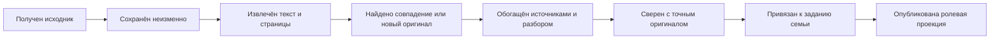

# Общие артефакты и семейные связи Education {#shared-artifacts}

Статус: **контракт по стадиям; первый этап сохранения исходников реализован, общий реестр разборов ещё не подключён**. Этот документ дополняет [глобальный запуск](global-sync.md), [семейную библиотеку](../materials/family-library.md) и [доступ к файлам](../families/family-artifact-access.md). Один запуск обходит все семьи, но его содержательная работа адресуется отдельным источникам и артефактам, а не копирует готовый разбор в каждую семью.

## Границы данных {#boundaries}

| Слой | Что хранит | Где | Переиспользование |
| --- | --- | --- | --- |
| Исходник семьи | Полный ответ МЭШ, назначение, оценки, оригинал работы ребёнка, сведения о владельце | Закрытый локальный журнал и приватный объект Диска; семейные метаданные Firestore | Содержимое не становится общей записью автоматически. Старые версии сохраняются. |
| Общий оригинал | PDF учебника, страница, лист учителя или иной документ после проверки байтов | `storedObjects/{sha256}` и `materialBooks` в закрытом Firestore; один проверенный файл и производные изображения на Яндекс.Диске | Точные байты дедублицируются по SHA-256. Другое сканирование того же издания связывается только после сверки содержания. |
| Общий учебный артефакт | Точное условие с рисунком, найденный первоисточник/ключ, предметно верный разбор и эталонный путь решения **без сведений об ученике** | Целевой закрытый `sharedLearningArtifacts/{artifactId}` с неизменяемыми ревизиями; большие производные файлы на Диске | Один подтверждённый артефакт может служить источником для нескольких заданий при доказанном совпадении оригинала и контекста. Он не доступен браузеру напрямую. |
| Связь с семьёй | Какая семья загрузила издание, какое задание назначено, какой артефакт к нему подходит, степень совпадения и семейные правила | `families/{familyId}/children/{childId}/books`, страницы и целевые связи задания | Семья видит только собственный срез. Совпадение в общем каталоге само по себе не выдаёт доступ. |
| Личный учебный слой ребёнка | Его цель, траектория, прежние ошибки, самостоятельность, порядок помощи, сформулированные для него подсказки и адресные решения взрослого | Закрытые документы ребёнка и ролевые проекции Firestore | Вычисляется из общего содержания и **его** истории. Не переносится другому ребёнку, даже в том же классе. |
| Персональный результат | Фото, попытка, оценка, проверка ребёнка и история полученной помощи | Закрытые семейные и ролевые документы Firestore | Не дедублицируется как учебный ответ другого ребёнка. |

Слово «общий» означает единое служебное хранилище и повторное использование **после проверки**, а не публичный доступ всех семей. **Критерий допуска:** значение общего артефакта не должно измениться, если заменить ребёнка, его семью, оценки, попытки и траекторию при том же точном учебном оригинале. Если изменится — поле относится к семейной связи или личному учебному слою. МЭШ-снимок и работа ребёнка могут содержать личные сведения; из них извлекаются кандидаты учебного содержания, но сами они не становятся общими артефактами. Модель данных не должна допускать чтения общего каталога из браузера.

## Стадии одного артефакта {#stages}

1. **Получение.** Сборщик фиксирует поставщика, время, семейный контекст, исходный ID и полный ответ или байты. Ошибка либо неполный ответ создаёт отдельную попытку; прежний полный артефакт не перезаписывается.
2. **Неизменяемый захват.** Хэш вычисляется по каноническому содержимому без времени загрузки. Каждая ревизия исходника сохраняется по хэшу, а каждый запуск записывает отдельное наблюдение. Реализовано для полных снимков МЭШ в закрытой `.local/project-sync/private-captures/` через `sync/artifact-capture.mjs`; для PDF уже действуют `storedObjects` и архив Диска.
3. **Извлечение.** PDF разбивается на все страницы, OCR и текст получают ссылку на оригинальный PDF и номер страницы; вложение учителя сохраняет хэш и координаты. OCR не считается доказательством текста без визуальной сверки. Производные файлы живут на Диске, поисковые метаданные — в Firestore.
4. **Сопоставление.** Равный SHA-256 означает равные байты. Похожий текст или другой скан — только кандидат: сравниваются издание, печатная и PDF-страница, рисунок, формулировка и учебный год. URL найденного решения сам по себе не доказывает совпадение. Нельзя слить задачи с разными рисунками или условиями из-за общего номера.
5. **Обогащение.** К общему кандидату добавляются прямые ссылки и снимки найденных источников, точный ключ, предметный тип задания, независимый от личности структурный разбор и версия предметных правил. Каждое поле имеет источник, степень совпадения, время проверки и хэш входа. Вывод модели помечается производным; он не заменяет оригинал. История ошибок ребёнка, его уровень помощи и персональный текст подсказки сюда не входят.
6. **Проверка.** Новый разбор допускается к переиспользованию только после сверки с точным оригиналом, семейно назначенным изданием и применимыми критериями. Изменение входа или правил делает прежнюю ревизию требующей повторной сверки, не удаляя историю.
7. **Привязка.** Адресная связь содержит `familyId`, `childId`, урок, `taskId`, ревизию задания, `artifactId`, ревизию артефакта и доказательство совпадения. Сначала подтверждается собственная загрузка семейной книги; общий архив не назначает книгу семье автоматически. Семейное требование учителя и опциональность остаются в этом слое.
8. **Персонализация и проекция.** После адресной связи общий разбор сопоставляется только с попытками, траекторией и правилами помощи данного ребёнка. Так определяются его текущий шаг, доказанное расхождение, уровень и текст подсказки. Из этого строятся ученическая карточка без закрытого ответа и родительский разбор с адресной помощью; затем выполняется readback обеих ролей. Ошибка на любом этапе оставляет прежнюю опубликованную карточку и адресный статус ожидания или остановки.

## Идентификаторы и повторный запуск {#identity}

Физический файл: SHA-256 байтов. Исходный снимок: SHA-256 канонического полного содержимого. Общая учебная сущность: тип + точный оригинал/издание + локатор страницы или листа + отпечаток условия **с рисунком**; семейный ID не входит в этот ключ. Ревизия разбора: хэш входного артефакта, набора источников, версии предметного правила и проверенного результата. Адресная связь с семьёй имеет отдельный ID. Равный вход и версия повторно используют результат; новый вход порождает новую ревизию. Исполнитель сохраняет стадии и хэши до перехода дальше; `complete` требует адресного readback, а не только успешной записи.

## Постоянный журнал следующей реализации {#journal}

Следующий этап должен хранить **отдельные** документы, а не один изменяемый JSON с готовой семейной карточкой:

| Запись | Устойчивый ключ и обязательные поля | Где хранится |
| --- | --- | --- |
| Событие получения | `sourceAccountId / sourceRecordId / fetchedAt / contentSha256 / familyId / childId / state` | Закрытый журнал запуска; в Firestore только безопасный адресный статус |
| Исходные байты и производные | `sha256 / mediaType / storageRef / parentSha256 / extractorVersion / pageNumber / extractionStatus` | Закрытый файл Яндекс.Диска; индекс и ссылки — в операторском Firestore |
| Кандидат общей учебной сущности | `candidateId / subject / originRef / edition / locator / textHash / figureHash / matchEvidence / state` | Закрытый общий индекс Firestore; OCR и найденный URL сами не дают `verified` |
| Ревизия общего разбора | `artifactId / revisionHash / inputHashes / sourceRefs / methodVersion / canonicalGuide / verification / state`; без `familyId`, `childId`, попыток и подсказок | Закрытый `sharedLearningArtifacts/{artifactId}/revisions/{revisionHash}`; большие изображения и снимки источников — на Диске |
| Семейная связь | `familyId / childId / lessonId / taskId / assignmentRevision / artifactId / revisionHash / bindingEvidence / state` | Закрытый семейный документ Firestore; видимая карточка — отдельная ролевая проекция |
| Личный учебный контекст и помощь | `childId / taskId / trajectoryRevision / attemptRefs / firstConfirmedGap / hintLevel / hintText / parentDecision / state` | Закрытые документы ребёнка и ролевые проекции Firestore; каждая помощь имеет свою историю |

У каждого этапа есть `queued → processing → verified` либо `blocked` с кодом причины, временем и ссылкой на входную ревизию. Ключ работы включает вид этапа и хэш входа. Повторный запуск читает его прежде записи: `verified` с тем же хэшем переиспользуется; `blocked` возобновляется после устранения причины; изменённый вход получает новую ревизию. Публикация дневной карточки не стирает исходную запись, промежуточные файлы и прежний разбор. При ошибке Яндекс.Диска или Firestore прежняя проверенная проекция остаётся доступной, а адресный статус показывает, что именно ждёт повторения.

Поиск по общему каталогу разрешён операторскому процессу только после того, как он проверил собственные материалы семьи. Если совпавшая книга уже есть, новая загрузка семьи добавляет её доказательство владения и связь с существующим `bookId`; если совпало задание, новое назначение получает ссылку на уже проверенную ревизию разбора. Семейные правила, требования учителя и опциональность добавляются при адресной связи. Попытки, траектория и подсказки добавляются **после** неё в личном слое и не меняют общую ревизию для остальных семей. Дети одного класса могут разделять `artifactId`, но никогда не разделяют `hintText`, `firstConfirmedGap` или историю помощи.

## Что уже работает и что ещё требуется {#implementation}

Работают: архив оригиналов учебников на Диске, `storedObjects`, общий `materialBooks` с постраничным индексом, семейные `books`/`bookPages`, барьер семейного издания и теперь неизменяемый закрытый захват полных МЭШ-снимков. `day/family-source-graph.mjs` строит семейный граф при выпуске, но часть найденных онлайн-источников пока хранится в конкретном `day-source`, а разбор — в конкретном родительском документе.

Следующая реализация: закрытый реестр `sharedLearningArtifacts` с неизменяемыми ревизиями, перенос проверенных `sourcePacks` и предметных разборов в него, адресные связи заданий и автоматическая проверка устаревших ревизий. Пока этот слой не подключён, нельзя утверждать, что все разборы дедублицируются или что глобальный `education-sync` полностью обогащает новые семьи.
