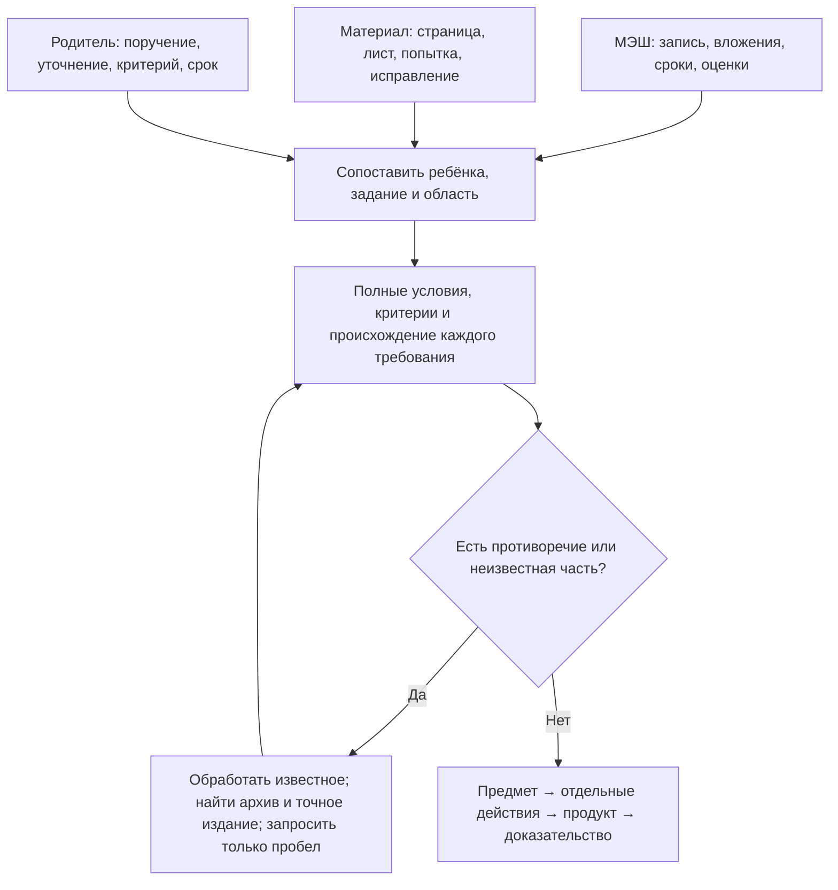
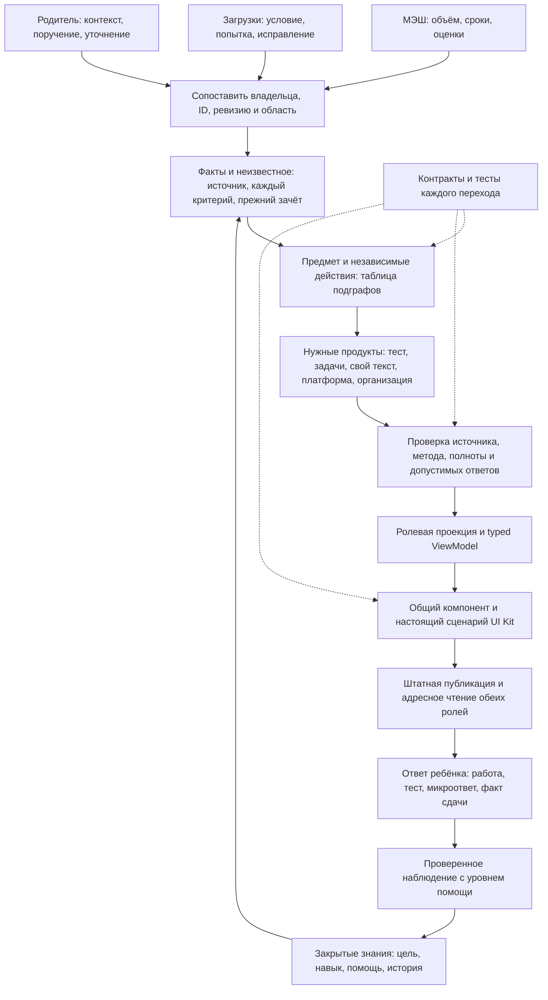

# Сквозной предметный граф Education

## Входы и объединение {#inputs}

Этот граф уточняет предметные решения; [жизненный цикл](task-routing.md#learning-lifecycle)
остаётся общей инфраструктурой, а не его заменой. Основание — независимый аудит
всей доступной сессии18.10–16.11:304хода,40требований с первичными message IDs.
Личные цитаты и случаи хранятся отдельно, в закрытом evidence pack.

Три равноправных начала: запись МЭШ; загруженный материал; прямой контекст родителя.
Для каждого сохраняются ребёнок, дата, роль источника, ссылка/ID, ревизия, область
применимости и степень подтверждения. Родитель может добавить отдельную семейную
практику и уточнить срок/требование; это не выдуманная цитата учителя.
Загрузка классифицируется как условие/учебник/работа/исправление/результат платформы;
получение условия не считается выполнением работы. Уточнение родителя перечитывает
затронутые условия, критерии и прежний результат, сохраняя историю и верное.

МЭШ определяет школьный объём; назначенное упражнение раскрывает содержание.
Семейная дополнительная практика отмечается отдельно. Смешанное назначение даёт
несколько независимых действий с общей исходной записью; неизвестная устная часть
не должна задерживать готовую письменную после явного разделения и сверки
источника каждой части. Общая materialStatus не доказывает, какая часть готова. Противоречие не разрешается молча.

## Предметные подграфы {#subjects}

Исполняемый реестр `subjectDecisionProfiles` хранит для каждой ветви условие,
необходимый продукт и критерии. `subjectDecisionPlan` выбирает предмет и несколько
действий из уже известного вида/явных признаков; это план проверки, не разрешение
придумывать условия по словам. `taskRoute.subjectPlan` и `eventTaskRoute.subjectPlan`
включают его в существующие планы; настоящую смысловую классификацию выполняет агент.

| Предмет | Развилки, которые нельзя смешивать |
|---|---|
| Математика | упражнение/геометрия → точные номера и метод; теория/повторение → тест; контрольная → диагностика по навыкам; выполненная попытка → проверка каждого перехода |
| Спецкурс/практикум | файл → все исходные номера/crops, варианты и optional, полный родительский путь; повторение → тест; сдача тетради → отдельное организационное действие |
| Русский | правило → тест; упражнение → точное действие; анализ/план → опора на текст; сочинение → собственный замысел/жанр; изложение → воспроизведение исходника; контрольная → структура назначенных примеров и открытые ответы |
| Литература | чтение → тест ровно по главам; пересказ → понимание и отдельное устное действие; стихотворение → смысл и декламация отдельно; письменный ответ → позиция/текстовое основание/связь |
| Английский | учебник и тетрадь → раздельные упражнения; письмо/перевод → коммуникативная задача и все содержательные критерии; слова → написание всего назначенного списка; reading/listening/speaking → разные свидетельства |
| История | тема/повторение → факты, хронология и причины; документ → происхождение/тезис/доказательство; точное поздравление → информационное сообщение |
| География | текст → понятия/причины/применение; карта → условные знаки/наблюдение/вывод; таблица → извлечение данных по источнику |
| Биология | тема → понятия и применение; структура/функция → проверяемые связи; классификация → признак и основания; выписка → только назначенные сведения |
| Информатика | код → трассировка/условия/циклы/границы/debugging и конечная проверка; теория → тест; внешняя платформа → собственный факт выполнения, без подмены тестом Education |
| Труд/технология | программирование выбирается по содержанию и идёт в информатику; изделие/проект → требования/план/процесс/свой результат; инструкция → понимание, но тест не доказывает изготовление |
| Другой предмет | точный источник и требуемое действие; не приписывать неизвестный эталон, устный/практический навык не подтверждать одним тестом |

Для каждого предмета дополнительно действуют общие ветви: отсутствие ДЗ,
организационное действие, ЦДЗ, смешанная работа, предыдущий урок, контрольная,
частично известный источник и новое уточнение родителя. Предметное название не
превращает всякую работу в математическую и не отменяет обязательного теста по устному.

## Продукты и барьеры {#products}

Каждая ветвь заканчивается проверяемым продуктом: тест с покрытием темы;
отдельные задачи с полными условиями/рисунками и закрытым разбором; свой текст
с критериями; проверенный платформенный результат; организационное напоминание.
Один PDF, название адаптера, `reviewed` или операторский done не заменяют продукт.
Требование → источник → критерий → место работы → вывод → следующий шаг должны
сходиться для каждого пункта. Содержательный national/жанр/единицы не перекрываются
правильной грамматикой, ответом или аккуратным оформлением.

Родитель получает метод, модель, полноту и допустимые решения; ребёнок — текущую
опору и один вопрос без закрытого ответа. Новая версия подсказки не новая попытка.
Прежние зачёты, исходные номера, optional, фото и семейные решения сохраняются.
Для «повторить прошлый урок» архив сначала восстанавливается самим агентом;
новая самопроверка не требует повторной сдачи старой письменной работы.

## Разные графы и владельцы {#graphs}

Это связующая карта действующих правил, а не новая копия всех правил в одном switch.
У каждого узла остаётся свой владелец:

| Граф | Что действительно представляет | Исполнитель и граница |
|---|---|---|
| [Спецификации](../../shared/specification-system.md#граф) | Контракты → файлы → проверки | `spec-graph.mjs`; не читает работу ребёнка и не доказывает её правильность |
| [Семейные источники](../materials/family-library.md#source-graph) | Ребёнок → назначение → издание/страница/файл/метод | `day/family-source-graph.mjs`, вызываемый publisher; связь с изданием не означает прочитанное условие |
| Предметные решения | Предмет + действие + точный ожидаемый результат → продукт | `subjectDecisionPlan`, `quizDecision`, `repetitionDecision`, `cardAdapter`; содержательное решение выполняет проверяющий |
| [Текущий учебный шаг](../reviews/subject-aware-guidance.md#tutor-decision) | Попытка → наблюдаемый пробел → помощь → микроответ | `storage/tutoring-decision.mjs`; не диагноз способности по отметке |
| Закрытая история знаний | Попытка → свидетельство навыка → гипотеза → траектория/цель | Семейный evidence graph; общий runtime не получает его автоматически. Без переданных адресных фактов состояние неизвестно |

## Исполняемая трасса и границы подтверждения {#trace}

`sync/decision-evidence.mjs` строит **закрытый производный индекс** внутри существующего
`taskRoute`/`eventTaskRoute`: `facts`, `unknown`, `decisions`, `expectedProducts` и
`knowledgeUpdate`. В event artifact он входит в существующий fingerprint; отдельной
коллекции, подписки и скрытого сетевого обхода нет. Ссылки на original, previousReview,
parentGuide, releasedGuidance и answerKey указывают на уже прочитанный пакет.
Сам закрытый текст не копируется в трассу или публичную страницу.

Каждое действие получает устойчивый ID, ruleId, источники и ожидаемый продукт с
существующими publisher/consumer. Это **кандидаты**, пока агент не подтвердил область
каждого факта и семантические критерии. Наличие ссылки не подтверждает соответствие
материала этой части. `sourceState` сохраняется отдельно, `completionClaim` всегда
false; техническое построение индекса ничего не закрывает.

В событийном пакете `subjectProducts` описывает подготовку родительского задания,
а `expectedProducts` — результат **текущего события**. Запрос по номеру сохраняет
точный `taskId` и отдельный `parentTaskId`; помощь ожидает микроответ, а не новый
полный гид. Фото страницы ожидает sourceAnalysis и продолжение; submitted quiz —
адресную проверку попытки. Отсутствие дневного контекста теста явно unknown.
Существующий testToken сохраняется как existingProductRef: mixed-план сначала
перечитывает текущий тест и готовит только отсутствующие продукты.

Адресный контекст родителя передаётся через `decisionContext.parentRefs`; адресные
знания — `learnerFacts[{ref,scope,revision}]` в закрытом пакете. Если их не передали,
пишется явное unknown. В текущем capture нет автоматического чтения всей семейной
траектории, а штатный exporter ещё не предлагает универсальный ввод такого пакета.
Это открытая граница, а не обещание уже действующей автоматической персонализации.

Ожидаемый продукт требует: полный источник/критерии; предметный метод; настоящую
композицию потребителя в UI Kit; безопасную ученическую и закрытую родительскую
проекции; свежий readback обеих ролей. Единый автоматический pre-ack валидатор всех
этих квитанций пока отсутствует: применяются существующие адресные gates конкретных
CLI и проверка агента. Не закрывать содержательную подготовку квитанцией ingest PDF.

## Сквозные сценарии восстановления {#scenarios}

| Вход и критерий | Решение → продукт → потребитель | Подтверждение и оставшийся барьер |
|---|---|---|
| Учительский лист с необязательными номерами | `special.sheet` → исходные номера/рисунки и отдельные закрытые решения → `ProblemTaskCard`/`ParentTaskGuide` | `sourceInventory`, math-route, card-flow-certification; публикация самого файла недостаточна |
| Письмо о блюде своей страны | `english.production` → точное условие и отдельные содержательные/языковые критерии → `WorkReview` | `review-requirements`, requirementChecks; грамотность не перекрывает неверную тему |
| Упражнение письменно + правило устно | Два actionId → письменный маршрут + тест → `ParentTaskGuide` и `QuizCard` | Источник каждой части; известное готовится независимо после явного разделения |
| Чтение двух глав | `literature.reading` → тест ровно по назначенным главам → `QuizCard` | Quiz plan/coverage и readback; ссылка на тест не доказывает чтение |
| Повторить предыдущий урок | История того же ребёнка/предмета → новый тест по всем восстановленным частям | `lesson-repetition`; прежняя письменная работа не пересдаётся |
| Программирование под названием технологии | Содержание → `informatics.code` → трассировка и проверка границ → общий письменный разбор | Конечные примеры проверяются независимо; внешний результат платформы сохраняется |
| Изложение | `russian.retelling` → исходный текст/микротемы/собственное воспроизведение → общий маршрут | Не превращать в сочинение на похожую тему; жанр подтверждается исходником |
| Пришла запрошенная страница | sourceAnalysis → resolve request → replan → нужный тест/разбор | `upload-lifecycle`; полученная страница не считается выполненной работой |
| Ответ на один учебный вопрос | Опубликованная помощь + свой ответ → один переход → `ReviewConversation` | `help-response`, tutoring-decision; микроответ не закрывает всю работу |
| Контрольная/ДЗ/тетрадь перед сроком | `learningGate` + `deadlineDecision` → самостоятельная диагностика/архив/организационное действие | В существующем sync; готовое ДЗ, готовность и физическая сдача — разные факты |
| Карточка теста внутри карточки дня | ViewModel + role + headingProvided + optional + disclosure → настоящий `QuizCard` | Проверять композицию потребителя с production CSS; synthetic HTML не доказывает этот случай |

Эти строки — обязательная карта приёмки, а не заявление о проверке всех живых
заданий. Конкретные личные исходники, message IDs, фото, вердикты и квитанции остаются
в закрытом evidence pack. Исследовательское основание выбора помощи —
[разбор методов](../../research/learning-decision-evidence-2026-11-16.md).

## Сквозные ветви за пределами учебного продукта {#crosscutting}

| Вход или состояние | Действующий владелец решения | Связь с учебным контуром |
|---|---|---|
| Файл ещё не дошёл или сохранился локально | [Материалы и хранение](../materials/storage-privacy.md), [очередь событий](event-queue.md) | Подтверждение байтов/SHA → анализ назначения → учебный продукт. Выпуск исправления отправки не доказывает доставку конкретного фото |
| Проверка завершилась или получена школьная отметка | [Уведомления](../../product/notifications.md) | Краткий предметный результат и следующее действие; группировка/dedup по установленному контракту. Цвет и «проверено» не заменяют смысл |
| Средняя ниже4,5 или нет запаса до цели | [Контроль срока и риска](../assignments/deadline-control.md), [основания проверки](../reviews/review-criteria-provenance.md) | Перед проверкой агент сверяет актуальную оценку и каждый содержательный критерий. Period-risk job охватывает свой период и не доказывает усиленный аудит каждого ДЗ |
| Дата рождения | [Семейный профиль](../families/README.md#birthday) | Поздравление/тема по подтверждённой дате конкретного ребёнка; задания и оценки не меняются |
| Олимпиада или внешний этап | [Подготовка](../assessments/olympiad-preparation.md), [история](../assessments/olympiad-history.md) | Сроки/участие/подготовка/фактическая работа различаются; загруженный лист разбирается по своим задачам, незаявленное участие не выдумывается |
| Обновился источник, критерий или родительское уточнение | [Сверка изменений](change-detection-and-reconciliation.md), [revision](../../shared/data/revisions.md) | Пересмотреть затронутую часть и прежний вывод, сохранить фотографии, историю и верный подход; исправленная подсказка не новая попытка |

Каждая ветвь входит в существующие sync/event процедуры. Нового регулярного запуска
для этих проверок нет. Перечисленный владелец и наличие кода сами по себе не являются
квитанцией исполнения конкретного случая.

## Аудит исполнения и пробелы {#audit}

Три inputs пока являются обязательным контрольным списком private operator plan,
а не автоматически исполняемым merge прямых сообщений. Для нескольких действий
план хранит sourceState каждой части; неизвестная часть не называется готовой.
Код уже выбирает subject/action plan, содержит валидаторы источника, предметных
карт/тестов, роли и readback. Агент читает источники, связывает родительский контекст,
сверяет ключ и создаёт содержание. Нет универсального автоматического извлечения
всех смысловых критериев, цифрового доказательства самостоятельности и единой формы
физической сдачи. Эти пробелы помечаются у перехода, не спрятаны за общим зелёным статусом.
Сроки/риск периода остаются частью существующей синхронизации, новых расписаний нет.
