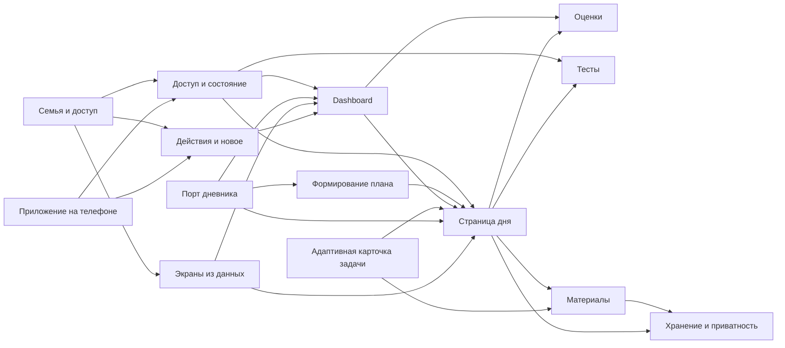

# Карта спецификаций Education

[Глобальная синхронизация](global-sync.md) задаёт охват всех семей и детей, граф работ, ограниченный параллелизм, адресный статус и условия полного отчёта.
[Матрица ревизий и local-first чтения](../architecture/local-first-revision-matrix.md) определяет, какие данные неизменяемы, кто владеет каждым каналом, когда повышается ревизия и что читает стартовый экран.
[Повторный аудит чтений Firestore 14 октября](../architecture/firestore-read-audit-2026-10-14.md) сверяет фактические серии Monitoring с реестром вызовов и фиксирует неподтверждённые расходы каждого регулярного маршрута.
[Общие артефакты и семейные связи](../architecture/shared-artifact-pipeline.md) задают неизменяемые стадии, дедубликацию, границу личных данных и проекцию общего разбора на конкретное задание.

[Семейная библиотека учебников и общий архив](family-library.md) описывает загрузку PDF каждой семьёй, дедубликацию, покрытие расписания и граф источников.

[Система компонентов](component-system.md) определяет конечные роли действующих React-компонентов, границы переиспользования и проверки перед добавлением нового элемента. Её читают вместе с [моделью Firestore](firestore-data-model.md) и [ролевым ViewModel](subject-card-viewmodel.md), чтобы новый источник данных не породил ещё одну карточку с тем же смыслом.

[Граф выбора карточки](card-generation-policy.md) задаёт общую оболочку и выбор предметного адаптера по ожидаемому результату; [математический маршрут](math-solution-route.md) задаёт его адаптивную глубину для обычной математики и спецкурса.
[Матрица дизайн-решений задачи](problem-card-design-decisions.md) фиксирует слои и визуальные инварианты каждого компонента нумерованной карточки перед изменением интерфейса.
[Управление изменениями интерфейса](ui-change-control.md) связывает действующий сценарий, компонент, CSS, тест и согласование; запечатанный реестр останавливает незаявленные правки UI в `check:spec`.
[Свежая версия переключателя](ui-decisions/stage-switch-fresh-version-2026-10-14.md) фиксирует проверку серверной ревизии перед семейным выбором и пределы доступной проверки.
[Прочитать все обновления](ui-decisions/notification-read-all-2026-10-14.md) фиксирует массовую квитанцию личного inbox и расположение действия в шапке колокольчика.
[Сертификация пути карточки](card-flow-certification.md) связывает запись МЭШ, оригинал, варианты, номера, действия, ролевую публикацию и регрессионные проверки.

[Уточнение порога 85%](ui-decisions/quiz-threshold-85-2026-10-14.md) заменяет прежний числовой порог самопроверки.
[Необязательная самопроверка](quizzes.md#optional-quiz) фиксирует единый родительский переключатель активного теста, сохранение выбора у исходной попытки и исключение только теста из счётчиков дня, расписания и кабинета.
[Время каждой попытки](quizzes.md#attempt-time) фиксирует значок часов в действующем общем блоке тестов, значения четырёх отметок и правило для старых записей без времени.
[Граф учебных самопроверок](assessment-decision-graph.md#decision-graph) связывает подтверждённый вид задания, обычный или контрольный тест, предметную матрицу, источники, закрытый план каждого вопроса, ручную проверку и очереди `education-sync`.

[Словарный диктант](assessment-decision-graph.md#vocabulary-dictation) задаёт открытое написание, повтор полного списка, работу над ошибками и отложенную проверку; [исследование](../research/vocabulary-dictation-practice.md) хранит первичные источники и пределы переноса.
[Сверенное чистое чтение](assessment-decision-graph.md#reading-only) автоматически попадает в очередь короткого теста; [исследование](../research/reading-only-self-checks.md) объясняет его объём и ограничения.
[Родительский вид русского языка](card-generation-policy.md#russian-adapter) работает в том же графе: устная часть переиспользует карточку теста, четыре письменных вида проходят через общую схему и компонент. [Протокол наполнения](russian-language-route.md#pipeline) задаёт источник и проверку; LLM/оператор наполняет конкретный JSON, а не меняет React. Семантическая проверка нового фото пока остаётся ручной.
[Слой листа спецкурса](special-course-card-overlay.md) добавляет правила оригинала учителя и нумерации поверх общего математического маршрута.

Каждый контракт описывает одну границу продукта и остаётся короче 500 строк. Это **граф**, а не один документ, в который копируется всё. [Карта всех файлов](file-map.md) связывает каждый файл с ближайшим контрактом, причиной существования и потребителем; `npm run check:spec` не даёт оставить новый файл без этой связи. Точечные JSDoc `@see` дополнительно ведут от сложной логики к конкретному правилу. Контракт может описывать целевую часть, поэтому состояние реализации проверяется отдельно.

Итог сквозной проверки договорённостей и открытые расхождения — в [аудите от 11 октября](protocol-audit-2026-10-11.md).
[Инвентаризация выпуска 12 октября](release-inventory-2026-10-12.md) отделяет опубликованный сайт, живые правила и данные Firestore от накопленных исходных изменений и задаёт порядок следующих небольших выпусков.
Порядок стадий, барьеры выпуска и точки возобновления — в [сквозном протоколе Education](education-pipeline.md).

| Контракт | Что определяет | Основные модули |
|---|---|---|
| [Дизайн-система](design-system.md) | Действующая шапка, общие токены, карточки, состояния и правила для новых экранов | `src/education-design-tokens.css`, `src/App.tsx`, `src/App.css`, `src/components/ui/` |
| [Матрица статусов](status-presentation.md) | Единые значки, цветовые роли, компактный вид, полный текст и квитанция просмотра нового ДЗ | `src/components/StatusIcon.tsx`, `src/DayDashboard.tsx`, карточки и библиотека |
| [Система компонентов](component-system.md) | Почему компонент существует, кто его использует и когда вариант становится данными | `src/components/`, `src/DayPage.tsx`, `src/WeekendMathSlot.tsx` |
| [Доступ и состояние](access-and-state.md) | Маршруты, роли, документы Firestore, повторный выпуск | `src/App.tsx`, `src/lib/store.ts`, `src/lib/dayStore.ts`, `day/merge.mjs` |
| [Модель Firestore](firestore-data-model.md) | Строгие поля и владельцы v1, связи, совместимость, аудит и миграции | `day/data-contract.mjs`, `day/placement-integrity.mjs`, `scripts/day.mjs` |
| [Основания проверки](review-criteria-provenance.md) | Порядок источников, подтверждённый критерий, предел вердикта и спор | `scripts/submissions.mjs`, `src/components/WorkReview.tsx` |
| [Страница дня](day-page.md) | Дата ДЗ, карточки, фото, связь теста с предметом и свёрнутый завершённый лист | `src/DayPage.tsx`, `src/WeekendMathSlot.tsx`, `src/components/ProblemGroup.tsx`, `day/build.mjs`, `scripts/day.mjs` |
| [Адаптивная карточка задачи](adaptive-problem-card.md) | Точный оригинал, отдельные ориентиры, свидетельства навыка и запрос помощи | `src/components/ProblemStatement.tsx`, `src/lib/dayStore.ts`, `src/WeekendMathSlot.tsx`, `src/DayPage.tsx`, `scripts/day.mjs` |
| [Математический маршрут](math-solution-route.md) | Четыре этапа родительского решения, источник каждого перехода, выборочная помощь ребёнку и барьер следующего листа | `src/components/ParentTaskGuide.tsx`, `src/lib/dayGuidance.ts`, `day/build.mjs`, `scripts/day.mjs` |
| [Формирование плана](plan-generation.md) | Граница точной записи МЭШ, проверенного разбора и неопределённости | `day/build.mjs`, `scripts/day.mjs`, `src/DayPage.tsx` |
| [Многодневный dashboard](dashboard.md) | Полоса дат, сводки и контракт будущей многодневной синхронизации | `src/DayDashboard.tsx`, `src/lib/dayDashboardStore.ts`, `day/dashboard-index.mjs`; многодневная синхронизация и полная история версий ДЗ ещё не реализованы |
| [Тесты](quizzes.md) | Попытка, сохранение, результат, списки | `src/App.tsx`, `src/components/SubjectTheme.tsx`, `src/lib/quiz.ts` |
| [Материалы](materials.md) | Точный источник, страницы, ридер | `src/components/MaterialReader.tsx`, `src/lib/yandexPublic.ts`, `storage/material-pages.mjs` |
| [Средний балл](grades.md) | Метка, условный сценарий, комментарии МЭШ и единая проекция на связанных днях | `scripts/day.mjs`; `src/DayPage.tsx`; `src/DayDashboard.tsx` |
| [Хранение и приватность](storage-privacy.md) | Прямая загрузка на Диск, метаданные в Firebase, миграция старых копий | `scripts/direct-upload-worker.mjs`, `src/lib/photoOutbox.ts`, `scripts/storage.mjs` |
| [Доступ к архиву семей](../architecture/family-artifact-access.md) | Общие оригиналы, ссылки и будущий журнал всех открытий | `storage/yandex-disk.mjs`; постоянно доступный шлюз ещё не реализован |
| [Порт дневника](../architecture/school-diary-port-adapter.md) | Изоляция МЭШ, локальное подключение через приглашение и семейные правила видимости | `diary/`, `packages/education-connect/`, `scripts/connect.mjs`, `src/components/ConnectionInvite.tsx`, `scripts/day.mjs` |
| [Семья и доступ](../architecture/family-data-model.md) | Семьи, роли, дети, родительский кабинет, источник истины и перенос ссылочной модели | `src/components/ParentHome.tsx`, `src/lib/useParentChildOverview.ts`, `scripts/family.mjs`, `scripts/connect.mjs`, `firestore.rules` |
| [Экраны из данных](../architecture/backend-driven-ui.md) | Инвариант движка, общие подписки и будущий безопасный манифест | `src/lib/useDayEvidence.ts`, `src/components/ProblemTaskCard.tsx`, `src/lib/educationSchema.ts`, `src/components/EducationScreen.tsx` |
| [Local-first через горячие пути](../architecture/local-first-hot-path-decision-2026-10-12.md) | Сокращение реальных чтений, локальный показ, выбор кеша и библиотек по маршруту | Действующий порядок исследования; рабочие экраны ещё читают Firestore напрямую |
| [Поэтапный план local-first](../architecture/local-first-release-plan-2026-10-12.md) | Порог 20% для маршрута, измерения до/после, условия выпуска и отката | Родительский кабинет; материалы; день; EducationSync |
| [Расширенный протокол синхронизации](../architecture/local-first-sync.md) | Возможные семейные каналы, ревизии, delta-пакеты и безопасный перенос попыток | Условный вариант для маршрутов, где будет доказана выгода |
| [Действия и новое](../architecture/activity-and-inbox.md) | Журнал посещений, ревизии просмотра и адресные уведомления | `src/lib/educationStore.ts`, `firestore.rules` |
| [Обнаружение и сверка изменений](../architecture/change-detection-and-reconciliation.md) | Сигнал Firebase, проверка МЭШ, очередь фото, восстановление процесса и граница пробуждения агента | `diary/application/sync.mjs`, `scripts/submissions.mjs`; автономный наблюдатель ещё не реализован |
| [Приложение на телефоне](pwa.md) | Установка на iPhone, обновление кода, кеш и граница push | `src/lib/pwa.ts`, `pwa/sw-template.js`, `scripts/generate-sw.mjs` |
| [Карта файлов](file-map.md) | Назначение, потребитель и контракт каждого файла | `scripts/check-spec-map.mjs` |
| [Сквозной протокол](education-pipeline.md) | Инварианты между МЭШ, Диском, Firestore, разбором и ролями | `diary/application/sync.mjs`, `scripts/day.mjs`, `scripts/submissions.mjs`, `skills/education-sync` |

## Сверка реализации (исходный аудит 11.10.2026, дополнено 12.10.2026)

| Контракт | Действующий путь | Открытая часть |
|---|---|---|
| [День и тесты](day-page.md), [тесты](quizzes.md) | `dayPages`, фото, разбор и попытки читаются через `onSnapshot`; новое содержание приходит без выпуска PWA | Новые виды компонентов требуют выпуска движка |
| [Фото и Диск](storage-privacy.md) | Новое фото идёт из IndexedDB прямо на Диск; Firestore хранит метаданные; локальный worker подтверждает файл | Реальная съёмка на iPhone ещё не проверена; без Mac передача ждёт его запуска и повторного открытия страницы |
| [Нумерованные листы](adaptive-problem-card.md) | Исходный лист один, фрагменты по координатам, общие фото, разбор и карточка номера работают в `DayPage` и `WeekendMathSlot`; текст листа берётся из Firestore | Разметка следующего листа выполняется оператором как данные |
| [Семья](../architecture/family-data-model.md) | Личные ссылки, роли, кабинет взрослого, карточки детей и управление приглашениями и ссылками работают на опубликованном сайте; вход обеих ролей проверен на живом Firestore | Подробные дни, тесты и оценки ещё используют прежние документы первого ребёнка; генератор нового ребёнка требует изолированного контекста `(familyId, childId, sourceAccountId)` |
| [Семейная библиотека](family-library.md) | Кабинет показывает только книги семьи, отличает подтверждённое издание от предварительного; страницы 10 связанных PDF опубликованы и доступны через семейную проекцию общего индекса | Постоянный приёмник PDF зависит от локального Mac; точные издания некоторых предметов ещё не подтверждены; проверка полноты семейной проекции остаётся обязательной при новых загрузках |
| [Манифест экрана](../architecture/backend-driven-ui.md) | Типы, подписка и компонент подготовлены | Текущие маршруты дня и dashboard к нему не подключены |
| [Действия и новое](../architecture/activity-and-inbox.md) | Личный inbox и колокольчик показывают изменение ДЗ, новую оценку, разбор и уточнение работы, родительский зачёт и выпуск продукта | Сбор посещений и системный Web Push пока не работают |
| [Обнаружение и сверка изменений](../architecture/change-detection-and-reconciliation.md) | Есть ручные `diary sync`, `submissions inbox`, публикация дня и живые подписки клиента | Автономный наблюдатель с курсором, атомарная аренда разбора и пробуждение сессии не реализованы |
| [Многодневный МЭШ](dashboard.md) | Ролевой индекс сохранённых дней и живые статусы работают | Полный будущий горизонт и автоматическое снятие отменённого ДЗ не реализованы |
| [Архив семей](../architecture/family-artifact-access.md) | Новые оригиналы лежат на Диске | Постоянный медиа-шлюз, отзыв пересланных файловых ссылок и полный журнал открытий ещё не реализованы |

Семейные планы, токены, снимки дневника, фото работ и привязки конкретных учебников лежат в закрытом локальном проекте или на Яндекс.Диске; эта карта не содержит их. Публичный исходный репозиторий и ветка сайта не должны содержать сами изображения. Перед выпуском проверяются и текущие файлы, и история Git: удаление файла новым коммитом не удаляет его из старых коммитов.
