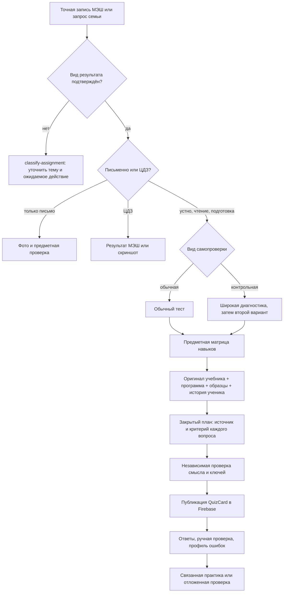

# Граф подготовки учебных самопроверок {#decision-graph}

**Статус:** действующий контракт для новых `quiz create` и ручного цикла `education-sync`. Граф выбирает план и проверяет его форму; поиск, составление вопросов, независимая проверка ключа и разбор открытых ответов пока выполняются оператором/LLM. Код не генерирует проверенный тест автономно. Старые опубликованные попытки и ключи не переписываются.



## Развилки задания {#assignment}

1. Сначала сохраняются дословная запись учителя, устойчивый ID, дата, класс, источник уточнения и `outputKind`. Подготовка к контрольной, чтение, устное действие и ссылка на параграф в проверенной записи ставят задачу в очередь. **Чистое чтение** с уже проверенными страницами сразу даёт `prepare-quiz` по правилу ниже; остальные случаи идут через `classify-assignment`. ЦДЗ и указатель на прежний день в эту ветку не попадают. `task.assessmentIntent = {state:"confirmed",mode:"ordinary"|"control-diagnostic",topic,evidenceRef}` допустим лишь после сверки темы и вида работы. При смене записи МЭШ `day/build.mjs` сбрасывает старое решение. Старый `kind:"read"` проходит ту же проверку записи и страниц, без обхода барьера источника.
2. Только письменное действие остаётся карточкой работы и фото. ЦДЗ подтверждается результатом МЭШ либо скриншотом; тест Education его не заменяет. Смешанное назначение разделяется на связанные письменный и устный пункты с одним оригиналом МЭШ и разными действиями. Если разделение ещё не сделано, публикация теста блокируется оператором. Устное чтение, пересказ, повторение теории и подтверждённая подготовка к контрольной допускают тест. Проверка выразительности чтения, произношения и развёрнутого устного выступления требует отдельного свидетельства; балл выбора ответа их не доказывает.
3. `ordinary` — самопроверка конкретного материала. `control-diagnostic` — первая широкая диагностика значимой контрольной: для объёмной темы минимум 20 содержательных пунктов, несколько форм ответа, охват матрицы навыков. `control-followup` создаётся на новом материале после завершённой проверки всех свободных ответов первого теста и анализа ошибок. `targeted-followup` — короткая адресная практика конкретного подтверждённого пробела. Оба продолжения получают `linkedToTestId`; прежний результат остаётся в истории общей `QuizCard`.

<a id="reading-only"></a>
### Чтение без письменной сдачи

Если точная запись МЭШ просит только прочитать или познакомиться с текстом, `instructionStatus=reviewed`, назначенные страницы семейного источника связаны (`materialStatus=textbook-page-linked`), нет письменной части, ЦДЗ и ссылки на другое ДЗ, сканер **автоматически ставит `prepare-quiz`**. Поле `kind=check` здесь не отменяет тест. Нельзя оставлять такую карточку в состоянии «прочитай, а результат неизвестен» после синхронизации. Новая запись МЭШ или утрата сверки страниц снова останавливает это решение. Смешанная запись сначала разделяется на разные действия; по одной фразе из неё нельзя назначить лишний тест.

Для обычного знакомства с параграфом нужна короткая самопроверка Education: несколько вопросов о главной мысли, ключевых понятиях и одной связи между ними, преимущественно с простой формой ответа. Вопросы из конца учебника могут подсказать темы, но **не становятся обязательным ДЗ учителя**, если МЭШ их не назначил. Личные прошлые ошибки, отдельная пройденная тема и перенос остаются в закрытом плане, но не превращают чтение в экзамен. Порог `requiredPoints` ставь так, чтобы ошибка только в дополнительном повторении не возвращала уже подтверждённое чтение в статус «не сделано». После попытки балл означает результат этой самопроверки, а не доказательство того, что ученик прочёл каждую строку.

### Словарный диктант и заучивание написания {#vocabulary-dictation}

Это **отдельная орфографическая ветка**, если назначен список слов или семья просит подготовить диктант. До составления сверить точный список и целевой язык по записи учителя/учебнику: фото с неразборчивыми строками нельзя превращать в ключ догадкой. Общий тест на тему иностранного языка не заменяет написание слов. Начальный раунд требует открытого написания каждого слова по однозначной подсказке, не выбора из вариантов, букв с уже видимым ответом или копирования. Для перевода указывай нужное значение/контекст и допустимые варианты; для русского диктанта — предложение либо диктовку. Не показывай искомое написание до попытки. Ошибку проверяй по буквам и источнику; автоматическое расстояние между строками не является критерием знания.

Последовательность: **полный список → после разбора ещё один полный проход → только ошибочные/пропущенные слова до верного написания → отложенная проверка полного списка**. После каждого завершённого прохода покажи точную правильную форму и трудный фрагмент ошибочного слова; следующая попытка идёт без открытого образца. Пропуск остаётся в наборе для коррекции, а спорное оценивание блокирует выбор следующего набора до ручной сверки. Ноль ошибок в коротком коррекционном проходе завершает текущую тренировку, но не доказывает удержание через день. Срок отложенной проверки выбирается по дате школьного диктанта; не обещай научно обязательное число часов/дней. [Первичные исследования и пределы переноса](../research/vocabulary-dictation-practice.md).

Закрытый план `dictation` хранит `sourceRef`, уникальные `sourceWordIds`, `phase`, предыдущие проверенные `priorWordIds/priorResults` и отображение `wordIdByQuestion`. `assessment/decision-graph.mjs` вычисляет набор для каждой фазы и не пропускает неразобранное слово. Все пункты этой ветки имеют `kind: short`; раунды после первого связаны через `linkedToTestId`. Ремонтный раунд может содержать одно слово и является узкой практикой подтверждённой ошибки предыдущего полного теста: каждое его происхождение — `prior-gap` с доказательством. Четырёхслойная матрица относится к исходному полноценному тесту и отложенной общей проверке; добавлять посторонние слова в ремонтный раунд ради формального числа слоёв нельзя. Школьное выполнение и освоение не закрываются только созданием теста или одной успешной немедленной попыткой.

**Граница реализации:** селектор и барьер структуры действуют при `quiz create`, но сами не создают раунды, не извлекают точный список из фото, не делают аудиодиктовку и не назначают отложенный тест автоматически. Оператор сверяет источник, альтернативные ответы и результаты, затем публикует связанное продолжение. Старые тесты без `dictation` не меняются.

«Подготовиться к самостоятельной/контрольной» — отдельная более широкая диагностическая ветка, а не короткий тест на факт чтения. Подтверждённая тема и материал обязательны; если они отсутствуют, `classify-assignment` остаётся видимым долгом очереди, а агент ищет их в уроке, учебнике, тетради и прошлых заданиях. Для контрольной действует цикл из двух тестов после проверки первого.

## Общий план и предметный слой {#contract}

Новый JSON теста хранит `assessmentPlanPath` — относительный путь к **закрытому** плану рядом с ним в `work/`. `quiz validate/create` читает план, но **не** публикует ни его, ни ссылки на личные ошибки в `assignments`, `previews` или `dashboard`. В `assignments.assessment` допускаются лишь безопасные `policyVersion`, `mode`, `subjectAdapter`. У плана `assignment.outputKind` принимает `oral`, `reading`, `control-prep` или `standalone-practice`; смешанное назначение сначала разделяется, письменное и ЦДЗ сюда не попадают. Сам файл плана содержит:

```json
{
  "policyVersion": 1,
  "mode": "ordinary",
  "subjectAdapter": "geography",
  "assignment": {"evidenceRef":"МЭШ: урок/запись", "topic":"Тема", "grade":6, "outputKind":"reading", "confirmed":true},
  "sources": [
    {"id":"mesh", "role":"assignment", "ref":"МЭШ: урок/запись", "verified":true},
    {"id":"book", "role":"family-material", "ref":"точное издание, PDF/печатные страницы, source_ref", "verified":true},
    {"id":"program", "role":"official-scope", "ref":"официальная программа и раздел", "verified":true}
  ],
  "learnerEvidence": [{"id":"attempt-1", "ref":"закрытая попытка/событие", "state":"confirmed"}],
  "objectives": [{"id":"map-skill", "strand":"map", "skill":"Найти и объяснить объект по карте"}],
  "items": [{"questionId":"q1", "layer":"current", "objectiveId":"map-skill", "sourceIds":["book"], "format":"short", "rationale":"Проверяет действие из назначенного параграфа", "criterion":"Объект и признак указаны", "keyReviewed":true}],
  "semanticReview": {"completed":true,"ref":"закрытая запись независимой проверки"}
}
```

Пример выше показывает форму полей, **не готовый валидный тест**: реальный план охватывает каждый вопрос и четыре слоя при наличии истории. У каждого пункта есть цель, происхождение, формат и критерий. Слои: `current` (назначенное), `prior-gap` (подтверждённая ошибка или открытая проверка; `evidenceIds` указывают на подтверждённую попытку), `spaced` (отдельная ранее пройденная тема; обязательны `topic` и `priorTopicRef`), `transfer` (новый контекст). Если в истории нет подтверждённой ошибки, используется `baseline` с `historyGapReason`, а не выдуманная слабость. Если отдельная прежняя тема ещё не установлена, `spacedGapReason` фиксирует пробел; тема текущей ошибки не выдаётся за прежнюю. Пропуск достоверного источника или темы блокирует выпуск, а не заменяется уверенным текстом LLM. Количество и сложность следуют объёму темы и истории, не фиксируются одинаково для всех предметов.

| Адаптер | Проверяемые действия и допустимые формы | Что нельзя подменять |
| --- | --- | --- |
| Русский | Понимание текста, языковой разбор, орфография с основанием, создание/правка фрагмента; выбор, пропуск, короткий и развёрнутый ответ | План или сочинение одним вопросом на узнавание |
| Литература | Понимание произведения, текстовая опора, аргументированная трактовка; несколько обоснованных прочтений | Пересказ фактов оценкой выразительности или единственным «авторским» мнением |
| Математика и спецкурс | Понятие, модель, вычисление, объяснение; открытая запись по умолчанию, выбор ответа только по прямой просьбе родителя | Угаданное число доказательством решения в тетради |
| История | Источник, хронология, причина и следствие, интерпретация свидетельства | Запоминание даты полным объяснением события |
| География | Факты из параграфа, карта/схема, причинная связь, применение | Тест по карте без видимой карты или подтверждённого изображения |
| Биология | Факт, строение и функция, классификация, применение | Термин без связи с объектом и наблюдением |
| Иностранный язык | Понимание текста/аудио, форма в контексте, короткое собственное высказывание | Угаданную грамматическую форму доказательством устной речи |
| Неизвестный предмет | Факт источника, объяснение, применение после ручного выбора матрицы | Публикацию теста без предметного критерия |

`assessment/decision-graph.mjs` хранит ID веток, матрицы навыков и структурные проверки. Предмет выбирает **данные и критерии**, но не создаёт новый React-компонент: `QuizCard` и история попыток общие. Видимость результата в день определяют назначение, порог `requiredPoints`, текущая и связанные попытки. Если школьное действие письменно, ученическая карточка по-прежнему предлагает фото.

## Источники, методика и проверка {#sources}

Порядок: оригинал учителя → точный семейный учебник/тетрадь и страницы → официальный раздел программы нужного класса и периода → официальные банки формата → проверенные открытые учительские образцы только как подсказка к **форме**. Из сети не переносится целиком чужой текст контрольной. [Каталог](../research/assessment-source-catalog.md) хранит общие источники; личный профиль и попытки только в закрытом плане. [IES](https://ies.ed.gov/ncee/wwc/PracticeGuide/1) поддерживает извлечение из памяти, интервальное повторение и объясняющие вопросы; [EEF](https://educationendowmentfoundation.org.uk/education-evidence/guidance-reports/feedback) — предметную обратную связь с конкретным следующим действием. Эти методики **не** подменяют российскую программу или школьный критерий.

Перед `quiz create` человек/агент сверяет каждый ключ с оригиналом, альтернативные допустимые ответы, однозначность формулировки, длину теста и доступность всех приложений. Структурная проверка CLI этого не доказывает. После ответа сохраняются подтверждённые ошибки и сильные действия, но школьная оценка и освоение не выводятся из одного процента. Второй вариант контрольной строится только после ручной проверки открытых ответов; `pendingManualQuestionIds` используется и при создании продолжения, и при закрытии задания очереди. Если история подтверждает плато, следующий вопрос меняет контекст или немного усложняется.

## Связи с кодом и статус автоматизации {#implementation}

| Этап | Действующая реализация | Граница |
| --- | --- | --- |
| Смена МЭШ и решение о тесте | `day/build.mjs`, `scripts/day.mjs`, `src/lib/dayStore.ts` | Оператор подтверждает `assessmentIntent`; автоматическая классификация по сырому тексту не публикует тест. |
| Общая очередь | `scripts/sync-queue.mjs`, `assessment/decision-graph.mjs` | Сканер автоматически ставит `prepare-quiz` для сверенного чистого чтения; остальные ветки: `classify-assignment`, `review-quiz`, `prepare-control-followup`. Агент составляет и сверяет содержание. |
| Источники и закрытый план | `skills/online-quiz/SKILL.md`, `assessment/decision-graph.mjs`, `scripts/quiz.mjs` | CLI проверяет полноту ссылок, слоёв и форматов, но не фактическую верность. |
| Публикация и показ | `scripts/quiz.mjs`, `src/components/QuizCard.tsx`, `src/lib/useDayQuizOutcomes.ts` | Только данные нового теста и связи; существующий UI без новой предметной ветки. |
| Ответ, ручной разбор и продолжение | `scripts/sync-inbox.mjs`, `scripts/sync-queue.mjs`, `scripts/quiz.mjs` | Прогресс ученика обновляется после проверенного результата, не из факта создания теста. |

Исторические тесты без нового закрытого плана продолжают работать. Новое создание по старому JSON теперь останавливается до добавления плана; уже опубликованные попытки не мигрируются задним числом. Полностью автоматическая генерация, в том числе независимый поиск источников и смысловая оценка длинного ответа, остаётся открытой задачей; статус очереди должен показывать это явно.
