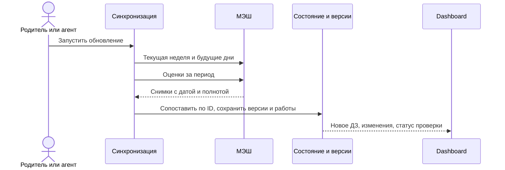

# Многодневный dashboard Education

Статус: **личные ссылки ведут сразу на ролевой dashboard; календарь и переход к существующей странице дня работают через Firestore. Глобальный многодневный сбор МЭШ и сверка публикации действуют; смысловая подготовка новых карточек остаётся этапом оператора**. Связанные контракты: [страница дня](day-page.md), [доступ и состояние](access-and-state.md), [оценки](grades.md), [тесты](quizzes.md), [материалы](materials.md) и [порт дневника](../architecture/school-diary-port-adapter.md). Карта: [README](README.md).

## Назначение и даты

Dashboard — точка входа ученика и родителя в сохранённые дни, ДЗ, оценки, тесты и работы. Расписание относится к дате, выбранной в календаре; отдельная карточка ДЗ — к ближайшему следующему учебному дню. При первом входе выбрана текущая московская дата; после перехода к подробной странице и возвращения выбор сохраняется в текущей вкладке. «Завтра» не хранится как дата ДЗ: в пятницу ближайшим днём занятий может быть понедельник. Срез оценок показан отдельно и подписан своей датой.

В данных различаются `viewDate` (выбранная дата), `lessonDate` (дата урока), `dueDate` (срок сдачи ДЗ), `plannedWorkDate` (когда ученик собирается делать отдельную работу) и `fetchedAt` (время последней успешной проверки МЭШ). Все подписи для семьи вычисляются в `Europe/Moscow`. Владелец задания и результатов определяется уроком МЭШ, его точным предметом и устойчивым ID; `dueDate` только показывает срок сдачи и не меняет владельца. Если в задании четвергового спецкурса написано «сдать ... в среду», карточка и результаты остаются у спецкурса в четверг, а среда отображается как срок. Практикум в среду — другой предмет. Ранее загруженные фото и результаты остаются связанными доказательствами при исправлении ошибочной даты карточки. Незавершённое за прошедшую дату не переезжает на следующий день автоматически; работа, выполненная заранее, видна в карточке своего урока.

## Полоса дней и выбранный день

- При входе выбрана текущая московская дата. Нажатие на любую дату меняет **в этой же странице** заголовок и расписание со статусами ДЗ именно этой даты. Карточка ниже показывает работу к ближайшему следующему учебному дню из индекса МЭШ; после пятницы это может быть понедельник. Подробная страница открывается из соответствующего расписания или карточки ДЗ; возвращение восстанавливает выбор календаря.
- Сегодняшняя дата отмечена тонкой рамкой; выбранная дата залита фиолетовым. При выборе прошлого или будущего дня сегодняшний день не остаётся главной карточкой.
- Полоса показывает сохранённые прошлые даты, текущую неделю и будущие даты с полученным расписанием. Прошедшие снимки МЭШ нельзя отфильтровывать только потому, что началась новая неделя.
- `dayPages/<token>` создаётся для даты планирования `date`, а его задания относятся к `targetDate`. Для календарной даты `D` расписание и статусы его предметов берутся из индексного снимка и страницы с `targetDate === D`. Нижняя карточка ДЗ берёт ближайшую следующую учебную дату `N > D` с расписанием или назначением и открывает страницу с `targetDate === N`. Индекс хранит отдельные `dayToken` для расписания и `homeworkDayToken` для ДЗ; точная ссылка МЭШ на предыдущий урок может вести к уже опубликованной странице этого урока.
- Выходные и другие даты без школьного расписания остаются выбираемыми в полосе дней. Они не создают пустые школьные страницы. Отдельная работа на выходных показана в обзоре выбранной даты и связана со своим сроком сдачи.
- Выходной обзор может показывать несколько независимых карточек математики: геометрия привязана к своему уроку среды, спецкурс ДЗ-05 — к своему уроку четверга. Обе доступны в субботу и воскресенье для работы заранее; каждый блок открывает **свою опубликованную страницу**, использует её `problem.id`, фото и историю попыток. Копию задания между датами не создаём. В каждом блоке отдельно подписаны дата урока и срок сдачи; подготовка на выходных не переносит срок. Предлагаемый порядок решения остаётся советом Education и не расширяет требование учителя «реши сколько получится».
- Будущий день с расписанием доступен даже без ДЗ. В его блоке написано «ДЗ пока не опубликовано» и показано время последней успешной проверки. Формулировку «ДЗ нет» нельзя выводить из пустого ответа МЭШ.
- Если пришла только часть будущего расписания, интерфейс должен обозначить неполноту. Правило, по которому определяется полнота недели, нужно уточнить в реализации по данным МЭШ; отдельный ранний урок не следует выдавать за окончательное расписание.
- Обзор выбранного дня показывает краткий ход работы; подробные карточки используют существующий [контракт страницы дня](day-page.md#day-page): точные источники, фото, связанные тесты и их собственные статусы. Будущие задания доступны для работы заранее.

## Ближайший учебный день в кабинете родителя

Строка каждого ребёнка показывает его ближайший учебный день по собственному индексу расписания. До начала **его первого урока** в московском времени сегодняшний день остаётся главным. С момента начала первого урока карточка переключается на следующий день с расписанием, даже если сегодняшнее ДЗ полностью готово. Время берётся из `dayDashboards.days[].schedule[].start` именно этого ребёнка и сверяется с датой урока; устаревшая запись другого дня не задаёт границу. Открытая вкладка пересчитывает выбор каждую минуту. Если расписание следующего учебного дня ещё не загружено, карточка сообщает об этом и не возвращается к уже прошедшему дню. Прошедшие даты остаются доступными в календаре.

Главная карточка не показывает `awaiting-review`: это внутреннее ожидание смысловой сверки всего горизонта, а не действие ребёнка и не состояние показанного дня. Активное обновление и ошибку доступа можно увидеть в раскрытых подробностях; завершённая техническая фаза не создаёт отдельный баннер. Ссылка «Открыть календарь» выбирает текущую московскую дату, хотя сводка ДЗ после начала уроков относится к следующему учебному дню. Даты расписания и домашней работы нельзя связывать через это действие.

## Расписание в течение дня

При открытии календаря из кабинета ребёнка выбран сегодняшний день. Расписание выбранного дня и ДЗ ближайшего следующего учебного дня остаются отдельными блоками. Пока идут уроки, завершённые по `schedule[].end` уроки собраны в **один изначально свёрнутый пункт** «Прошли · N» с перечнем названий через запятую; длинный перечень обрезается в одну строку, а полностью доступен через подпись кнопки. Нажатие показывает все прошедшие уроки с их собственными счётчиками и подробностями. Текущий и будущие уроки видны сразу. **Подробности каждого урока изначально свёрнуты**; компактная строка показывает число выполненных пунктов, если известны их числитель и знаменатель. При проверке работы счётчик не заменяется словом «Проверяем». После окончания всех уроков весь блок расписания свёрнут до заголовка и кнопки раскрытия; ручное раскрытие показывает полный день. Открытая вкладка обновляет временные границы раз в минуту и при возвращении в приложение; некорректное время окончания не скрывает урок. Адресный переход к прошедшему предмету раскрывает и группу, и нужный урок. Выбор иной даты вручную не меняется от тика часов. Сводка ребёнка на главной переключается на следующий учебный день в момент начала первого урока, но не меняет дату календаря.

### Отсчёт уроков

У **ближайшего будущего** урока выбранного сегодняшнего дня рядом с названием стоят песочные часы `Hourglass` и время до начала. У остальных будущих уроков отсчёта нет. У текущего урока вместо слова «Идёт» стоят `Timer` и время до конца; если уже идёт один урок, ближайший следующий всё равно может показывать ожидание. Эти две оси не меняют бейдж ДЗ справа и не создают новый учебный статус. Иконки берутся из установленной `lucide-react`, без анимации загрузки: известное расписанием время показывается числом, а не неопределённым спиннером. Полная подпись «Начнётся через …» или «До конца урока …» доступна через `aria-label`/подсказку, видимый формат краток (`10 мин`, `1 ч 5 мин`). Округление вверх до целой минуты исключает нулевой отсчёт до наступления границы. Тик раз в минуту и возврат во вкладку пересчитывают состояния по локальному времени; новых полей Firestore, чтений и подписок нет. При выборе другого дня, неверном времени начала или конце, не следующем после начала, соответствующий живой отсчёт не показывается; строка урока остаётся. Граница начала переводит ожидание в текущий урок, граница конца переносит его в группу прошедших. Обе роли видят одинаковое расписание.

Сквозная связь этого решения: источник `dayDashboards.days[]` и границы `schedule[].start/end` описаны в [модели Firestore](firestore-data-model.md#dashboard-date-projection); `parentFocusDay` вычисляет дату сводки, `DayDashboard` — выбранную дату и следующий учебный день; [реестр компонентов](component-system.md#registry) сохраняет раздельные контейнеры `ParentHome` и `DayDashboard`. Переход на сегодня, граница первого урока, постепенное сворачивание, отсутствие сегодняшней строки и непрочитанное новое ДЗ закреплены в `ParentHome.readBudget.test.tsx`, `parentFocusDay.test.ts` и `DayDashboard.warmStart.test.tsx`. Изменение не добавляет документ, поле, подписку или миграцию Firestore.

## Связь подготовки на выходных с уроками

Каждый опубликованный день, содержащий работу для выходных, хранит `weekendSlot: { dates, title, taskIds, dueDate? }` в `dayPages` и закрытом исходнике дня. `taskIds` — явные ID листов **этого** урока, а не список названий предметов и не копии номеров. `day/dashboard-index.mjs` переносит в `dayDashboards.weekendWork` дату урока, фактический срок из задания, ID заданий и ролевой токен страницы. `DayDashboard` показывает все записи выбранной субботы или воскресенья; `WeekendMathSlot` выводит только указанные `taskIds` и подписывается на их фото и проверки. Геометрия и спецкурс могут иметь разные страницы и сроки в одном выходном обзоре.

Перед выпуском индекс проверяет, что каждый `taskId` существует на своём уроке, содержит исходные номера и не повторяется в другом выходном блоке, что выходные даты предшествуют уроку и что срок совпадает с заданием. Неверная или устаревшая связь **останавливает публикацию**, вместо молчаливого исчезновения карточки. Отдельный `day dashboard` дополнительно сверяет план с уже опубликованной страницей Firestore; при изменении плана сначала нужен `day publish` соответствующего урока. Фото, разборы и семейные решения остаются в коллекциях исходного токена; выходной блок их читает, не копируя.

Изменение `weekendSlot` создаёт новую ревизию плана и записывается в `changes` страницы. Индекс и обе роли получают её через подписки Firestore. Оператор сверяет после выпуска, что все ID из индекса присутствуют в `dayPages` нужного урока для ученика и родителя; отсутствие одного ID означает незавершённую публикацию, даже если соседняя выходная карточка видна.

При каждом выпуске индекс сравнивает прежние `weekendWork` с новым набором. Если исчез исходный файл или само поле `weekendSlot`, публикация блокируется. Для подтверждённого снятия оператор указывает дату урока, точные `taskIds` и причину в закрытом `.local/weekend-slot-removals.json`. Для обычных дней каждый `homeworkDayToken` сверяется с опубликованной страницей своей роли и отпечатком исходного плана; свежий индекс не может вести к устаревшей карточке. [Общий порядок](education-pipeline.md) распространяет эту проверку на все даты.

## Сводки ученика и родителя

Ученик видит расписание и действия к **выбранному дню**. Строки предметов ведут к конкретным заданиям, тестам и фото в существующей подробной странице. В выходные отдельно видно запланированную внешкольную работу для выбранной даты; она ссылается на **то же задание** и его срок сдачи, без второго независимого статуса.

Новая оценка показывается компактной карточкой: оценка, предмет, текущий средний; подробности раскрываются по нажатию. Общий блок оценок показывает все предметы с опубликованным средним и раскрывает список сохранённых отметок каждого предмета; дата среза не выдаётся за живую проверку МЭШ. Средний и условные сценарии подчиняются [контракту оценок](grades.md#dashboard-grade-list), включая спокойный вид чистой `5,00`. Балл, выполнение ДЗ и освоение навыка не смешиваются.

Родитель входит по отдельной ссылке без переключателя роли. На первом экране он видит изменения после синхронизации и открытые вопросы: добавленное или изменённое ДЗ, новые оценки, ожидающие разбора фото, исправления и тесты. Тексты учителя и версии заданий остаются доступны для сверки. Дополнительная детализация интерфейса родителя остаётся задачей прототипа; существующие права и [состояние Firestore](access-and-state.md) не заменяются общей публичной страницей.

### Ход ДЗ следующего учебного дня

Родитель может сделать открытый тест необязательным в общей карточке. Тогда тест остаётся доступным, но не входит в числитель и знаменатель прогресса на странице дня, в уроке расписания, следующем ДЗ и обзоре ребёнка. Если он был единственным действием урока, расписание показывает «По желанию» без 0 из 1. Задание учителя, номера листа и письменная сдача не меняют обязательность вместе с тестом. [Контракт переключателя](quizzes.md#optional-quiz).

Самопроверка и все её продолжения составляют **одно действие** предмета, обязательное по умолчанию: текущая попытка определяет его статус, предыдущие результаты остаются в истории. После проверенного результата от 85% действие считается сделанным; ниже порога требуется работа над ошибками. Родительский запрос через иконку перед «Результат» сразу возвращает действие в «надо доделать / ждём новый тест», пока оператор не опубликует связанное продолжение. Если есть ровно одно `kind=check` задание и один отдельно размещённый тест этого предмета и дня, обзор связывает их в один пункт; неоднозначные случаи требуют явной связи. МЭШ и письменная работа не засчитываются баллом Education. Реализация: `src/lib/useDayQuizOutcomes.ts`, `src/lib/homeworkStatus.ts`, `src/lib/useParentChildOverview.ts`, `src/lib/useDashboardDayWork.ts`, `src/DayPage.tsx`; [порог и очередь](assessment-decision-graph.md#followup-threshold).

Бейдж «Проверяем» возможен только для ожидающего фото или активного этапа разбора. После завершённого разбора `assessmentBasis.outcome: unresolved` сам по себе не означает неясный критерий: `unresolvedReason: missing-evidence` показывает «Не вся работа видна» и одну короткую конкретную причину из проверенной ученической обратной связи; `criterion-unclear` или историческая запись без причины показывает «Итог не установлен» и ведёт к полному основанию в карточке. Большой `review.summary` не копируется в обзор. Если [отдельное поле `workCoverage`](review-criteria-provenance.md#work-coverage) подтверждает все назначенные действия на той же версии проверки, семейный статус становится «Работа сдана» и предмет переходит в список сделанного; критерий качества остаётся открытым. Новое ожидающее фото возвращает состояние ожидания. Это не новый долг ребёнка и не активная проверка. Родитель видит происхождение спорного требования и решает, оставить его обязательным или сделать необязательным; обращение к учителю не является шагом продукта.

Виджет «Домашнее задание» строится для ближайшего следующего учебного дня после выбранной даты из тех же заданий, фотографий `dayUploads`, разборов `dayProgress` и результатов ЦДЗ/тестов, что и страница этого следующего дня. Расписание выбранной даты уже показывает её задания и статусы по предметам, поэтому виджет не повторяет этот день. Предмет считается завершённым только после подтверждения **всех** его обязательных пунктов: выполненный лист не скрывает открытое ЦДЗ того же предмета. Простая загрузка фото или отправка теста не равна завершению.

Вверху — короткий заголовок и дата по [контракту компактной сводки](#compact-homework). Предметы с незавершёнными действиями стоят в группе «Сделать» первыми; каждая строка называет конкретный ближайший пункт и ведёт к его карточке. Затем отдельно показана группа «Проверка» для работ, где ожидаются разбор или уточнение. Полностью предъявленная работа с неясной оценкой относится к семейному списку сделанного с явной пометкой открытого критерия. Завершённые предметы по умолчанию собраны в раскрываемую строку «Сделано · N»; внутри остаются названия и доступ к результату. Счётчики групп считают предметы. Если действий ученика нет, группа «Сделать» отсутствует, а ожидающие вопросы остаются видимыми; длинный общий баннер не повторяет это ещё раз. Если подробная модель ещё не опубликована, показывается точная запись МЭШ без выдуманного статуса. Данные меняются по подпискам Firestore без выпуска новой версии сайта.

### Повторное открытие расписания

Сохранённый календарь сам по себе не является полным снимком экрана: цвет и число в строке урока зависят также от страницы дня, загрузок, проверок, решений родителя и результатов тестов. При повторном открытии показываем последний **целостный** локальный результат каждой строки того же ролевого токена и даты. Отдельные первые ответы подписок не превращают `1 из 2` в «Задано» или `0 из 1`. Новый результат заменяет локальный только после первого ответа всех участвующих потоков; затем весь список меняется согласованно. При холодном запуске отсутствие этих данных обозначается нейтрально, без выдуманного прогресса. Сохранённый результат не называется устаревшим только потому, что началась проверка; сетевой сбой сохраняет его. Отзыв доступа запрещает показывать приватный снимок после подтверждённого отказа. Дополнительных чтений Firestore ради индикации обновления нет.

Тот же принцип применяется ко **всему видимому первому кадру**: следующий учебный день использует последнюю полностью рассчитанную сводку ДЗ по ролевому токену дня; оценки — последний срез опубликованной страницы; кабинет и колокольчик — последний подтверждённый локальный профиль и inbox пользователя. Пустой первый ответ отдельной подписки не должен заменять уже показанные ДЗ, оценки или число сообщений. Если сохранённый календарь уже есть, более старый дисковый снимок Firestore SDK не заменяет его до серверного ответа; для оценок на тёплом маршруте также ожидается серверное подтверждение страницы. На холодном устройстве SDK-кеш может дать первый результат. Прочитанное сообщение сохраняет квитанцию на этом устройстве даже при промежуточном старом SDK-снимке. Снимки принадлежат конкретной роли, ссылке календаря и пользователю; при подтверждённом отзыве доступа они удаляются. Наличие локального снимка не означает, что сервер уже подтвердил его свежесть: время последней сверки МЭШ остаётся видимым. Пока фоновые подписки отвечают за 300 мс, индикатор обновления не показывается; маленький индикатор у соответствующего блока появляется только после 450 мс, если сверка ещё идёт и уже есть локальный снимок. Числа, цвет и текст сохранённого результата не заменяются словами «загружаем» или «актуализируем». На холодном устройстве без подтверждённого снимка показывается нейтральное ожидание только для отсутствующей секции.

Ограничение текущей схемы: публикация календаря, фото, теста и оценки несколькими документами не образует общей серверной транзакции. Барьер первого ответа всех потоков защищает повторный запуск от пустого промежуточного состояния, но при изменении уже открытой страницы документы могут прибывать последовательно. Общая ревизия или атомарная проекция — отдельный этап после измерения горячих путей; текущая правка не добавляет чтений Firestore и не обещает их уменьшения.

Наблюдение из записи повторного запуска 13 октября: примерно в 1,5 с все шесть строк показывают «Задано», в 2,67 с часть строк показывает `0 из 1`, а к 3,0 с видны ранее известные `1 из 1` и `1 из 2`. Это переход между неполными входами вычисления статуса, а не смена задания в МЭШ.

### Статус ДЗ в строке расписания

На узком телефоне название урока занимает отдельную строку сетки, а бейдж переносится под название целиком, без разрыва текста и сжатия предмета. Это правило одинаково для свёрнутого и раскрытого урока.

Каждый урок расписания выбранной даты показывает компактный раскрываемый бейдж. Стрелка находится **внутри** бейджа и выравнивается по центру вместе с текстом. Бейдж раскрывается и для знака `⸻` (подтверждённое отсутствие ДЗ), и для завершённой, частичной, ожидающей проверки или неизвестной работы. Внутри перечислены конкретные подтверждённые пункты, пункты в проверке и то, что осталось сделать; нужный пункт открывается в подробном ДЗ с прокруткой и выделением его карточки. Один лист с отдельными задачами считает подтверждённые номера, а не только факт загрузки листа. Сданное фото и завершённый тест без результата не считаются проверенным выполнением.

Адресный переход к уроку раскрывает расписание даже после окончания занятий и ставит начало урока у верхнего края области просмотра. Переход к пункту ДЗ раскрывает его предмет и, если нужно, лист учителя; длинная карточка выравнивается по началу, чтобы пользователь видел название и действие. После загрузки сохранённых статусов прокрутка один раз уточняется, не возвращая пользователя к началу дня.

Перед подсчётом применяются [правила для указателя «Файл здесь» и результатов связанных страниц дня](plan-generation.md#material-only-mesh-entries): указатель остаётся видимым в точной записи МЭШ, но не становится отдельным долгом; уже подтверждённое ЦДЗ той же даты и того же задания засчитывается независимо от даты создания страницы. Материал учителя остаётся при основном письменном пункте.

Источник — `dayDashboards` для расписания и точной записи МЭШ, `dayPages` для заданий, `dayUploads`, `dayProgress`, `dayParentDecisions` и `assignments` для живого состояния. [Родительское засчитывание](day-page.md#parent-acceptance) завершает пункт в семейном плане, но подпись «ответ верен, ход неполон» остаётся видимой; счётчик означает «завершено», а не «ход подтверждён». Подтверждённая пустая запись означает, что ДЗ **не задано на последней сверке**: в краткой строке виден только двухэмный знак `⸻`, без иконки и подписи; полное имя доступно экранному диктору, а пояснение и время сверки — в раскрытии. Сохранённый старый текстовый бейдж нормализуется при первом кадре. Это отличается от «Уточняем» при неполной сверке. В шапке расписания и раскрытии каждого бейджа показано время последней успешной сверки МЭШ. Появление нового ДЗ выделяется существующей меткой «Новое ДЗ» до адресного просмотра. Если подробная страница ещё не готова, но запись МЭШ уже есть, показывать её точный текст с «Задано», не выдумывая выполнение. Цвет дополняет текст, а не заменяет его.

При выпуске индекса `day/dashboard-index.mjs` и `scripts/day.mjs` сравнивают текущие записи ДЗ с предыдущим индексом Firestore. Для добавленного либо изменённого предмета сохраняются `homeworkUpdate.at` и `homeworkUpdate.subjects`. На обеих ролях у такого урока до трёх дней показано «Новое ДЗ» и время изменения; повторная публикация без изменения не сбрасывает эту дату. После адресного открытия урока в расписании, задания в виджете следующего дня или перехода к предмету из колокольчика отметка исчезает **на этом устройстве** по ключу роли, даты, предмета и версии изменения; новая версия снова появляется. Общий переход к дню без выбора предмета не гасит все новости. Это локальная квитанция интерфейса без дополнительного чтения Firestore, не серверное доказательство просмотра ребёнком. Адресное обновление с отдельным `readAt` появляется в [центре обновлений](../architecture/activity-and-inbox.md#in-app-center); системный push [не включён](pwa.md#push). [Матрица статусов](status-presentation.md#homework-new) определяет значок новизны. Реализация: `src/DayDashboard.tsx`, `src/lib/homeworkUpdateReceipt.ts`, адресная прокрутка в `src/DayPage.tsx` и раскрытие листа в `src/components/ProblemGroup.tsx`.

Если колокольчик активен, раскрытие урока одним пакетом отмечает соответствующие `homework_published/homework_changed` как прочитанные в Firestore. Совпасть должны семья, ребёнок, дата и предмет; открытие другого задания не гасит чужую новость. Локальная отметка «Новое ДЗ» и серверный `readAt` решают разные задачи: первая быстро меняет текущий экран, второй синхронизирует колокольчик между устройствами.

### Указатель на прежнее ДЗ

Если точная запись МЭШ целиком говорит «Смотри/Смотрите ДЗ/задание на [прошедший день]», `day/homework-reference.mjs` вычисляет `referenceDate` и при наличии явной даты сверяет её с днём недели. `day/build.mjs` сохраняет исходный ID и текст МЭШ, но назначает задаче поле `referenceDate`; это информационный указатель, а не вторая попытка и не новый пункт для счётчика. `scripts/day.mjs` не выпускает указатель с будущей датой, тестом, новым результатом или набором задач. В расписании выбранного дня компактный бейдж «ДЗ 12.10» остаётся справа от названия урока даже при 320 CSS px; полная дата и переход на опубликованное прежнее ДЗ доступны при раскрытии. Кеш старой версии может хранить длинную строку «См. 12 октября», поэтому видимая короткая подпись вычисляется из `referenceDate` при каждом показе. В нижнем виджете подготовки к следующему дню указатель не увеличивает число долгов и завершений. `src/lib/homeworkStatus.ts`, `src/DayDashboard.tsx` и `src/DayPage.tsx` читают это поле из Firebase. Статус прежнего листа, фото и ЦДЗ остаются на исходных ID прежней карточки.

## Повторяемая синхронизация

Статус «Ожидается результат ЦДЗ» допустим только для задания с явной записью «ЦДЗ» в МЭШ или подтверждённым цифровым назначением. Внутренний тип `check` у ещё не разобранной карточки не доказывает наличие ЦДЗ. Явная запись «в тетради», «дописать» или «(пис)» показывает письменную работу и ссылку на её карточку, не перенаправляя ребёнка к несуществующему цифровому заданию.

Один запуск проверяет заново даты **текущей недели** и **все будущие дни, для которых обнаружено расписание**. Отдельно он получает сводку оценок за текущий аттестационный период, чтобы поздняя публикация оценки за прошлый урок не зависела от окна ДЗ. Сканирование будущего горизонта должно обнаруживать новые дни; фиксированный список ранее сохранённых дат для этого недостаточен. Безопасный предел запросов и способ обнаружения конца горизонта требуют отдельного технического решения.

Синхронизация хранит время и полноту каждого ответа, сравнивает записи МЭШ по устойчивому ID урока/задания и публикует **только подтверждённое изменение**. При ошибке доступа последний успешный снимок остаётся, но его возраст виден; ошибка не превращает задания в «отменённые». Два урока с одинаковым текстом ДЗ сохраняют свои исходные ID: визуальная группировка допустима только без потери происхождения и статусов.

## Свежесть и связанный выпуск {#sync-freshness}

В блоке синхронизации выбранного дня показывай **время последней полной проверки МЭШ** и её возраст относительно текущего времени. Не подписывай дату уроков словом «за» рядом с датой проверки: это разные даты. Нулевые счётчики изменений не являются доказательством актуальности и не занимают место в краткой карточке. Счётчики изменений страницы относятся к её последнему выпуску, а не к последнему запросу МЭШ.

Если локальные планы нескольких связанных дней уже изменились, выпусти их одной командой `npm run day -- publish-batch DATE DATE ...`. Команда сначала готовит и проверяет все ролевые страницы, затем в **одном Firestore batch** записывает их вместе с индексом и перечитывает результат. Полная проверка отпечатка каждого плана против опубликованной страницы сохраняется; незавершённый соседний план не обходится одиночной публикацией. После нового ДЗ повтори сбор и выпуск, даже если предыдущий `sync:project collect` прошёл успешно: он означает получение источников, а не готовую карточку.

Успешная полная проверка МЭШ без изменения содержания тоже меняет время `checkedAt`. `sync:project collect` обновляет его в двух ролевых индексах одним пакетом только для дат с той же ревизией, расписанием, текстом ДЗ и ссылками на страницы; затем перечитывает изменённые индексы. Ранее опубликованные `homeworkUpdate` и остальные поля сохраняются. Если содержание изменилось, прежнее время остаётся у неподтверждённой карточки до выпуска дня. Ни старый локальный снимок, ни ожидание результатов фото/тестов не должны скрывать новый предмет из свежего индекса: показывается точная запись МЭШ с нейтральным статусом сверки, без ложного «сделано» или «осталось».

Новое ДЗ показывается сразу **точным текстом МЭШ** с пометкой «разбор готовится». Позже агент сверяет учебник, материалы, формулирует действия и при необходимости связывает тест; неподтверждённый текст не маскируется под проверенный разбор. Условия [точного источника](materials.md) и [создания теста](quizzes.md) сохраняются.

Если учитель убрал задание, оно уходит из актуального плана, а прежнее условие, фото, ответы и история изменения сохраняются; родитель видит отмену. Если текст изменился после загрузки работы, фото не теряется, появляется статус «условие изменилось — сверить работу». Ни изменение, ни отмена не удаляют доказательства и не назначают новую загрузку автоматически. В старые незавершённые ДЗ других дат эти изменения не переносятся.

## Граница первой реализации

Пилот даёт отдельные ролевые маршруты dashboard, полосу сохранённых дат, переключение обзора без перехода, ссылку на существующую страницу дня и обратно, точные снимки МЭШ для дат без подробной страницы, ДЗ ближайшего следующего учебного дня с живым ходом фото и тестов и сохранённый срез оценок. Личная ссылка открывает dashboard; старый статичный макет `education-quizzes/.local/prototypes/dashboard-v1.html` не является точкой входа. Для дат без `dayPages` показываются точные записи МЭШ и время проверки.

Индекс строится из **уже сохранённых** снимков начиная с самой ранней сохранённой даты и до последней сохранённой даты либо конца текущей недели; он не обнаруживает новые будущие дни сам. Команда `day refresh` проверяет выбранный день и ближайший учебный день, но ещё не выполняет контракт [многодневной синхронизации](#multi-day-sync). Каноническая база версий заданий, реакция на отмену или изменение условия, полнота будущего расписания и развёрнутый отчёт о спецкурсе выходных остаются открытыми. При их реализации нужно сохранить существующие Firestore-фото, попытки тестов и токены дней.

## Источник интерфейса и доступ

`dayDashboards/<token>` — ролевой индекс дат. Он содержит проверенные снимки МЭШ: расписание, точные записи ДЗ, `checkedAt`, признак полноты, `dayToken` страницы с расписанием этой даты и `homeworkDayToken` страницы с заданиями к этой дате. Команда `day dashboard` строит этот индекс из закрытых снимков; `day publish` обновляет его в одном пакете с двумя документами дня. Индекс содержит `familyId` и `childId`; правило Firestore разрешает чтение только действующему участнику этой семьи, привязанному к ребёнку, и только в своей роли. Токены сохраняются только в `.local/day-dashboard-links.json` и не попадают в Git.

`DayDashboard` подписывается на индекс в Firestore, на страницы ДЗ выбранной и следующей учебной даты, их фото в `dayUploads` и связанные попытки в `assignments`. Общий хук `useDashboardDayWork` строит одинаковые живые статусы для расписания и следующего дня. Срез оценок читается отдельно из последней опубликованной страницы. Интерфейс не хранит даты, ДЗ, оценки и статусы ученика в HTML или коде. Пустой будущий день обозначается по ответу МЭШ и времени проверки; отсутствие документа дня не подменяется выдуманной карточкой. Для дат без опубликованного `dayPages` индекс остаётся только точной записью МЭШ.

После входа по личной ссылке открывается dashboard без промежуточной карточки профиля. При нескольких детях взрослый выбирает ребёнка в панели; данные каждого индекса проверяются по семейной связи. Выбор даты меняет обзор без перехода, а кнопка подробного расписания или ДЗ открывает существующую страницу дня с фото, тестами и материалами. Кнопка «На главную» возвращает в dashboard; ссылка личного входа и установленная PWA также восстанавливают его. Прямые старые ссылки дня продолжают работать и ведут назад через личную главную страницу.

Текущий командный индекс строится для одной уже привязанной семьи из `legacyDayOwner`; отдельные индексы на каждого ребёнка понадобятся перед публикацией второго ребёнка. Правило чтения не разрешает перечислять индексы или записывать их из браузера.

## Короткая сводка ДЗ {#compact-homework}

В обеих ролях заголовок — «Домашнее задание», под ним одна явная дата: «Понедельник, 19 октября». Дата по-прежнему выбирается по ближайшему назначению из индекса, а не прибавлением суток: после пятницы возможен понедельник. Слова «уроки», «учебный день» и объяснение, что это следующее ДЗ, в заголовке не повторяются. Неизвестная дата называется неизвестной, не подменяется «завтра».

Один чистый `HomeworkOverview` используется в dashboard и живом UI Kit. Группы «Сделать», «Проверка», «Уточнить» и изначально свёрнутое «Сделано» имеют собственные счётчики предметов. Отдельный длинный баннер не повторяет те же числа и состояния. Уточнение и ожидание не объявляются невыполнением или ошибкой ученика. Семантика `todo/checking/unclear/done`, опциональность и состав заданий определяются прежним селектором, вне визуального компонента.

У предмета отдельно показаны название, статус, задание и конкретная причина. Две последние строки — предпросмотр до двух строк каждая; полный текст сохраняется в данных/доступном имени и в существующей подробной карточке. Нажатие ведёт к прежнему заданию и сохраняет квитанцию просмотра нового ДЗ. При отсутствии опубликованной карточки точный текст МЭШ не обрезается. Новый компонент не читает Firebase и не меняет учебный статус. Родитель и ученик получают одну структуру со своими прежними маршрутами.

Подробная страница использует заголовок выбранного раздела («Расписание»/«Домашнее задание») и соответствующую дату. Во вкладке заданий нет повторного объяснения «только назначения этих уроков» и заголовков «к урокам…». Объяснение особого срока показывается лишь при реально отличающемся dueDate. Оригиналы МЭШ, записи источников и разборы сохраняются. Основание — прямое требование родителя16.10 убрать тавтологию и структурировать существующую карточку.

Нижняя подпись не повторяет объяснение «ближайший следующий учебный день». Техническое имя базы данных не выводится в обычное пояснение семье; полезное правило обновления сформулировано как «Новые результаты появляются без перезагрузки».
