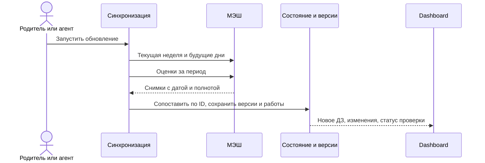

# Многодневный dashboard Education

Статус: **личные ссылки ведут сразу на ролевой dashboard; календарь и переход к существующей странице дня работают через Firestore. Многодневная синхронизация ещё не реализована**. Связанные контракты: [страница дня](day-page.md), [доступ и состояние](access-and-state.md), [оценки](grades.md), [тесты](quizzes.md), [материалы](materials.md) и [порт дневника](../architecture/school-diary-port-adapter.md). Карта: [README](README.md).

## Назначение и даты

Dashboard — точка входа ученика и родителя в сохранённые дни, ДЗ, оценки, тесты и работы. Основной блок всегда относится к дате, выбранной в календаре. При первом входе выбрана текущая московская дата; после перехода к подробной странице и возвращения выбор сохраняется в текущей вкладке. «Завтра» не хранится как дата ДЗ: в пятницу ближайшим днём сдачи может быть понедельник. Срез оценок показан отдельно и подписан своей датой.

В данных различаются `viewDate` (выбранная дата), `lessonDate` (дата урока), `dueDate` (срок сдачи ДЗ), `plannedWorkDate` (когда ученик собирается делать отдельную работу) и `fetchedAt` (время последней успешной проверки МЭШ). Все подписи для семьи вычисляются в `Europe/Moscow`. Владелец задания и результатов определяется уроком МЭШ, его точным предметом и устойчивым ID; `dueDate` только показывает срок сдачи и не меняет владельца. Если в задании четвергового спецкурса написано «сдать ... в среду», карточка и результаты остаются у спецкурса в четверг, а среда отображается как срок. Практикум в среду — другой предмет. Ранее загруженные фото и результаты остаются связанными доказательствами при исправлении ошибочной даты карточки. Незавершённое за прошедшую дату не переезжает на следующий день автоматически; работа, выполненная заранее, видна в карточке своего урока.

## Полоса дней и выбранный день

- При входе выбрана текущая московская дата. Нажатие на любую дату меняет **в этой же странице** заголовок, расписание, ДЗ, фото, результаты и спецкурс на сведения этой даты. Подробная страница открывается отдельной кнопкой из расписания или ДЗ; возвращение восстанавливает выбор календаря.
- Сегодняшняя дата отмечена тонкой рамкой; выбранная дата залита фиолетовым. При выборе прошлого или будущего дня сегодняшний день не остаётся главной карточкой.
- Полоса показывает сохранённые прошлые даты, текущую неделю и будущие даты с полученным расписанием. Прошедшие снимки МЭШ нельзя отфильтровывать только потому, что началась новая неделя.
- `dayPages/<token>` создаётся для даты планирования `date`, а его задания относятся к `targetDate`. Для календарной даты `D` расписание берётся из индексного снимка `D`, а подробное ДЗ — из опубликованной страницы, у которой `targetDate === D`. Индекс хранит отдельные `dayToken` для расписания и `homeworkDayToken` для ДЗ. Не показывать ДЗ следующего учебного дня при выборе `D`.
- Выходные и другие даты без школьного расписания остаются выбираемыми в полосе дней. Они не создают пустые школьные страницы. Отдельная работа на выходных показана в обзоре выбранной даты и связана со своим сроком сдачи.
- Выходной обзор может показывать несколько независимых карточек математики: геометрия привязана к своему уроку среды, спецкурс ДЗ-05 — к своему уроку четверга. Обе доступны в субботу и воскресенье для работы заранее; каждый блок открывает **свою опубликованную страницу**, использует её `problem.id`, фото и историю попыток. Копию задания между датами не создаём. В каждом блоке отдельно подписаны дата урока и срок сдачи; подготовка на выходных не переносит срок. Предлагаемый порядок решения остаётся советом Education и не расширяет требование учителя «реши сколько получится».
- Будущий день с расписанием доступен даже без ДЗ. В его блоке написано «ДЗ пока не опубликовано» и показано время последней успешной проверки. Формулировку «ДЗ нет» нельзя выводить из пустого ответа МЭШ.
- Если пришла только часть будущего расписания, интерфейс должен обозначить неполноту. Правило, по которому определяется полнота недели, нужно уточнить в реализации по данным МЭШ; отдельный ранний урок не следует выдавать за окончательное расписание.
- Обзор выбранного дня показывает краткий ход работы; подробные карточки используют существующий [контракт страницы дня](day-page.md#day-page): точные источники, фото, связанные тесты и их собственные статусы. Будущие задания доступны для работы заранее.

## Сводки ученика и родителя

Ученик видит расписание и действия к **выбранному дню**. Строки предметов ведут к конкретным заданиям, тестам и фото в существующей подробной странице. В выходные отдельно видно запланированную внешкольную работу для выбранной даты; она ссылается на **то же задание** и его срок сдачи, без второго независимого статуса.

Новая оценка показывается компактной карточкой: оценка, предмет, текущий средний; подробности раскрываются по нажатию. Общий блок оценок показывает все предметы с опубликованным средним и раскрывает список сохранённых отметок каждого предмета; дата среза не выдаётся за живую проверку МЭШ. Средний и условные сценарии подчиняются [контракту оценок](grades.md#dashboard-grade-list), включая спокойный вид чистой `5,00`. Балл, выполнение ДЗ и освоение навыка не смешиваются.

Родитель входит по отдельной ссылке без переключателя роли. На первом экране он видит изменения после синхронизации и открытые вопросы: добавленное или изменённое ДЗ, новые оценки, ожидающие разбора фото, исправления и тесты. Тексты учителя и версии заданий остаются доступны для сверки. Дополнительная детализация интерфейса родителя остаётся задачей прототипа; существующие права и [состояние Firestore](access-and-state.md) не заменяются общей публичной страницей.

### Ход ДЗ выбранной даты

Бейдж «Проверяем» возможен только для ожидающего фото или активного этапа разбора. Если фото уже разобраны, а `assessmentBasis.outcome: unresolved`, предмет получает нейтральный бейдж «Критерий неясен»; раскрытие сообщает, что подтверждено и почему нельзя установить школьный критерий. Если [отдельное поле `workCoverage`](review-criteria-provenance.md#work-coverage) подтверждает все назначенные действия на той же версии проверки, семейный статус становится «Работа сдана» и предмет переходит в список сделанного; критерий качества остаётся открытым. Новое ожидающее фото возвращает состояние ожидания. Это не новый долг ребёнка и не активная проверка. Следующий шаг для родителя — уточнить критерий учителя, если он нужен для окончательного вывода.

Виджет «Домашнее задание» выбранной даты строится из тех же заданий, фотографий `dayUploads`, разборов `dayProgress` и результатов ЦДЗ/тестов, что и страница дня. Предмет считается завершённым только после подтверждения **всех** его обязательных пунктов: выполненный лист не скрывает открытое ЦДЗ того же предмета. Простая загрузка фото или отправка теста не равна завершению.

Вверху кратко написано, требуется ли действие ученика. Предметы с незавершёнными действиями стоят первыми; каждая строка называет конкретный ближайший пункт и ведёт к его карточке. Затем отдельно показаны работы, по которым ожидаются проверка либо уточнение критерия и полнота предъявленного задания ещё не доказана. Полностью предъявленная работа с неясной оценкой относится к семейному списку сделанного с явной пометкой открытого критерия. Завершённые предметы по умолчанию собраны в раскрываемую строку «Сделано · N предметов»; внутри остаются названия и доступ к результату. Когда все обязательные пункты подтверждены, виджет прямо говорит «Всё заданное сделано». Когда действий ученика нет, но есть ожидающие решения вопросы, он говорит «От ученика пока не требуется действий», сохраняя эти вопросы видимыми. Если подробная модель ещё не опубликована, показывается точная запись МЭШ без выдуманного статуса. Данные меняются по подпискам Firestore без выпуска новой версии сайта при очередной проверке.

### Статус ДЗ в строке расписания

Каждый урок расписания выбранной даты показывает компактный раскрываемый бейдж. Стрелка находится **внутри** бейджа и выравнивается по центру вместе с текстом. Бейдж раскрывается и для «Пока нет ДЗ», и для завершённой, частичной, ожидающей проверки или неизвестной работы. Внутри перечислены конкретные подтверждённые пункты, пункты в проверке и то, что осталось сделать; нужный пункт открывается в подробном ДЗ с прокруткой и выделением его карточки. Один лист с отдельными задачами считает подтверждённые номера, а не только факт загрузки листа. Сданное фото и завершённый тест без результата не считаются проверенным выполнением.

Перед подсчётом применяются [правила для указателя «Файл здесь» и результатов связанных страниц дня](plan-generation.md#material-only-mesh-entries): указатель остаётся видимым в точной записи МЭШ, но не становится отдельным долгом; уже подтверждённое ЦДЗ той же даты и того же задания засчитывается независимо от даты создания страницы. Материал учителя остаётся при основном письменном пункте.

Источник — `dayDashboards` для расписания и точной записи МЭШ, `dayPages` для заданий, `dayUploads`, `dayProgress`, `dayParentDecisions` и `assignments` для живого состояния. [Родительское засчитывание](day-page.md#parent-acceptance) завершает пункт в семейном плане, но подпись «ответ верен, ход неполон» остаётся видимой; счётчик означает «завершено», а не «ход подтверждён». Пустая запись означает «Пока нет ДЗ» **на последней сверке**, а не обещание, что учитель не добавит задание позднее. В шапке расписания и раскрытии каждого бейджа показано время последней успешной сверки МЭШ. Для будущего дня без опубликованной страницы ДЗ используется «Уточняем». Если подробная страница ещё не готова, но запись МЭШ уже есть, показывать её точный текст с «Задано», не выдумывая выполнение. Цвет дополняет текст, а не заменяет его.

При выпуске индекса `day/dashboard-index.mjs` и `scripts/day.mjs` сравнивают текущие записи ДЗ с предыдущим индексом Firestore. Для добавленного либо изменённого предмета сохраняются `homeworkUpdate.at` и `homeworkUpdate.subjects`. На обеих ролях у такого урока три дня показано «Новое ДЗ» и время изменения; повторная публикация без изменения не сбрасывает эту дату. Это временное выделение, а не персональная отметка прочтения. Адресное обновление с `readAt` появляется в [центре обновлений](../architecture/activity-and-inbox.md#in-app-center); системный push [не включён](pwa.md#push). Реализация: `src/DayDashboard.tsx`, `src/DayDashboard.css`, адресная прокрутка в `src/DayPage.tsx` и раскрытие листа в `src/components/ProblemGroup.tsx`.

## Повторяемая синхронизация

Один запуск проверяет заново даты **текущей недели** и **все будущие дни, для которых обнаружено расписание**. Отдельно он получает сводку оценок за текущий аттестационный период, чтобы поздняя публикация оценки за прошлый урок не зависела от окна ДЗ. Сканирование будущего горизонта должно обнаруживать новые дни; фиксированный список ранее сохранённых дат для этого недостаточен. Безопасный предел запросов и способ обнаружения конца горизонта требуют отдельного технического решения.

Синхронизация хранит время и полноту каждого ответа, сравнивает записи МЭШ по устойчивому ID урока/задания и публикует **только подтверждённое изменение**. При ошибке доступа последний успешный снимок остаётся, но его возраст виден; ошибка не превращает задания в «отменённые». Два урока с одинаковым текстом ДЗ сохраняют свои исходные ID: визуальная группировка допустима только без потери происхождения и статусов.

Новое ДЗ показывается сразу **точным текстом МЭШ** с пометкой «разбор готовится». Позже агент сверяет учебник, материалы, формулирует действия и при необходимости связывает тест; неподтверждённый текст не маскируется под проверенный разбор. Условия [точного источника](materials.md) и [создания теста](quizzes.md) сохраняются.

Если учитель убрал задание, оно уходит из актуального плана, а прежнее условие, фото, ответы и история изменения сохраняются; родитель видит отмену. Если текст изменился после загрузки работы, фото не теряется, появляется статус «условие изменилось — сверить работу». Ни изменение, ни отмена не удаляют доказательства и не назначают новую загрузку автоматически. В старые незавершённые ДЗ других дат эти изменения не переносятся.

## Граница первой реализации

Пилот даёт отдельные ролевые маршруты dashboard, полосу сохранённых дат, переключение обзора без перехода, ссылку на существующую страницу дня и обратно, точные снимки МЭШ для дат без подробной страницы, ДЗ выбранной даты с живым ходом фото и тестов и сохранённый срез оценок. Личная ссылка открывает dashboard; старый статичный макет `education-quizzes/.local/prototypes/dashboard-v1.html` не является точкой входа. Для дат без `dayPages` показываются точные записи МЭШ и время проверки.

Индекс строится из **уже сохранённых** снимков начиная с самой ранней сохранённой даты и до последней сохранённой даты либо конца текущей недели; он не обнаруживает новые будущие дни сам. Команда `day refresh` проверяет выбранный день и ближайший учебный день, но ещё не выполняет контракт [многодневной синхронизации](#multi-day-sync). Каноническая база версий заданий, реакция на отмену или изменение условия, полнота будущего расписания и отдельная сводка спецкурса выходных остаются открытыми. При их реализации нужно сохранить существующие Firestore-фото, попытки тестов и токены дней.

## Источник интерфейса и доступ

`dayDashboards/<token>` — ролевой индекс дат. Он содержит проверенные снимки МЭШ: расписание, точные записи ДЗ, `checkedAt`, признак полноты, `dayToken` страницы с расписанием этой даты и `homeworkDayToken` страницы с заданиями к этой дате. Команда `day dashboard` строит этот индекс из закрытых снимков; `day publish` обновляет его в одном пакете с двумя документами дня. Индекс содержит `familyId` и `childId`; правило Firestore разрешает чтение только действующему участнику этой семьи, привязанному к ребёнку, и только в своей роли. Токены сохраняются только в `.local/day-dashboard-links.json` и не попадают в Git.

`DayDashboard` подписывается на индекс в Firestore, на `dayPages/<homeworkDayToken>` выбранной даты, фото в `dayUploads` и связанные попытки в `assignments`. Срез оценок читается отдельно из последней опубликованной страницы. Интерфейс не хранит даты, ДЗ, оценки и статусы ученика в HTML или коде. Пустой будущий день обозначается по ответу МЭШ и времени проверки; отсутствие документа дня не подменяется выдуманной карточкой. Для дат без опубликованного `dayPages` индекс остаётся только точной записью МЭШ.

После входа по личной ссылке открывается dashboard без промежуточной карточки профиля. При нескольких детях взрослый выбирает ребёнка в панели; данные каждого индекса проверяются по семейной связи. Выбор даты меняет обзор без перехода, а кнопка подробного расписания или ДЗ открывает существующую страницу дня с фото, тестами и материалами. Кнопка «На главную» возвращает в dashboard; ссылка личного входа и установленная PWA также восстанавливают его. Прямые старые ссылки дня продолжают работать и ведут назад через личную главную страницу.

Текущий командный индекс строится для одной уже привязанной семьи из `legacyDayOwner`; отдельные индексы на каждого ребёнка понадобятся перед публикацией второго ребёнка. Правило чтения не разрешает перечислять индексы или записывать их из браузера.
