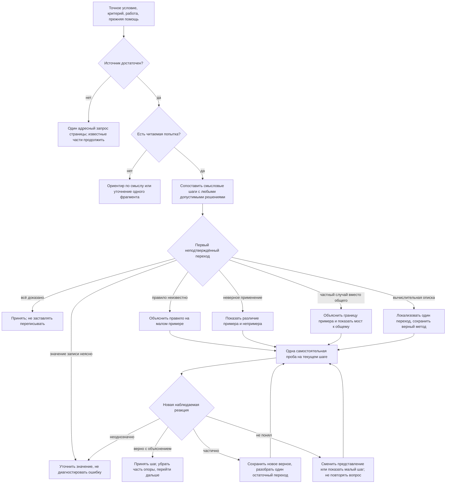

# Персональное объяснение вместо отчёта об ошибке

## Источники и выводы

Ревизия прежних исследований от10–25октября: идеи дозирования уже приняты, но публикация
проверяла в основном наличие текстовых полей. Наличие вопроса не подтверждает помощь.

| Проверенный источник | Что следует для нашей задачи |
|---|---|
| [EEF, Teacher Feedback to Improve Pupil Learning,2021](https://educationendowmentfoundation.org.uk/education-evidence/guidance-reports/feedback) | Начинать с наблюдаемой работы и нужного продвижения. Важен способ использования обратной связи, а не число блоков или письменная форма. Само сообщение о недочёте ещё не обучает. |
| [AERO, Explicit instruction,2026](https://www.edresearch.edu.au/guides-resources/practice-guides/glance-explicit-instruction) | Показать небольшой переход и объяснить его связь с известным; затем предложить посильную пробу. Проверять понимание и уменьшать поддержку по мере готовности. Это гибкий подход, а не сценарий одинаковых реплик. |
| [IES/WWC, Organizing Instruction,2007,рекомендации2/4/7](https://ies.ed.gov/ncee/wwc/PracticeGuide/1) | Чередовать разобранные примеры с самостоятельной работой, связывать конкретную модель и абстрактную запись, просить объяснение связи. Не вводить букву до объяснения обозначаемой величины. |
| [Aleven,McLaren,Koedinger, Help-Seeking,2006,с.4–5](https://www.cs.cmu.edu/~bmclaren/pubs/AlevenEtAl-HelpSeekingChapter-HelpSeeking2006.pdf) | Помощь, относящаяся к текущему шагу задачи, снимает часть нагрузки по самостоятельному поиску применения общего правила. Возможны разные уровни помощи; одна общая отсылка к справочнику не равноценна адресной подсказке. |

Не существует доказанного универсального правила «один вопрос всегда лучше объяснения».
Один основной ход за обмен ограничивает нагрузку и сохраняет диалог, но перед ним может быть
нужное объяснение, короткий показ или аналогия. Поддержку не следует удерживать ради формальности.

## Алгоритм репетитора

Это наш операционный синтез исследований, не установленный ими универсальный алгоритм.

Перед текстом составить закрытый tutoringPlan: точный якорь работы, что уже связано правильно,
первый пробел, почему выбирается помощь, конкретное объяснение-мост, одна проба,
ожидаемое свидетельство понимания и разные ветки correct/partial/stuck/ambiguous.
Отсутствие ответа не является «не понял». Две неудачные реплики не доказывают неспособность.

Ребёнку показывать связную речь: «В твоей строке… связь верна, потому что… Здесь вывод
пока относится только к… Разница вот в чём… Теперь попробуй…». Это смысловой контракт,
а не обязательные буквальные фразы. Родителю — тот же якорь, полный допустимый путь,
почему подсказка относится к этому шагу, что считать продвижением и чем помочь при затруднении.
Служебные сведения о проверке и цитату условия не подмешивать вместо объяснения.

## Предметные развилки

| Вид требуемой работы | Объясняющая модель | Наблюдаемая самостоятельная проба |
|---|---|---|
| Вычисление, уравнение | Значение операции, величина, единица, одна равносильная строка | Один переход с объяснением; при описке не повторять весь метод |
| Доказательство, все варианты | Что установил пример; что требуется для любого случая; граница перебора | Один общий переход или один ещё не исследованный случай |
| Построение, геометрия | Условие рисунка, допустимые элементы, проверка конструкции | Один элемент конструкции с проверкой требования |
| Изложение | Микротема исходного текста → существенные события → пересказ без выдумки | Пересказать одну микротему, сохранив смысл |
| Сочинение, литературное обоснование | Тезис → точное свидетельство → объяснение, что оно доказывает | Связать один свой тезис и пример, не писать работу за ученика |
| Язык, диалог | Ситуация, смысл реплики, нужная форма, отличие близкой неверной формы | Одна реплика или преобразование в той же ситуации |
| История, биология, география | Источник → факт/признак → связь/причина, отличия похожих понятий | Объяснить одну связь по конкретному фрагменту источника |
| Повторение правила | Точное правило, пример и непример, применение | Адресная самопроверка Education после подтверждения источника |

Предмет и тип урока уточняют модель, не задают оценку. Один предмет содержит разные виды
результата. Методическое обогащение не расширяет обязательный объём учителя.

## Границы

Проверка структуры не может доказать, что объяснение понятно конкретному ребёнку.
Репетитор обязан смыслово проверить математическую точность, связь с фото, доступность,
отсутствие решающего ответа и посильность пробы. Критерий действенности — следующая работа,
а не длина текста. Сохранённый граф не является уже реализованным автоматическим диалогом.
