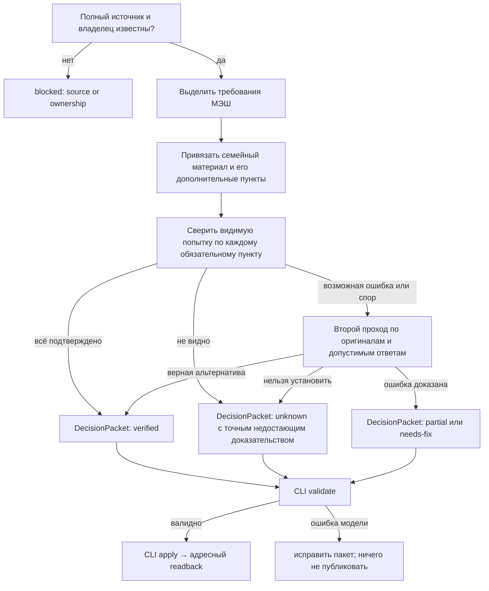

# Операторское ядро Education {#operator-core}

`task:presentation` принимает `assignmentUnits`, точное `expectedAssignmentUnits` и, при существующем закрытом гиде, `expectedGuideRevision`. [Общая проверка единиц](../../modules/assignments/source-units.md#publication) сохраняет все этапы и принимает только источники/тесты того же назначения. Dry run ничего не записывает; apply адресно обновляет обе роли и перечитывает их, прежние фото/ответы не меняет.

Для подтверждённого семьёй переноса листа между курсами: `npm run day:route -- REQUEST.json` (dry run), затем `--apply` и указанный в квитанции `day publish-batch`. [Схема пакета и ограничения](../../modules/synchronization/plan-generation.md#assignment-routing) сохраняют исходный МЭШ, единственного владельца и прежние доказательства. Это обогащение назначения, не сбор нового снимка и не изменение ответа ребёнка.

Статус: **единый CLI-контракт введён; существующие доменные обработчики подключаются поэтапно**. Этот документ описывает фактическую границу между механической работой CLI и решениями учебного агента. Он связан с [глобальной синхронизацией](../../modules/synchronization/global-sync.md), [исходниками и семейными правами](../../modules/synchronization/shared-artifact-pipeline.md), [графом самопроверок](../../modules/assessments/assessment-decision-graph.md) и [основаниями проверки](../../modules/reviews/review-criteria-provenance.md).

## Почему нужен единый путь

Переписка 9–16 октября и история изменений показывают пять повторяющихся сбоев:

| Повторяющаяся работа | Наблюдавшийся сбой | Закреплённая граница |
| --- | --- | --- |
| Сбор МЭШ, оценок и расписания | Агент снова соединял `collect`, числовой срез, публикацию и обратное чтение вручную; подробности оценок однажды исчезли | Неизменяемый снимок → сравнение по ID/ревизии → адресная запись → чтение обеих ролей; операция и метрики в одной квитанции |
| Разбор русских, английских и математических работ | Учебник расширял обязательное задание МЭШ; обрезанное фото превращалось в «не сделано» | Для каждого требования: источник МЭШ, контекст материала, фактически видимое, `confirmed / not-met / unknown`; сомнение запускает второй проход |
| Тесты и работа над ошибками | Порог 85%, обязательность и связанный тест неоднократно расходились со статусами | Один граф решения и проверенный `quiz.json` с закрытым планом; создание через `validate → create → readback` |
| Карточки и ролевые статусы | Исчезали лист учителя, оригинал номера, комментарии к оценке и переключатели | Общая проекция из сохранённого результата, контракт компонентов и интеграционные тесты прежних сценариев |
| Операторская очередь | Одни и те же ID приходилось искать и закрывать вручную; длительность запуска было трудно объяснить | Устойчивый ID, фаза, входная ревизия, причина блокировки, повторный scan, тайминги по этапам |

Это не пять разных предметных процессов. Общий граф содержит шесть стадий: **обнаружить → захватить исходник → связать источники → вынести предметное решение → применить → перечитать**. Русский, литература, английский и математика различаются содержательным адаптером решения, но формат доказательства, статуса и публикации общий.

## Модель данных и границы {#data-model}

| Сущность | Минимальное содержание | Кто её создаёт | Кто может менять |
| --- | --- | --- | --- |
| `SourceRecord` | семейный владелец, ID МЭШ/попытки/фото, полный оригинал, время, SHA-256, ревизия, полнота | CLI-адаптер источника | Никто; новая ревизия создаёт новый захват |
| `EvidenceBundle` | точное назначение МЭШ, подтверждённое семейное издание, фрагменты оригинала, видимая попытка, ссылки на ревизии | CLI собирает ссылки; агент подтверждает смысл | Только новая ревизия с происхождением |
| `DecisionPacket` | структурированный `review.json`, `quiz.json` + `assessment-plan.json` или адресный план дня; статус каждого обязательного пункта и один следующий шаг | Агент после чтения доказательств | Агент создаёт новую ревизию; CLI валидирует форму и семейную связь |
| `OperationRequest` | `schemaVersion`, зарегистрированный `operation`, типизированный `input`; никаких произвольных команд | Агент или механический рецепт | Неизменяемый файл запроса |
| `OperationReceipt` | отпечаток запроса и содержимого, время, фаза, счётчики, закрытый stdout, результат применения | CLI-ядро | Только переход `started → succeeded` или `started → needs-readback` |
| `Projection` | адресные документы Firestore ребёнка и родителя без чужой семьи и закрытого ключа | Доменные CLI-адаптеры | Только подтверждённая публикация с обратным чтением |

`SourceRecord` и `EvidenceBundle` уже представлены снимками `.local/diary`, оригиналами, семейным графом, `day-source` и закрытыми файлами. Единого физического `EvidenceBundle` для всех предметов пока нет. `DecisionPacket` уже имеет работающие предметные схемы; новый CLI не вводит вторую конкурирующую схему содержания. Новые `OperationRequest` и `OperationReceipt` живут в `operator/` и закрытом `.local/operator-runs/`.

### Источник истины для проверки

1. Дословное назначение МЭШ и прямое уточнение учителя определяют **обязательный объём**.
2. Семейный учебник, лист и методика уточняют содержание, но дополнительные действия остаются опциональными, пока учитель их не назначил.
3. Фото/ответ ребёнка доказывает только видимое. Отсутствующее в кадре — `unknown`, а не `not-met`.
4. Неполный или спорный вывод требует второго чтения всех оригиналов и сильнейшей добросовестной трактовки в пользу ученика.
5. Публикуемый статус следует из отдельных требований, а не из общего впечатления о работе. Учебный совет не подменяет школьную оценку.

## Граф решений для агента {#decision-graph}

Для теста `DecisionPacket` проходит [граф самопроверок](../../modules/assessments/assessment-decision-graph.md): ниже 85% — адресное продолжение после полной проверки, при 85–99% — только по запросу родителя, при 100% — без работы над ошибками. План содержит текущую тему, подтверждённые старые ошибки, отдельное интервальное повторение и перенос. Для письменной работы используется общий `assessmentBasis`/`requirementChecks`; предметный адаптер меняет критерий, но не происхождение требования.

## Контракт операции {#operation-contract}

Перед новым тестом `npm run quiz:plan -- INPUT.json OUTPUT.json` рассчитывает закрытые слоты выбора, самостоятельного ответа и объяснения. `npm run quiz:plan -- check PLAN.json QUIZ.json` проверяет фактические форматы. Тот же обязательный барьер встроен в quiz validate/create/revise-open; `npm run check:assessment-formats` включён в общий check. [Входы, исключение диктанта и пределы](../../modules/assessments/format-plan.md).

Каждый scan сохраняет детерминированный [план по предметам, источникам и событиям](../../modules/synchronization/task-routing.md). `npm run education -- plan SCAN_RUN_UUID` извлекает его в закрытый JSON из существующего stdout.routePlan; возвращает время и агрегаты. Это локальная диагностика, не новая синхронизация и не complete. Отсутствующая страница без валидного запроса теперь создаёт material-needed; публикация запроса не закрывает предметное обогащение.

Полный запуск начинается `npm run education -- begin --apply`: queue.scan, project.plan и project.collect вызываются в фиксированном порядке заново каждый раз. Начало не является завершением: обработка задач, публикация/readback и finalize остаются обязательны. discover — отдельная диагностическая граница без полного сбора.

Вход CLI — JSON-файл вида `{"schemaVersion":1,"operation":"grades.snapshot","input":{"sourceDate":"2026-10-19","reportPath":"reports/2026-10-16-education-sync/baseline.md"}}`. Команда `npm run education -- catalog` возвращает фиксированный реестр, `npm run education -- run REQUEST.json` делает чтение/предпросмотр, `--apply` разрешает запись, `status` собирает проектный статус, `discover --apply` начинает очередь и инвентаризацию, `finalize --apply` повторяет inbox и очередь. `result RUN_UUID` читает безопасную сводку квитанции. Произвольные скрипты, SQL/Firestore-пути и имена исполняемых файлов во входе запрещены.

Аудиоматериалы проходят `audio.discover`, `audio.sync` и `audio.link`: [каталог и плеер](../../modules/materials/audio-library.md#sync). Первые две операции требуют `--apply`; связь поддерживает предпросмотр и отпечаток входного пакета.

Операции в реестре: `project.plan/collect/audit`, `inbox.snapshot`, `queue.list/scan`, `grades.snapshot/publish`, `calendar.publish`, `day.audit`, `quiz.validate/publish/revise-open`, `review.validate/publish`. Они делегируют уже существующим доменным CLI; не делают скрытой педагогической оценки. `quiz.publish` и `quiz.revise-open` требуют явный `personId` из закрытого реестра семей. `quiz.revise-open` допускает только ещё не начатую открытую попытку: сверяет исходные ошибки, целевой объём и план, транзакцией сохраняет идентификатор и ссылку, затем читает назначение, ключ, предпросмотр и ролевые индексы. Начатую попытку операция не меняет. Переход `project.phase complete` пока оставлен в предметной команде: общий CLI не принимает произвольную строку как доказательство обратной проверки. Пакет записи сначала проходит соответствующий валидатор. Квитанция сохраняется с правами `0600`; stdout с личными ссылками остаётся только там, в обычный вывод попадают разрешённые агрегаты. Отпечаток теста включает JSON и закрытый assessment plan. Та же успешная публикация повторно не создаётся; исход с потерянным подтверждением требует readback, а не слепого повторения.

## Метрики и критерии завершения {#execution}

`project.audit` принимает только `runId` и повторно проверяет сохранённый publication window без инвентаризации, сбора и перевода фазы. Успех требует точного статуса `publication-verified`, 42 полных дат, пустого списка ожидания, `readOnly:true`, `receiptReadOnly:true`, `workflowPhaseChanged:false` и receipt вида `project-sync/audit-receipts/RUNID-UUID.json`. Operator wrapper отвергает отсутствующий, чужой или не-private receipt; `pending`/`blocked` сохраняются как `partial`. Ни один из этих статусов не означает workflow complete.

`catalog` и `describe OPERATION` возвращают назначение и трактовку результата рядом с контрактом входа. Фиксированные рецепты в `operator/recipes.mjs`: `discover` = `queue.scan → project.plan`, `finalize` = `queue.scan`; полный свежий inbox сохранён внутри закрытого результата сканирования. Второй прямой inbox в этих рецептах запрещён тестом. Неполный снимок останавливает рецепт; его нельзя считать пустым. `status` остаётся отдельным чтением `plan → inbox → queue.list`.

Сводка `project.collect` сохраняет `sourceState`, `sourceJournal`, `report` и `timing`. Если доменный сбор вернул частичное состояние, оболочка возвращает `status=partial` с причинами; это не неопределённая публикация. `day.audit` подтверждает `verified` только при явном пустом `problems`; пропущенное поле или найденная проблема завершают операцию ошибкой. Полные личные данные доступны только в закрытой квитанции. Результат `partial` требует продолжения по журналу; общий цикл не становится успешным от успешного запуска CLI.

Для каждой операции квитанция фиксирует `elapsedMs`, байты вывода и код/причину ошибки. Доменные обработчики добавляют `phaseMs`, число SDK-вызовов и доставленных документов, где такие измерения уже существуют. Это **не** счётчик оплаченных Firestore reads: при оптимизации сравнивай одинаковые сценарии и отдельно смотри консоль Firebase. Публикацию можно назвать подтверждённой только по адресному readback; успешный выход команды без такого доказательства означает лишь «применено». Для `quiz.create` readback назначения встроен, для `review.publish` читаются закрытая и ученическая проекции и фото; для остальных применяй их доменный аудит или фазу `project.phase complete`. Квитанция `reused` означает подтверждение **прошлой публикации того же пакета**, а не новое доказательство актуальности Firestore: перед объявлением текущего статуса сравни источник и адресную проекцию. По возможности валидируй перед записью; при ошибке старый проверенный результат остаётся доступным.

## Состояние и следующие ограничения

Введены CLI-ядро, типизированный реестр, закрытые квитанции, метрики времени, защита от повторной публикации одного теста/разбора и отдельная проверка `submissions validate`. Старые команды продолжают работать, чтобы не менять живые данные или UI. Это первая совместимая оболочка, а не объявление всей синхронизации автоматической: `project.collect` ещё требует человеческой сверки нового ДЗ и семейного издания; числовой `grades:snapshot` пока обслуживает прежнее локальное рабочее пространство; единого хранилища `EvidenceBundle` и атомарной аренды педагогической проверки нет. Эти пункты нельзя закрывать пустым отчётом или новой карточкой по догадке. Следующий перенос — общий семейно-адресный числовой срез и автоматический рецепт публикации только бесспорных изменений расписания/оценок, после тестов на две семьи и повторный запуск.

Операторский `sync:project` и Telegram runtime теперь используют общий [server runtime](../../shared/server-runtime.md) для Google Firestore/ADC, семейного графа, Mesh credentials/session и телеметрии. `scripts/lib/admin-firebase.mjs` сохраняет совместимый вызов старых семейных CLI. Исторический `.local/diary` допускается только при явном exact-owner подтверждении через `family-access.legacyDayOwner`, actor hash и source registry; другой файл credentials автоматически не подбирается. Межпроцессная lock защищает один физический account между sync и worker на одном macOS/Linux хосте через Python3/fcntl. Эти изменения описывают код и локальные проверки, не deployment или live end-to-end.

## Entrypoints and effects

Полнота критериев и запись наблюдений: `submissions criteria-export DAY_TOKEN TASK_ID
.local/packet.json` экспортирует точные исходники/отпечатки; агент сверяет оригиналы
и заполняет полную опись. `submissions criteria .local/packet.json` регистрирует её
в отдельном закрытом документе с readback. `submissions validate/review/feedback`
применяет обязательный gate: пропущенный критерий не даёт нового зачёта. Для этого
внутреннего этапа не запрашивается новое разрешение пользователя.

`quiz export TOKEN .local/attempt.json` выдаёт attemptFingerprint и
priorReviewFingerprint с закрытой рубрикой. `quiz rubric TOKEN .local/rubric.json`
сохраняет полные критерии открытых вопросов в quizReviewPrivate с историей; затем
экспорт перечитывается. `quiz review TOKEN .local/review.json` сверяет каждый критерий,
баллы, прежний разбор и свежесть попытки. Перед подготовкой объяснения оператор
выбирает [ветку разбора открытого ответа](../../modules/assessments/assessment-decision-graph.md#open-answer-feedback).
Коррекция требует correctionReason.
Результат и learningEvidence сохраняются атомарно, обе проекции и знания перечитываются.

Операторский runtime состоит из типизированных CLI-команд, а не одного фонового сервиса. Каждая команда возвращает проверяемый результат; смысловую интерпретацию и педагогические решения принимает оператор/агент.

| Command | Input → output | Contract |
|---|---|---|
| `npm run day` (`scripts/day.mjs`) | снимки источника и выбранная операция → проверенный день и результат обратного чтения | [Synchronization](../../modules/synchronization/README.md) |
| `npm run quiz` (`scripts/quiz.mjs`) | план вопросов и источники → проверенный пакет проверки и квитанция публикации | [Assessments](../../modules/assessments/README.md) |
| `npm run diary` (`diary/cli.mjs`) | настройки семьи/ребёнка → снимок дневника МЭШ | [School diary](../../modules/school-diary/README.md) |
| `npm run family:access` (`scripts/access-management.mjs`) | запрос доступа → проверенное состояние семейной связи | [Families](../../modules/families/README.md) |

Для адресной редакции существующего закрытого родительского пути используется `npm run guide:edit -- .local/edit.json [--apply]`. [Контракт пакета](../../modules/reviews/method-guided-solutions.md#адресная-редактура) требует ожидаемую ревизию guide и задания, неизменные stage IDs/источники и readback. Это доменный CLI, ещё не зарегистрированная операция общего `education run`; изменение верстки не создаёт новую проверку ребёнка.

`npm run review:presentation -- export DAY TASK .local/export.json`, затем
`edit .local/packet.json [--apply]` — отдельная [коррекция вопроса и модели ответа](../../shared/design/student-review-step.md#addressed-presentation-migration).
Она сохраняет предметный вердикт и знания, требует свежие отпечатки источника,
обеих проекций, фото и помощи; не заменяет `submissions feedback` для нового зачёта
или исправления оценки. Новые уведомления и расписания этим действием не создаются.

Адресный `quiz:parent-review export/publish` подготавливает один полный родительский
разбор без изменения попытки, баллов или помощи ученика. Сверка источника остаётся
за автором; структура, CAS, архив и readback обязательны.
[Ролевой контракт](../../modules/reviews/parent-review.md#publication).

`task-presentation .local/packet.json --dry-run|--apply` также назначает проверенный тест этапу: change содержит `taskId`, `expectedGuideRevision`, `expectedStageAssessments` (точное прежнее значение либо []), `stageAssessments` [{stageId,title,scope,token}]. Тест уже назначен в том же предмете testPlacements, ID этапа существует в закрытом guide. CAS охватывает обе роли, владельца и guide; меняются только безопасные связи, сохраняются guide, фото, решения семьи и попытки. Изменение учителем текста снимает прежнюю связь вместе с интерпретацией. Оператор сохраняет связь и в приватном day-source, чтобы следующая публикация не потеряла исправление.

В том же адресном пакете `learnerFlowBoundary` с `expectedLearnerFlowBoundary` исправляет только устаревшую поясняющую границу. Исходный объём, цель, источник и все этапы неизменны; CAS сохраняет новые ответы и прежние переключатели. Это позволяет убрать старое «запись ещё не известна» после принятия работы, не менять задание целиком.
