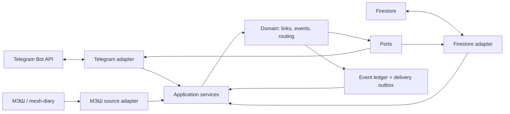

# Архитектура сервиса уведомлений `@agi_edu_bot`

**Статус:** архитектура частично реализована: account registry, подтверждённый `/stop`, typed event/diff/renderer и Firestore ledger/outbox primitives доступны. Production source observation и deployment не объявлены.
**Исправления 17 октября:** strict snapshot completeness, идемпотентные context refs и учёт доступности канала реализованы и покрыты регрессиями; [решение и проверки](../../decisions/telegram-review-fixes-2026-10-17.md). Source wiring, link issuer/UI и rollout остаются незавершёнными.
**Владелец:** отдельный Node.js worker в Education.
**Бизнес-контракт и решения интервью:** [спецификация сервиса](petr-private:docs/product/agi-edu-bot-service-spec.md).

## Назначение

Сервис детерминированно обнаруживает подтверждённые изменения в источниках PETR, связывает их с семьёй и ребёнком, сохраняет событие и доставляет родителям и команде структурированные Telegram-сообщения. LLM не участвует в обнаружении, классификации, маршрутизации или отправке. Сервис не изменяет учебные данные и не запускает педагогическую проверку.

Этот документ — корневой архитектурный контракт. Он фиксирует устойчивые границы, правила зависимостей и точки расширения; подробности принадлежат дочерним спецификациям. Дочерний документ может иметь собственные подмодули. Поддерживать этот файл короче 700 строк; предпочтительный размер — до 300.

## Границы и инварианты

- Сервис является отдельным worker-процессом, а не частью PWA или браузерного клиента.
- Доменное ядро не импортирует grammY, Firestore SDK, МЭШ-клиент, Firebase Admin или переменные окружения.
- Все внешние взаимодействия проходят через объявленные порты; адаптеры переводят внешние данные в контракт ядра.
- Неизвестные, неполные или неподтверждённые данные не превращаются в событие удаления, оценки или завершения.
- События идентифицируются устойчивым ключом источника и ревизии; повторный сигнал не создаёт повторную доставку.
- Сначала сохраняется событие и задание доставки, затем выполняется отправка. Ошибка Telegram не теряет подтверждённое событие.
- Получатель определяется только через проверенную связь Telegram account → семья → роль/ребёнок. Имя, username и текст источника не являются доказательством доступа.
- Первая версия уведомляет родителей/опекунов и команду PETR. Прямой канал ребёнку, действия из сообщений и запуск Education/Codex остаются за границей.
- Начальный снимок источника задаёт базовую точку и не рассылается как история.
- Учебные документы остаются источником истины; реестр Telegram, события и outbox — отдельные служебные данные.

## Контекст и поток



Поток изменения:

1. Источник выдаёт сигнал или новый полный снимок.
2. Адаптер проверяет полноту и преобразует данные в `SourceObservation`.
3. Доменный diff/classifier выдаёт ноль или несколько нормализованных `DomainEvent`.
4. Event ledger атомарно фиксирует событие по idempotency key и создаёт delivery jobs.
5. Router выбирает только активные, подтверждённые связи и получателей.
6. Renderer создаёт структурированный текст из события и безопасного контекста.
7. Telegram adapter отправляет части сообщения; результат и попытки записываются в outbox.

Сигналы Firebase могут дублироваться и приходить не по порядку. Адаптер обязан читать актуальный документ/ревизию, не считать сигнал самодостаточным содержимым. МЭШ подключается через полный валидный снимок и diff; только успешный полный снимок может продвинуть baseline.

## Карта модулей

| Модуль | Ответственность | Спецификация |
|---|---|---|
| Domain contracts и порты | Типы, идентичность события, версии контрактов, интерфейсы ядра | [Порты и события](ports-and-events.md) |
| Firebase source adapter | Наблюдение Firestore, проверка владения, преобразование snapshot в observation | [Адаптер Firestore](adapters/firestore.md) |
| МЭШ source adapter | Плановый опрос, полный снимок, нормализация и безопасный diff | [Адаптер МЭШ](adapters/mesh.md) |
| Telegram identity/linking | Регистрация аккаунта, одноразовая привязка, отключение и реестр доступа | [Идентичность и привязка](identity-and-linking.md) |
| Event ledger и delivery outbox | Идемпотентность, устойчивые события, очередь, повторы, восстановление | [Журнал и outbox](event-ledger-outbox.md) |
| Routing, rendering, delivery | Получатели, группировка, шаблоны, Telegram limits и отправка | [Маршрутизация и доставка](delivery.md) |
| Runtime и operations | Конфигурация, жизненный цикл, секреты, здоровье и эксплуатационные сигналы | [Runtime и эксплуатация](operations.md) |

Каждый дочерний контракт должен оставаться самостоятельным и обычно короче 500 строк. Если у одного контракта появляются разные источники, протоколы или циклы выпуска, вынести их в подмодули, оставив родителю только инварианты и ссылки. Не копировать один контракт в несколько документов.

## Порты ядра

Имена ниже — логические порты, не готовые интерфейсы кода. Реализация должна сохранить эти границы.

| Порт | Операции/ответственность | Первые адаптеры |
|---|---|---|
| `SourceObservationPort` | Запустить/остановить наблюдение, вернуть нормализованную observation и checkpoint | Firestore listener; МЭШ poller |
| `IdentityRegistryPort` | Найти Telegram account, активные family links и адресатов; создать/отозвать link | Firestore registry |
| `EventLedgerPort` | Атомарно записать уникальное событие и его исходные ссылки; читать прогресс обработки | Firestore ledger |
| `DeliveryOutboxPort` | Создать/захватить/завершить job, записать попытку и `retryAt` | Firestore outbox |
| `MessageRendererPort` | Преобразовать событие и разрешённый контекст в одну или несколько частей | Deterministic template renderer |
| `TelegramDeliveryPort` | Отправить текст/части, вернуть message IDs либо классифицированную ошибку | grammY Bot API adapter |
| `ClockPort` | Текущее время и задержки для окон/повторов | System clock |
| `LoggerPort` | Структурированные безопасные операционные записи | stdout JSON logger |

Доменное ядро зависит от портов; адаптеры зависят от порт-контрактов. Адаптеры не вызывают друг друга напрямую. Application services связывают шаги процесса и транзакционные границы. Для новых источников добавляется source adapter и mapping specification; для нового канала доставки добавляется delivery adapter и renderer, не меняя классификатор существующих событий.

## Контракты данных

Общие обязательные поля нормализованного события:

```text
schemaVersion, eventId, source, sourceEventKey, sourceRevision,
eventType, familyId, childId, occurredAt, detectedAt,
subject?, title?, before?, after?, contextRefs[], privacyClass
```

- `eventId` стабилен при повторной обработке одной ревизии и вычисляется без случайных компонентов.
- `occurredAt` берётся из источника, если подтверждён; `detectedAt` — время worker. Не подменять одно другим.
- `before`/`after` содержат только поля, нужные получателю. Закрытые ответы, пароли, токены, закрытые пояснения и сырые payload целиком не попадают в Telegram.
- `contextRefs` — типизированные внутренние ссылки/идентификаторы; адаптер renderer превращает их в URL только при наличии безопасного маршрута.
- Смена схемы делается явно через `schemaVersion`; совместимость читателей и сохранённых документов описывается до миграции.

Подробная семантика event types, idempotency keys, состояний jobs, retry policy и схем коллекций находится в дочерних спецификациях.

## Расширение без перестройки ядра

1. **Новый источник**: определить владение и полноту сигнала; добавить source-specific spec, adapter, mapping в стабильные `eventType`, fixture-контракт и checkpoint. Нельзя добавлять SDK-логику в домен.
2. **Новый тип события**: описать наблюдаемые поля, допустимые изменения, неизвестные/удалённые состояния и ключ дедупликации; добавить renderer mapping и проверочные примеры. Не распознавать тип по свободному тексту через LLM.
3. **Новый получатель/роль**: расширить identity policy и resolver с явным правилом авторизации и privacy class. Не выводить права из Telegram username.
4. **Новый канал**: реализовать `DeliveryPort`, адаптировать части/ошибки и outbox policy. Источник не должен знать о Telegram.
5. **Новый deployment**: заменить entrypoint/runtime adapter согласно operations spec. Use case и порты остаются прежними.
6. **Новая настройка события**: только после отдельного контракта предпочтений; отсутствие настройки трактуется единообразно, миграция существующих связей описывается явно.

Каждое расширение обновляет этот root только если меняется общая граница или инвариант; остальные изменения остаются в модульном документе. Новые документы связываются в [карте продукта](../../product/README.md) и [карте файлов](../../file-map.md).

## Порядок реализации и состояние

| Этап | Результат | Статус |
|---|---|---|
| A | Архитектура, события, privacy boundary, deployment decision | Спецификация в работе; данный документ — целевая граница |
| B | Core contracts, Firestore ledger/outbox, тестируемая идемпотентность | Частично; source wiring planned |
| C | Telegram `/start`, реестр аккаунтов и безопасная семейная привязка | Частично; registry/disconnect есть, issuer UI отсутствует |
| D | Firestore observation, затем МЭШ polling и source mappings | Не реализовано |
| E | Routing, structured templates, retry/recovery и team alerts | Частично; family renderer/outbox есть, grouping/team route отсутствуют |
| F | Операционный запуск, минимальные IAM/secrets, мониторинг и контролируемый rollout | Не реализовано |

Установка npm-пакета или документированный контракт не означает, что worker работает. Только явно запущенный `worker` принимает команды; delivery выключена по умолчанию. Сервис не является действующим наблюдателем.

Первый срез: `node scripts/telegram-bot.mjs check` делает read-only `getMe` и сверяет `agi_edu_bot` без создания Firestore client. Явный `worker` использует ADC, проверяет project access до polling, поддерживает `/start` и sender-bound одноразовый `/stop`; linking token может быть погашен только внедрённым trusted authorizer, которого в текущем UI нет. `--enable-delivery` отдельно включает обработку уже подтверждённых outbox jobs; Firestore/МЭШ observers, UI linking, team resolver и grouping/digest planned.

## Решения, ожидающие подтверждения/проверки

Независимая сверка документации и локального кода за 2026-10-16 зафиксирована в [аудите Telegram self-review](../../audits/telegram-self-review-2026-10-16.md); он различает реализованный foundation, planned source wiring и вопросы, требующие решения.

- Размещение и процессный режим: постоянный worker рекомендован, хостинг ещё не выбран.
- Срок одноразового токена и точные правила отзыва.
- Реальные Firestore paths/owners/revisions и корректность event mappings.
- Схема связей, ledger и outbox, включая retention и доступ к персональным данным.
- Категорийные шаблоны, ссылки и окончательный формат родительского/командного дайджеста.
- Гарантируемая задержка с учётом МЭШ polling, дедлайна группировки и rate limits.
