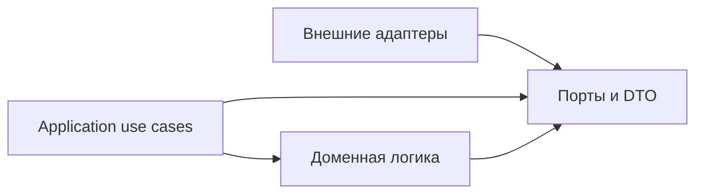

# Порты и события Telegram notification service

**Родитель:** [корневая архитектура](README.md).
**Статус:** normalized event validation, stable identity, snapshot diff and application ports implemented; source adapters do not yet produce observations.

## Назначение

Задать независимый от SDK контракт между источниками, приложением, доменом и каналами доставки. Это первое место расширения для новых event types и адаптеров.

## Направление зависимостей



Практическая организация кода может быть в одном пакете, но импорты должны соблюдать направление: домен и use cases не импортируют внешние SDK. Сериализуемые DTO — plain data; не передавать `DocumentSnapshot`, `Context` grammY, сетевые Response или `mesh-diary` model за adapter boundary.

## Контракт observation

`SourceObservation` сообщает подтверждённое представление одного источника и checkpoint:

```text
source, scopeKey, completeness, observedAt, sourceRevision?, cursor?, records[]
```

- `completeness` различает `complete`, `partial`, `unknown`; только `complete` может продвинуть snapshot baseline и порождать вывод об удалении.
- `scopeKey` изолирует `(familyId, childId, sourceAccountId)` либо явную глобальную область.
- `records[]` содержат стабильный `recordKey`, revision/updated time при наличии, и минимальные типизированные поля.
- `cursor` opaque и принадлежит адаптеру; ядро хранит/передаёт его, но не интерпретирует.
- Сетевой сбой не является observation и не очищает последний полный snapshot.

## Domain event contract

Корневая схема определяет общие поля. Здесь фиксируются семантика и правила идентичности:

| Поле | Правило |
|---|---|
| `eventId` | Детерминированный ID из `source + scopeKey + sourceEventKey + sourceRevision + eventType`; стабильная канонизация и хэширование задаются реализацией |
| `sourceEventKey` | ID записи источника, а для diff snapshot — устойчивый ID предметной записи, не индекс массива |
| `sourceRevision` | Ревизия источника; для snapshot-diff — hash перехода нормализованных значимых полей, включающий durable monotonic `observationSequence` |
| `eventType` | Версионируемый enum, например `grade.created`, `homework.changed`, `upload.confirmed`; свободные строки неизвестного типа не отправляются |
| `familyId`, `childId` | Разрешаются из проверенного owner map и сохраняются как идентичность адресации |
| `privacyClass` | Минимальная политика раскрытия: `family-summary`, `team-summary`, `restricted`; renderer проверяет её перед выводом |

Если значимое поле события меняется, появляется новая ревизия/событие. Дублирующийся сигнал той же ревизии возвращает существующий `eventId`. Неполные payload не становятся `deleted` или `cancelled`.

## Контракт портов

- `SourceObservationPort`: `start(emit)`, `stop()`, checkpoint lifecycle и управляемая ошибка источника.
- `IdentityRegistryPort`: читать активные связи account/family, выдавать/погашать одноразовый link token, отзывать одну связь, записывать историю переходов.
- `EventLedgerPort`: атомарно `recordIfAbsent(event)` и получить существующий receipt при повторе.
- `DeliveryOutboxPort`: добавить уникальные jobs, claim с lease, finish, reschedule и безопасно вернуть истёкшую lease в очередь.
- `RecipientResolverPort`: по событию вернуть получателей и разрешённые privacy views; принимать только сохранённую identity link, не произвольный Telegram ID из event payload.
- `MessageRendererPort`: `(event, recipientView, locale) → MessagePart[]`, без побочных эффектов и сети.
- `TelegramDeliveryPort`: `(chatId, MessagePart) → DeliveryReceipt`; ошибки нормализуются на retryable/permanent/rate-limited.
- `ClockPort` и `LoggerPort`: внедряются в use cases, чтобы тестировать окна группировки и таймеры без реального ожидания.

## Ошибки и обратная совместимость

Ошибки разделяются на invalid input, stale/duplicate, transient source/delivery, rate limit, permanent recipient/config и conflict. Адаптер не должен превращать permanent error в бесконечный retry. Новое поле DTO можно добавлять как optional; изменение смысла обязательного поля или event type требует новой schema version и периода совместимости читателей ledger/outbox.

## Проверочные сценарии контракта

1. Полный снимок без изменений даёт ноль событий.
2. Одинаковая ревизия повторно не создаёт новый event/job.
3. Неполный или некорректный снимок не создаёт события удаления и не продвигает baseline; каждый полный снимок обязан иметь durable monotonic `observationSequence` из checkpoint adapter, не `fetchedAt`.
4. Изменение значимого поля порождает event с новым ID и before/after минимумом.
5. Неизвестный event type не попадает в семейную доставку.
6. Изменение Telegram username не меняет идентичность account/link.
7. Закрытое поле не появляется в `family-summary` или `team-summary` без явного разрешения.

## Подмодули

При фактическом росте event catalog его следует выделить в `events/<source-or-domain>.md`; схемы сериализации и миграции — в `storage/schema-migrations.md`. Не заводить такие документы до появления конкретного контракта, требующего самостоятельного жизненного цикла.
