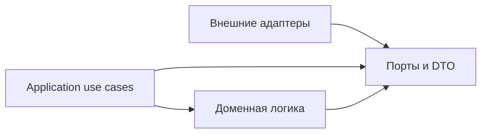

# Порты и события Telegram notification service

**Родитель:** [корневая архитектура](README.md).
**Статус:** normalized event validation, stable identity, snapshot diff and application ports implemented; source adapters and durable pipeline работают в постоянном Mac runtime; реальная доставка5upload событий подтверждена18.10 ([приёмка](../../decisions/upload-notification-lifecycle-2026-10-18.md)). Остальные незавершённые возможности перечислены в корневой спецификации.

## Назначение

Задать независимый от SDK контракт между источниками, приложением, доменом и каналами доставки. Это первое место расширения для новых event types и адаптеров.

## Направление зависимостей



Практическая организация кода может быть в одном пакете, но импорты должны соблюдать направление: домен и use cases не импортируют внешние SDK. Сериализуемые DTO — plain data; не передавать `DocumentSnapshot`, `Context` grammY, сетевые Response или `mesh-diary` model за adapter boundary.

## Контракт observation

Целевой DTO `SourceObservation` сообщает подтверждённое представление одного источника и checkpoint:

```text
source, scopeKey, completeness, observedAt, sourceRevision?, cursor?, records[]
```

- `completeness` различает `complete`, `partial`, `unknown`; только `complete` может продвинуть snapshot baseline и порождать вывод об удалении.
- `scopeKey` изолирует `(familyId, childId, sourceAccountId)` либо явную глобальную область.
- `records[]` содержат стабильный `recordKey`, revision/updated time при наличии, и минимальные типизированные поля.
- `cursor` opaque и принадлежит адаптеру; ядро хранит/передаёт его, но не интерпретирует.
- Сетевой сбой не является observation и не очищает последний полный snapshot.

Это целевая граница источника, а не текущая сигнатура snapshot-diff. Реализованный `diffCompleteSnapshots` в `packages/telegram-notifications/domain/diff.mjs` принимает `current.complete: boolean`, `current.observationSequence` и отдельный `detectedAt`; он также получает `source`, `scopeKey`, `familyId` и `childId` как отдельные аргументы. SourcePipeline преобразует DTO выше в этот вызов после проверки полноты и владения. При таком преобразовании `completeness === 'complete'` становится `complete: true`; `partial`/`unknown` должны отклоняться без продвижения baseline. Sequence берётся из durable checkpoint по scope, а не выводится из `observedAt`, `fetchedAt` или случайного значения. `detectedAt` — время обнаружения worker и не заменяет время observation/источника. Scope должен сохранять изоляцию семьи и ребёнка; идентичность `sourceAccountId` входит в `scopeKey` для источников с отдельными учётными записями.

**Исправление по fact-check 17 октября:** только `complete === true` у current и previous допускает продвижение baseline; строки, числа и объекты не считаются подтверждением полноты. Отрицательные тесты передают валидный `detectedAt`, чтобы достигать этой проверки. [Исходное воспроизведение](../../audits/telegram-self-review-2026-10-16.md#recheck-2026-10-17) сохраняется как история до ремонта.

Для upload baseline сохраняет `sourceProjectionVersion: 2`. Первый переход старой пустой bootstrap-проекции без этой версии выполняется тихо и сохраняет подтверждённую запись; новый live scope получает обычное событие. После фиксации версии2 переход от пустой baseline к подтверждённому файлу снова считается новым фактом даже для bootstrap scope. Это одноразовая защита от исторической рассылки при исправлении ошибочного фильтра, а не постоянное подавление загрузок. Для live scope отсутствие baseline означает восстановление пропущенного факта без ограничения по возрасту: простой процесса не должен терять события. Окно `upload-check --since` ограничивает только диагностический отчёт и не управляет доставкой.

Baseline сохраняет `observedAt` — время успешного полного чтения, подтверждённого pipeline. Lease renew/неполное наблюдение не меняют это поле; старый baseline без него имеет неизвестную свежесть до следующего полного чтения. Это служебная диагностика и не часть identity/semantic hash события.

## Domain event contract

Корневая схема определяет общие поля. Здесь фиксируются семантика и правила идентичности:

| Поле | Правило |
|---|---|
| `eventId` | Детерминированный ID из `source + scopeKey + sourceEventKey + sourceRevision + eventType`; стабильная канонизация и хэширование задаются реализацией |
| `sourceEventKey` | ID записи источника, а для diff snapshot — устойчивый ID предметной записи, не индекс массива |
| `sourceRevision` | Ревизия источника; для snapshot-diff — hash перехода нормализованных значимых полей, включающий durable monotonic `observationSequence` |
| `eventType` | Версионируемый enum, например `grade.created`, `homework.changed`, `upload.confirmed`; свободные строки неизвестного типа не отправляются |
| `familyId`, `childId` | Разрешаются из проверенного owner map и сохраняются как идентичность адресации |
| `privacyClass` | Минимальная политика раскрытия: `family-summary`, `team-summary`, `restricted`; renderer проверяет её перед выводом |

Для обновляемых предметных фактов изменение значимого поля создаёт новую ревизию/событие. Исключение `upload.confirmed`: уже известный recordKey означает тот же переданный файл; смена статуса проверки и обогащение контекста не создают новый факт загрузки. `title`, `subject`, `occurredLabel` разрешены для безопасного upload summary и проходят общий whitelist.

`review.changed` переносит подтверждённые subject/title/status/дату задания. Нельзя отправлять лишь имя ребёнка и статус. Точный task context берётся из источника; отсутствующий контекст не восстанавливается renderer-ом. Новая смена статуса или новый meaningful fingerprint при том же статусе создают результат; fingerprint включает статус, отсортированный набор хэшированных `uploadIds` и SHA-256 содержимого ученически доступных `summary`/`nextStep`. Он не переносит upload ID в event/checkpoint. Для информативной сводки разрешены только ограниченные санитизированные публичные summary/nextStep; приватный результат и ответы не копируются. `checkedAt` и обогащение прежнего контекста сами по себе тихие. `reviewProjectionVersion` отдельно мигрирует прежние status-only baselines: прежний статус и текущий отпечаток принимаются один раз без повторной отправки, но реальная смена статуса не подавляется. Событие при новом результате с прежним статусом получает только whitelist-маркер `fields.changeKind: "updated"`; digest сообщает «разбор обновлён · {статус}», не раскрывая summary.

Если значимое поле события меняется, появляется новая ревизия/событие только согласно политике его семейства. Дублирующийся сигнал той же ревизии возвращает существующий `eventId`. Неполные payload не становятся `deleted` или `cancelled`.

Нормализация идемпотентна для всего DTO, включая `contextRefs.id`: сырые ID хэшируются; при `identityEncoding: sha256-v1` уже нормализованный 64-символьный hex ID сохраняется. `NotificationService.accept` может безопасно повторно нормализовать event до записи. Отдельный navigationContext допускается только для подтверждённого Firestore day scope: kind=day, проверенный dayToken с доказанными metadata обеих ролей. Он не подменяет хэшированные contextRefs и не принимает произвольный URL. Renderer строит канонический маршрут Education; приложение отдельно проверяет семейный доступ. Смена только навигации не является новым учебным фактом.

## Контракт портов

Таблица различает реализованный минимум и целевой портовый контракт. Наличие общего интерфейса в документации не означает наличие adapter или его подключение к runtime.

| Порт / capability | Реализованный минимум | Planned / не подключено |
|---|---|---|
| `SourceObservationPort` | Targeted Firestore source reads by queue `sourceRef`; Mesh HTTP poller with durable source checkpoint and DTO normalization; bounded legacy reconciliation bridge | Producer/rules/index rollout and hosted readiness checks |
| `IdentityRegistryPort`, `FamilyLinkAuthorizationPort` | Регистрация, hashed private pairing challenge, доверенное локальное погашение, stop challenge и отзыв одной link | Web PETR UI issuer |
| `EventLedgerPort`, `DeliveryOutboxPort` | `recordIfAbsent`, job claim/finish/reschedule, lease, recovery и per-part receipts в Firestore adapter | Группировка реализована через persistent group/pointer и immutable digest; retention не утверждён |
| `RecipientResolverPort`, `MembershipAuthorizationPort` | Проверка активной семейной связи и membership родителя/ребёнка | Team resolver, team recipient configuration и раздельная route policy |
| `MessageRendererPort` | Детерминированная family summary whitelist и разделение длинного текста | Полные `recipientView`/locale templates; compact digest renderer и подтверждённые day links реализованы |
| `TelegramDeliveryPort` | grammY transport, классификация ошибок, ограниченный retry и явная доставка из существующего outbox | Hosted rollout; Mac runtime и реальные receipts подтверждены |
| `ChannelAvailabilityPort` | `getState` и version-fenced `markUnavailable`; private update ordering в registry; runtime всегда инжектирует Firestore adapter | Реальные Telegram/Firestore integration и полный channel audit/retention |
| `ClockPort`, `LoggerPort` | Внедряемые clock/logger в application services | Внешние alerts; durable окно30/60с реализовано |

Целевые сигнатуры остаются: `RecipientResolverPort` возвращает только проверенных получателей и privacy views; `MessageRendererPort` — `(event, recipientView, locale) → MessagePart[]`; `TelegramDeliveryPort` — `(chatId, MessagePart) → DeliveryReceipt`. Это описание будущих границ и не меняет фактический минимальный runtime composition.

В текущем `diffCompleteSnapshots` implicit mapping предусмотрен только для `grade`, `schedule` и `assignment` (`created`/`changed`). Для `upload`, `quiz` и `review` адаптер должен передать явный известный `eventType`; автоматическое выведение этих типов из `kind` отсутствует. Firestore source adapter передаёт эти явные типы после проверки lifecycle/status.

### Source observation и checkpoint

New Education actions enter through `educationEvents`; the worker maintains one pending-event subscription. Firestore source handlers validate and reread only the exact path in `sourceRef`. Mesh remains a separately polled full-snapshot source with durable checkpoint/sequence/pending replay. Temporary old-client reconciliation uses bounded cursor pages; it does not install Firestore listeners. Historical dynamic Firestore inventory/coordinator code may remain for diagnostics but is not part of production runtime.

`SourceCheckpointPort` предоставляет acquire, savePending, renew, advance, invalidateOwner и release. Scope lease получает fencing token/version/expiry до внешнего чтения. Все изменения проверяют актуальный token/version и срок. Sequence выделяется из persistent state, не из времени fetch. Pending batch и кандидат безопасной baseline записываются до приёма событий; повтор после сбоя использует те же event IDs. Продвижение baseline следует только за успешным идемпотентным приёмом. Старый worker не может продвинуть состояние или освободить lease нового.

Checkpoint хранит минимальные безопасные записи и hashed source references; raw day/quiz access tokens, ответы, файлы, credentials и закрытые разборы запрещены. Копирование whitelist полей не отменяет sanitization, проверку типов и предельного размера одной записи. Число маленьких checkpoint единиц не ограничивает число семей; технические batch/page limits должны проходить все данные, а не обрезать их.

Mesh shadow and notify states are isolated. Its first observation does not notify history; source owner changes invalidate prior baseline/pending data. Queue Firestore events instead use a durable event identity and lease fencing; a missing source document blocks that exact action rather than generating an inferred deletion.

`semanticHash` — необязательный SHA-256 meaningful projection записи: учитывает изменения, которые не помещаются в короткий display text, но не раскрывает исходный объект. В diff допускается только 64 hex; перестановка и транспортный шум не меняют hash. Hash не является отображаемым значением оценки или текстом сообщения.

Текущие checkpoint единицы ограничены безопасным размером документа: 2000 records и512000 serialized bytes для pending, общий store budget900000 bytes с baseline/envelope. Это защитные границы одной единицы, не фильтр семей: превышение не обрезает данные и не продвигает baseline, а выдаёт finite reasonCode/health для оператора. Firestore разделён по исходным документам, МЭШ — по датам и предметам/периодам; если одна такая область перерастёт budget, требуется дальнейшее sharding, а не молчаливое исключение семьи.

Lease heartbeat обновляет аренду примерно TTL/3, имеет один renew in-flight и останавливается/drain перед advance/release. Потеря lease не даёт начать новый accept; уже принятый event восстанавливается по durable pending без нового job. Heartbeat не заменяет deadline зависшего сетевого источника.

### Техническая проверка цепочки

`technical.probe` — отдельный тип с явным диагностическим текстом. Probe events use the normal queue consumer and notification outbox; the Mesh probe first reads a real confirmed scope. Проба не создаёт фиктивную оценку/ДЗ, не рассылается остальным родителям и не доказывает наблюдение естественного изменения. Доставка требует точного job claim и readback `sent` с message receipts; посторонняя очередь не дренируется.

Общие FamilyGraph, MeshSession, credential store, Firestore factory и TelemetryPort описаны в [серверном ядре](../../shared/server-runtime.md). Входы operator/Telegram подключают эти механизмы через внедряемые порты; педагогическая проверка не запускается ботом.

The shared event consumer uses bounded pages and per-event fenced claims. It drains all families without a family cap; Mesh source snapshot pagination remains independently bounded and resumable.

## Ошибки и обратная совместимость

Ошибки разделяются на invalid input, stale/duplicate, transient source/delivery, rate limit, permanent recipient/config и conflict. Адаптер не должен превращать permanent error в бесконечный retry. Новое поле DTO можно добавлять как optional; изменение смысла обязательного поля или event type требует новой schema version и периода совместимости читателей ledger/outbox.

## Проверочные сценарии контракта

1. Полный снимок без изменений даёт ноль событий.
2. Одинаковая ревизия повторно не создаёт новый event/job.
3. Неполный или некорректный снимок не создаёт события удаления и не продвигает baseline; каждый полный снимок обязан иметь durable monotonic `observationSequence` из checkpoint adapter, не `fetchedAt`.
4. Изменение значимого поля порождает event с новым ID и before/after минимумом.
5. Неизвестный event type не попадает в семейную доставку.
6. Изменение Telegram username не меняет идентичность account/link.
7. Закрытое поле не появляется в `family-summary` или `team-summary` без явного разрешения.

Связь частей с конкретными работами, подтверждённые переходы и атомарная история отправок описаны в [модуле истории работы](work-history.md).

## Подмодули

При фактическом росте event catalog его следует выделить в `events/<source-or-domain>.md`; схемы сериализации и миграции — в `storage/schema-migrations.md`. Не заводить такие документы до появления конкретного контракта, требующего самостоятельного жизненного цикла.
