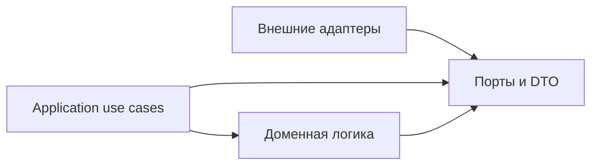

# Порты и события Telegram notification service

**Родитель:** [корневая архитектура](README.md).
**Статус:** normalized event validation, stable identity, snapshot diff and application ports implemented; source adapters and durable pipeline produce observations in explicit opt-in runtime; live rollout is unverified.

## Назначение

Задать независимый от SDK контракт между источниками, приложением, доменом и каналами доставки. Это первое место расширения для новых event types и адаптеров.

## Направление зависимостей



Практическая организация кода может быть в одном пакете, но импорты должны соблюдать направление: домен и use cases не импортируют внешние SDK. Сериализуемые DTO — plain data; не передавать `DocumentSnapshot`, `Context` grammY, сетевые Response или `mesh-diary` model за adapter boundary.

## Контракт observation

Целевой DTO `SourceObservation` сообщает подтверждённое представление одного источника и checkpoint:

```text
source, scopeKey, completeness, observedAt, sourceRevision?, cursor?, records[]
```

- `completeness` различает `complete`, `partial`, `unknown`; только `complete` может продвинуть snapshot baseline и порождать вывод об удалении.
- `scopeKey` изолирует `(familyId, childId, sourceAccountId)` либо явную глобальную область.
- `records[]` содержат стабильный `recordKey`, revision/updated time при наличии, и минимальные типизированные поля.
- `cursor` opaque и принадлежит адаптеру; ядро хранит/передаёт его, но не интерпретирует.
- Сетевой сбой не является observation и не очищает последний полный snapshot.

Это целевая граница источника, а не текущая сигнатура snapshot-diff. Реализованный `diffCompleteSnapshots` в `packages/telegram-notifications/domain/diff.mjs` принимает `current.complete: boolean`, `current.observationSequence` и отдельный `detectedAt`; он также получает `source`, `scopeKey`, `familyId` и `childId` как отдельные аргументы. SourcePipeline преобразует DTO выше в этот вызов после проверки полноты и владения. При таком преобразовании `completeness === 'complete'` становится `complete: true`; `partial`/`unknown` должны отклоняться без продвижения baseline. Sequence берётся из durable checkpoint по scope, а не выводится из `observedAt`, `fetchedAt` или случайного значения. `detectedAt` — время обнаружения worker и не заменяет время observation/источника. Scope должен сохранять изоляцию семьи и ребёнка; идентичность `sourceAccountId` входит в `scopeKey` для источников с отдельными учётными записями.

**Исправление по fact-check 17 октября:** только `complete === true` у current и previous допускает продвижение baseline; строки, числа и объекты не считаются подтверждением полноты. Отрицательные тесты передают валидный `detectedAt`, чтобы достигать этой проверки. [Исходное воспроизведение](../../audits/telegram-self-review-2026-10-16.md#recheck-2026-10-17) сохраняется как история до ремонта.

## Domain event contract

Корневая схема определяет общие поля. Здесь фиксируются семантика и правила идентичности:

| Поле | Правило |
|---|---|
| `eventId` | Детерминированный ID из `source + scopeKey + sourceEventKey + sourceRevision + eventType`; стабильная канонизация и хэширование задаются реализацией |
| `sourceEventKey` | ID записи источника, а для diff snapshot — устойчивый ID предметной записи, не индекс массива |
| `sourceRevision` | Ревизия источника; для snapshot-diff — hash перехода нормализованных значимых полей, включающий durable monotonic `observationSequence` |
| `eventType` | Версионируемый enum, например `grade.created`, `homework.changed`, `upload.confirmed`; свободные строки неизвестного типа не отправляются |
| `familyId`, `childId` | Разрешаются из проверенного owner map и сохраняются как идентичность адресации |
| `privacyClass` | Минимальная политика раскрытия: `family-summary`, `team-summary`, `restricted`; renderer проверяет её перед выводом |

Если значимое поле события меняется, появляется новая ревизия/событие. Дублирующийся сигнал той же ревизии возвращает существующий `eventId`. Неполные payload не становятся `deleted` или `cancelled`.

Нормализация идемпотентна для всего DTO, включая `contextRefs.id`: сырые ID хэшируются; при `identityEncoding: sha256-v1` уже нормализованный 64-символьный hex ID сохраняется. `NotificationService.accept` может безопасно повторно нормализовать event до записи. Это не означает наличия context links в renderer: их источник и разрешённый resolver пока planned.

## Контракт портов

Таблица различает реализованный минимум и целевой портовый контракт. Наличие общего интерфейса в документации не означает наличие adapter или его подключение к runtime.

| Порт / capability | Реализованный минимум | Planned / не подключено |
|---|---|---|
| `SourceObservationPort` | Firestore/МЭШ `observe/subscribe`, динамический coordinator, durable checkpoint/sequence/pending replay и DTO bridge; `diffCompleteSnapshots` и event normalization | Hosted readiness и эксплуатационные integration checks |
| `IdentityRegistryPort`, `FamilyLinkAuthorizationPort` | Регистрация, hashed private pairing challenge, доверенное локальное погашение, stop challenge и отзыв одной link | Web PETR UI issuer |
| `EventLedgerPort`, `DeliveryOutboxPort` | `recordIfAbsent`, job claim/finish/reschedule, lease, recovery и per-part receipts в Firestore adapter | Групповые записи/доставка дайджеста |
| `RecipientResolverPort`, `MembershipAuthorizationPort` | Проверка активной семейной связи и membership родителя/ребёнка | Team resolver, team recipient configuration и раздельная route policy |
| `MessageRendererPort` | Детерминированная family summary whitelist и разделение длинного текста | Полные `recipientView`/locale templates, approved context links и grouped digest renderer |
| `TelegramDeliveryPort` | grammY transport, классификация ошибок, ограниченный retry и явная доставка из существующего outbox | Реальная внешняя интеграция и production rollout |
| `ChannelAvailabilityPort` | `getState` и version-fenced `markUnavailable`; private update ordering в registry; runtime всегда инжектирует Firestore adapter | Реальные Telegram/Firestore integration и полный channel audit/retention |
| `ClockPort`, `LoggerPort` | Внедряемые clock/logger в application services | Политика окон группировки и внешние alerts |

Целевые сигнатуры остаются: `RecipientResolverPort` возвращает только проверенных получателей и privacy views; `MessageRendererPort` — `(event, recipientView, locale) → MessagePart[]`; `TelegramDeliveryPort` — `(chatId, MessagePart) → DeliveryReceipt`. Это описание будущих границ и не меняет фактический минимальный runtime composition.

В текущем `diffCompleteSnapshots` implicit mapping предусмотрен только для `grade`, `schedule` и `assignment` (`created`/`changed`). Для `upload`, `quiz` и `review` адаптер должен передать явный известный `eventType`; автоматическое выведение этих типов из `kind` отсутствует. Firestore source adapter передаёт эти явные типы после проверки lifecycle/status.

### Source observation и checkpoint

`SourceObservationPort` имеет `kind`, чистый `scopeKey(scope)`, `validateScope(scope)` и `observe(scope)`. Scope — внутренняя единица динамического inventory; пользователь не поддерживает список семей или детей. Полная observation обязана совпасть с арендованным scope по source/scopeKey/familyId/childId. Неполный или неверно адресованный снимок не продвигает baseline, в том числе первый.

`SourceCheckpointPort` предоставляет acquire, savePending, renew, advance, invalidateOwner и release. Scope lease получает fencing token/version/expiry до внешнего чтения. Все изменения проверяют актуальный token/version и срок. Sequence выделяется из persistent state, не из времени fetch. Pending batch и кандидат безопасной baseline записываются до приёма событий; повтор после сбоя использует те же event IDs. Продвижение baseline следует только за успешным идемпотентным приёмом. Старый worker не может продвинуть состояние или освободить lease нового.

Checkpoint хранит минимальные безопасные записи и hashed source references; raw day/quiz access tokens, ответы, файлы, credentials и закрытые разборы запрещены. Копирование whitelist полей не отменяет sanitization, проверку типов и предельного размера одной записи. Число маленьких checkpoint единиц не ограничивает число семей; технические batch/page limits должны проходить все данные, а не обрезать их.

Shadow и notify состояния изолированы. Первое наблюдение новой семьи не рассылает историю. Новая entity у уже наблюдаемого родителя отличается от bootstrap через persistent discovery state, включая перезапуск. Отсутствие документа не становится удалением. Изменение owner binding сбрасывает прошлую baseline/pending и не переносит её новому владельцу.

`semanticHash` — необязательный SHA-256 meaningful projection записи: учитывает изменения, которые не помещаются в короткий display text, но не раскрывает исходный объект. В diff допускается только 64 hex; перестановка и транспортный шум не меняют hash. Hash не является отображаемым значением оценки или текстом сообщения.

Текущие checkpoint единицы ограничены безопасным размером документа: 2000 records и512000 serialized bytes для pending, общий store budget900000 bytes с baseline/envelope. Это защитные границы одной единицы, не фильтр семей: превышение не обрезает данные и не продвигает baseline, а выдаёт finite reasonCode/health для оператора. Firestore разделён по исходным документам, МЭШ — по датам и предметам/периодам; если одна такая область перерастёт budget, требуется дальнейшее sharding, а не молчаливое исключение семьи.

Lease heartbeat обновляет аренду примерно TTL/3, имеет один renew in-flight и останавливается/drain перед advance/release. Потеря lease не даёт начать новый accept; уже принятый event восстанавливается по durable pending без нового job. Heartbeat не заменяет deadline зависшего сетевого источника.

### Техническая проверка цепочки

`technical.probe` — отдельный тип с явным диагностическим текстом. Firestore probe слушает отдельный служебный документ; МЭШ probe сначала читает реальную подтверждённую область. Оба проходят SourcePipeline, ledger, outbox и доставку ровно одному проверенному адресату. Проба не создаёт фиктивную оценку/ДЗ, не рассылается остальным родителям и не доказывает наблюдение естественного изменения. Доставка требует точного job claim и readback `sent` с message receipts; посторонняя очередь не дренируется.

Общие FamilyGraph, MeshSession, credential store, Firestore factory и TelemetryPort описаны в [серверном ядре](../../shared/server-runtime.md). Входы operator/Telegram подключают эти механизмы через внедряемые порты; педагогическая проверка не запускается ботом.

## Ошибки и обратная совместимость

Ошибки разделяются на invalid input, stale/duplicate, transient source/delivery, rate limit, permanent recipient/config и conflict. Адаптер не должен превращать permanent error в бесконечный retry. Новое поле DTO можно добавлять как optional; изменение смысла обязательного поля или event type требует новой schema version и периода совместимости читателей ledger/outbox.

## Проверочные сценарии контракта

1. Полный снимок без изменений даёт ноль событий.
2. Одинаковая ревизия повторно не создаёт новый event/job.
3. Неполный или некорректный снимок не создаёт события удаления и не продвигает baseline; каждый полный снимок обязан иметь durable monotonic `observationSequence` из checkpoint adapter, не `fetchedAt`.
4. Изменение значимого поля порождает event с новым ID и before/after минимумом.
5. Неизвестный event type не попадает в семейную доставку.
6. Изменение Telegram username не меняет идентичность account/link.
7. Закрытое поле не появляется в `family-summary` или `team-summary` без явного разрешения.

## Подмодули

При фактическом росте event catalog его следует выделить в `events/<source-or-domain>.md`; схемы сериализации и миграции — в `storage/schema-migrations.md`. Не заводить такие документы до появления конкретного контракта, требующего самостоятельного жизненного цикла.
