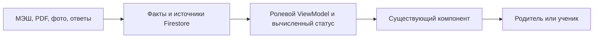

# Система компонентов Education

Этот контракт отвечает на вопрос, **почему** существующие компоненты разделены именно так и где повторное использование обязательно. Он дополняет [модель Firestore](../data/firestore.md#entities), [ViewModel карточки](../../modules/reviews/subject-card-viewmodel.md#projections) и [дизайн-систему](README.md#tokens). [Карта файлов](../../file-map.md) указывает ближайший контракт каждого исходника; таблица ниже определяет границы ответственности и запрещает параллельные реализации одного смысла.

## Один путь от факта к экрану {#data-flow}

Firestore хранит исходный факт, его владельца, ревизию и связи. `day/card-policy.mjs` и `day/homework-kind.mjs` выбирают смысл карточки по ожидаемому результату, `src/lib/homeworkStatus.ts`, `reviewPresentation.ts` и `quizCardViewModel.ts` вычисляют видимые статусы. React не решает, что учитель «должен был задать», не ищет ответы и не создаёт скрытые обязательные пункты. Он отображает уже сверенный ролевой срез и разрешённые действия. Именно поэтому дата, класс, предмет или новая семья меняют данные и конфигурацию, а не копию JSX.

## Реестр действующих продуктовых компонентов {#registry}

| Смысл | Каноническая реализация | Потребители и граница |
|---|---|---|
| Оболочка, навигация, обновления | `App/Shell`, `NotificationBell`, `PwaControls`, `DataCompatibilityNotice` | Одна шапка и колокольчик на маршрутах; на телефоне он последний справа, панель остаётся в пределах экрана. Кеш inbox отображается до восстановления сессии, подписка включается после неё. `PwaControls` сообщает о новой сборке, `DataCompatibilityNotice` блокирует лишь несовместимую схему документа; это разные причины обновления. Ошибка фоновой подписки не становится глобальной всплывашкой. |
| Личный вход и семейный доступ | `PersonalEntry`, `ConnectionInvite`, `FamilyAccessCards` | Личный доступ, принятие приглашения и управление членством имеют разные права записи. Их нельзя слить в карточку ДЗ или переключатель роли. |
| Главная взрослого и календарь | `ParentHome`, `FamilyLibrary`, `DayDashboard`, `DayPage`, `WeekendMathSlot` | Это контейнеры маршрутов и подписок, а не новые виды заданий. `ParentHome` показывает сводку ДЗ на вычисленный день, но его ссылка открывает календарь на сегодня; `DayDashboard` показывает расписание выбранного дня и ДЗ следующего учебного дня. Операторская очередь синхронизации не становится отдельной карточкой семьи или дня. Сворачивание завершённых уроков и [отсчёт до ближайшего/текущего](../../modules/school-diary/dashboard.md#lesson-countdowns) — локальные состояния существующего `DayDashboard`, новый компонент и поле Firestore не нужны. `DayPage` показывает детали; выходной лист использует те же `ProblemGroup` и `ProblemTaskCard`. [Модель дат](../data/firestore.md#dashboard-date-projection). |
| Точная запись учителя | `AssignmentBrief` | Один публичный текст МЭШ для обеих ролей. Страницы учебника поддерживают запись, но не расширяют её. |
| Устная самопроверка и контрольный тест | `QuizCard` и вложенный `QuizProgress` | Одно представление текущей попытки, баллов и истории в ДЗ и личном списке. Предмет влияет на вопросы и источник, не на компонент прогресса. `SubjectTheme`, `ReadingCard` и `CodeBlock` оформляют **прохождение** теста, а не вторую карточку результата. |
| Нумерованный лист | `ProblemGroup` → `ProblemTaskCard` → `ProblemCard` + `ProblemStatement` | `ProblemGroup` агрегирует номера, `ProblemCard` даёт сворачиваемую оболочку одного номера, `ProblemStatement` показывает оригинал и условия, `ProblemTaskCard` соединяет их с проверкой и загрузкой. Связанный тест остаётся отдельным `QuizCard`; [интеграционная матрица](../../modules/reviews/card-flow-certification.md#регрессии-и-пределы) проверяет их совместное присутствие и обратимый выбор варианта. Обычная письменная задача может использовать `AssignmentBrief` и `WorkReview` без фиктивной нумерации. |
| Закрытый разбор и адресная помощь | `ParentTaskGuide`, `TaskGuidance`, `WorkReview`, `useTaskGuidance` | Родительский полный маршрут, один выбранный ребёнку фрагмент и проверка фактической работы хранятся раздельно. Объединение их в один документ или компонент рискует раскрыть ответ ребёнку. Вид предмета задаёт данные этапов, не новую карточку. |
| Оригиналы и фотографии | `EducationImage`, `MaterialReader`, `SourceFragment`, `ArtifactAvatar` + `WorkArtifactImage` | `EducationImage` единолично ведёт загрузку, ошибку и retry. `MaterialReader` листает страницу или книгу; `SourceFragment` показывает точный кроп учительского листа; `ArtifactAvatar` отделяет техническое состояние фото от качества решения. `WorkArtifactImage` выбирает один и тот же источник снимка для дня и выходного листа. |
| Ссылка на решение в другом вложении | `LinkedWorkPhotos`, `taskUploadPresentation` | Отделяет владение галереей от педагогического покрытия. В других номерах — текстовая ссылка и просмотр исходника по запросу; без миниатюр, загрузки, удаления и повторной передачи файла. [Контракт](../../modules/materials/storage-privacy.md#multi-task-photo). |
| Будущая композиция экрана | `EducationScreen` | Типизированный рендерер манифеста существует, но действующие `DayPage` и `DayDashboard` ещё не подключены. Наличие компонента не означает готовую миграцию на v2. |
| Базовые примитивы | `src/components/ui/{badge,button,card,checkbox,input,progress,radio-group,textarea}` | Формы и семантика управления. Продуктовая карточка не заменяется общей `Card`, если у неё есть отдельный учебный контракт; цвета и размеры берутся из дизайн-системы. |

### Фотографии работы

`WorkArtifactImage` выбирает сохранённый в документе снимок, публичную ссылку или локальный файл из очереди и всегда передаёт его в `EducationImage`. `ArtifactAvatar` добавляет только состояние передачи и разбора. Эти два слоя нельзя сводить с `WorkReview`: зелёная галочка на фото означает, что **снимок обработан**, а не что ответ верен. Для родителя и ученика это предотвращает ложное «задание выполнено» до содержательной проверки.

Метка времени для миниатюры и связанной ссылки берётся только из `upload.createdAt`, выводится в `Europe/Moscow` с явным «МСК», присутствует в hover/focus title и доступном имени. Для touch она повторяется в раскрытом просмотре через `<time datetime>`. Legacy-запись без даты остаётся неизвестной; локальная очередь не получает искусственное время рендера. Подробности происхождения и исключения архива — в [контракте времени фото](../../modules/school-diary/day-page.md#photo-timestamp).

## Где совпадение, а где лишь сходный вид {#overlap-decisions}

| Пара | Решение | Причина |
|---|---|---|
| Миниатюра и полноразмерное изображение | Один `EducationImage` с параметрами `compact`, `size`, `fit`, `crop`; лишний адаптер миниатюр удалён. | Загрузка, таймаут и повтор должны работать одинаково для листа, учебника и фото. |
| Фото в дне и выходном листе | Один `WorkPhotoGallery`, использующий `ArtifactAvatar` и `WorkArtifactImage`; у выходного листа `compact`. | Открыть, переключить и закрыть своё фото можно в обоих маршрутах, включая локальное превью и проверенную работу. Compact сохраняет прежнюю полосу без дополнительной шапки, быстрый крестик удаления и ролевые ограничения; он не отключает действия просмотра. |
| Тест в карточке ДЗ и личном списке | Один `QuizCard`; оба маршрута передают ему данные и свои внешние действия. | Процент, текущая попытка и история должны совпадать по смыслу. |
| `ParentTaskGuide` и `TaskGuidance` | Сохранять разные контейнеры и источники доступа; общий чистый `GuidanceStageContent` рендерит только одобренную проекцию выбранного этапа. | Родитель читает закрытый полный путь, ученик — только свои `dayGuidance` события. Hint содержит выбранную прозу; reveal содержит прозу и поля выбранного этапа без внутренних ref/excerpt и соседних данных. Общая отрисовка не означает совместный доступ к коллекциям. |
| `MaterialReader` и `SourceFragment` | Общий `EducationImage`, но разные контейнеры. | Страницы учебника листают; фрагмент листа учителя сохраняет координаты точного условия и возможность открыть целый оригинал. |
| `ParentHome` и `DayDashboard` | Общие `lessonWorkItems` и типы статусов; разные контейнеры. | Взрослый сравнивает детей и следующий учебный день, календарь раскрывает один день. Преждевременный общий контейнер скрыл бы одно из этих действий. |

## Контракт изменений и проверки {#change-gates}

1. Сначала определить факт и владельца в [модели Firestore](../data/firestore.md#ownership), затем ролевую проекцию в [ViewModel](../../modules/reviews/subject-card-viewmodel.md#projections), затем выбрать строку реестра выше. Новый компонент нужен только при **новой интеракции или семантике**, которой существующий компонент не умеет выразить параметрами. Новый предмет, дата, класс, семья, вопрос или результат сами по себе не основание для нового компонента.
2. Для нового поля указать источник, обязательность, версию, область доступа и существующие обратные ссылки. `day/data-contract.mjs` проверяет форму, `day/placement-integrity.mjs` — связи назначения, `day/material-access.mjs` — семейное право на страницу. Публикация перечитывает результат; `day audit` проверяет исторические дни. Валидаторы не заменяют сверку смысла задания с МЭШ и оригиналом.
3. Для нового варианта карточки обновить конечный граф `day/card-policy.mjs`, закрытый родительский разбор и тест ролевой проекции. Ответ и ключ не попадают в ученическую страницу. `QuizCard`, `WorkReview`, `EducationImage` и `ArtifactAvatar` не дублируются ради нового предмета.
4. `npm run check:spec` проверяет строку каждого файла в карте, ссылку на существующую спецификацию, `@see` у продуктовых React/CSS и отсутствие прямого `` вне `EducationImage`. Проверки кода (`npm run check`) дополняют это типами, линтером, регрессиями и сборкой. Ручная сверка нужна для прав доступа, точности OCR, смыслового объёма ДЗ и отображения на реальном телефоне.
   Дополнительно [барьер изменений продукта](../../product/ui-change-control.md#mechanical-gate) сверяет отпечатки действующих клиентских и серверных модулей: перенос элемента, изменение оформления, вычисляемого статуса или публикации требует адресной записи «было → стало», ссылки на решение, спецификацию и тест. Отпечаток не подтверждает согласие пользователя и не заменяет визуальную проверку.
5. Если требуется менять общий вид, сначала обновить [дизайн-систему](README.md#workflow) и один существующий компонент. Для изменения JSX/CSS нужен выпуск приложения; новые учебные данные публикуются через Firestore и подписки без него. Старые ID, фото, попытки и семейные связи сохраняются.

## Граница текущей реализации {#implementation}

Общий каталог компонентов действует на уровне карточек и материала. Полная композиция страницы по `EducationScreen` ещё не включена; генерация нового учебника после неопознанной загрузки и автоматическая педагогическая сверка источников остаются операторскими этапами. `WorkPhotoGallery` теперь обслуживает день, выходной слот и UI Kit; отдельных статичных копий галереи в маршрутах нет. Повторяющиеся подписки `useParentChildOverview` и `useDashboardDayWork` уже используют общий классификатор `lessonWorkItems`, но не один механизм получения всех документов; при переносе на семейные документы v2 их следует свести на один источник снимка, сохранив разные ViewModel. Эти ограничения нельзя скрывать формулировкой «всё строится из Firebase».

## Первый набор UI Kit

Канонические индикаторы результата — `components/ui/result.tsx/css`, смысл состояния — `lib/resultPresentation.ts`. Их используют `QuizCard`, `QuizResultCard`, `ResultView` и отдельная страница `UiKit`. `QuizAttemptReview` выбирает уже загруженные ошибочные результаты и вызывает тот же `QuizResultCard`, сохраняя ограничения показа ключа. Общие данные, часы и раскрытия не создают новых Firestore-подписок. [Правила](../../modules/assessments/result-presentation-proposal.md), [расширение каталога](ui-kit.md).
